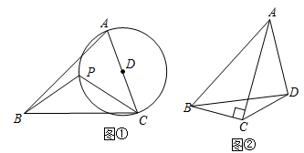

# Mathematics - 题目 2881

**ID**: 12069d379e44471396935ba1dd491b6e
**年级**: Grade 9
**难度**: Medium-Hard
**题型**: Calculation

## 题目
【问题提出】小慧同学遇到这样一道问题，如图①，在 $\vartriangle ABC$ 中，点D为边 $AC$ 的中点．以点D为圆心， $AC$ 为直径作圆， $∠ACB$ 的平分线交此圆于点P，点P在 $\vartriangle ABC$ 的内部，连结 $BP$ ．求证： $\mathrm{△}BPC$ 的面积等于 $\vartriangle ABC$ 面积的一半．【问题解决】小慧的做法是连结 $AP$ 并延长，交CB于点Q，利用 $\vartriangle ACQ$ 形状的特殊性解决问题，请你利用小慧的做法完成【问题提出】中的证明．【问题拓展】如图②，在四边形 $ABCD$ 中， $AC$ 平分 $∠BAD$ ． $AC⊥BC$ ，若 $BD=8$ ． $AB-AD=3$ ，则 $\mathrm{△}BCD$ 面积的最大值为．​​​​​​​‌

## 解答

1. 解：问题解决：如图，连结 $AP$ 并延长，交边 $BC$ 于点Q．
2. 
3. ∵ $AC$ 为⊙O的直径，
4. ∴ $\angle APC=90{}^\circ $ ．
5. ∴ $\angle APC=\angle QPC=90{}^\circ $ ．
6. ∵ $CP$ 平分 $∠ACB$ ，
7. ∴ $\angle ACP=\angle QCP,$
8. ∵ $CP=CP$ ，
9. ∴ $\vartriangle ACP≌\vartriangle QCP$ ．
10. ∴ $AC=QC$ ．
11. ∵ $\angle APC=90{}^\circ $ ．
12. ∴点P为 $AQ$ 的中点．
13. ∴ $S{{}_{\mathrm{△}CPQ}}=\frac {1}{2}S{{}_{\mathrm{△}AQC}}$ ， $S{{}_{\mathrm{△}BPQ}}=\frac {1}{2}S{{}_{\mathrm{△}AQB}}$
14. ∴ $S{{}_{\mathrm{△}BPC}}=S{{}_{\mathrm{△}CPQ}}+S{{}_{\mathrm{△}BPQ}}=\frac {1}{2}S{{}_{\mathrm{△}AQC}}+\frac {1}{2}S{{}_{\mathrm{△}AQB}}=\frac {1}{2}S{{}_{\mathrm{△}ABC}}$ ．
15. ∴ $\mathrm{△}BPC$ 的面积等于 $\vartriangle ABC$ 面积的一半．
16. 问题拓展：最大面积为6．理由如下：
17. 如图，以 $AB$ 为直径作 $\odot O$ ，由 $AC⊥BC$ ，则 $C$ 在 $\odot O$ 上，延长 $BC$ 交 $AD$ 的延长线于 $E,$
18. 由（1）同理可得： $\vartriangle ACB≌\vartriangle ACE,$
19. $\therefore AB=AE,BC=CE,$
20. $\therefore AB-AD=AE-AD=DE=3,$   $S{{}_{\vartriangle BCD}}=\frac {1}{2}S{{}_{\vartriangle BDE}},$
21. 
22. 当 $AD⊥BD$ 时， $S{{}_{\mathrm{△}BDE}}$ 最大，则 $S{{}_{△BCD}}$ 最大，
23. $\therefore S{{}_{\vartriangle BDE}}=\frac {1}{2}BD\centerdot DE=\frac {1}{2}\times 8\times 3=12,$
24. $\therefore S{{}_{\vartriangle BCD}}=\frac {1}{2}\times 12=6.$
25. 即 $\mathrm{△}BCD$ 的面积的最大值为： $6.$

## 知识点

**中文**:
  - 三角形的中线
  - 圆周角定理及推论
  - 全等三角形的判定与性质

**English**:
  - Medians
  - Inscribed Angle Theorem
  - Determination and Properties

---
