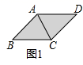
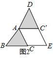
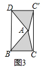

# Mathematics - 题目 1594

**ID**: 132ed1b7dd9d4dcca56d894196a69734
**年级**: Grade 9
**难度**: Medium-Hard
**题型**: Calculation

## 题目
（问题情境）在综合与实践课上，老师让同学们以“菱形纸片的剪拼”为主题开展数学活动，如图1，将一张菱形纸片 $ABCD$ （ $\angle BAD>90{}^\circ $ ）沿对角线 $AC$ 剪开，得到两个全等的 $\vartriangle ABC$ 和 $△ACD$ ．（操作发现）（1）将图1中的 $△ACD$ 以 $A$ 为旋转中心，按逆时针方向旋转角 $α$ ，使 $α=\angle BAC$ ，得到图2所示的 $△ACD$ ，分别延长 $BC$ 和 $DC$ 交于点 $E$ ，求证：四边形 $ACEC\prime $ 是菱形．（2）创新小组将图1中的 $△ACD$ 以 $A$ 为旋转中心，按逆时针方向旋转角 $α$ ，当 $α$ 与 $\angle BAC$ ，满足什么数量关系时，得到如图3所示的四边形 $BCC\prime D$ 是矩形，请说明理由．（实践探究）（3）缜密小组在创新小组发现结论的基础上，量得图3中 $BC=13$ cm， $AC=10$ cm，求 $BD$ 长．​​​​​​​‌

## 解答

1. （1）证明：∵AB=BC，
2. ∴∠BAC=∠BCA=∠CAC´=∠AC´D，
3. ∴AC´//EC，
4. ∴四边形ACEC´是平行四边形，
5. ∵AC=AC´，
6. ∴四边形 $ACEC\prime $ 是菱形．
7. （2）解：当 $α=2\angle BAC$ 时，四边形 $BCCD$ 是矩形，理由如下：
8. 如图，过点A作AE⊥C´C于点E，
9. 
10. 由旋转得， $AC\prime =AC$
11. ∴ $\angle CAE=\angle C\prime AE=\frac {1}{2}α=\angle BAC$ ，∠AEC=90°，
12. ∵ $BA=BC$ ，
13. ∴ $\angle BCA=\angle BAC$
14. ∴ $\angle CAE=\angle BCA$ ，
15. ∴ $AE//BC$
16. 同理， $AE//DC^{′}$ ，
17. ∴ $BC//DC^{′}$
18. ∵ $BC=DC\prime $
19. ∴四边形 $BCC\prime D$ 是平行四边形，
20. ∵AE//BC，∠AEC=90°，
21. ∴∠BCC´=180°-90°=90°，
22. ∴四边形 $BCC\prime D$ 是矩形．
23. （3）解：过点A作AE⊥CC´于点E，过点B作BF⊥AC于点F，
24. 
25. ∵ $BA=BC$ ，
26. ∴ $CF=AF=\frac {1}{2}AC=\frac {1}{2}\times 10=5$ ．
27. 在 $Rt\vartriangle BCF$ 中， $BF=\sqrt {BC{^{2}}-CF{^{2}}}=\sqrt {13{^{2}}-5{^{2}}}=12$ ，
28. 在 $\vartriangle ACE$ 和 $\vartriangle CBF$ 中，
29. ∵ $\angle CAE=\angle BCF$ ， $\angle CEA=\angle BFC=90{}^\circ $ ．
30. ∴ $\vartriangle ACE∽\vartriangle CBF$ ，
31. ∴ $\frac {CE}{BF}=\frac {AC}{BC}$ ，
32. 即 $\frac {CE}{12}=\frac {10}{13}$ ，
33. 解得 $CE=\frac {120}{13}$ ，
34. ∵ $AC=AC\prime $ ， $AE\bot CC\prime $
35. ∴ $CC\prime =2CE=2\times \frac {120}{13}=\frac {240}{13}$ ．

## 知识点

**中文**:
  - 几何变换——旋转综合题
  - 平行四边形的判定与性质
  - 菱形的判定
  - 旋转的性质
  - 相似三角形的判定与性质综合

**English**:
  - Rotation Comprehensive Problems
  - Determination and Properties
  - Determination of Rhombuses
  - Properties of Rotation
  - Determination and Properties

---
