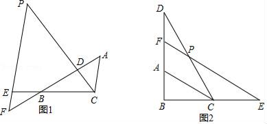

# Mathematics - 题目 2361

**ID**: 134dee24bd90464e9a7503251e395ebd
**年级**: Grade 9
**难度**: Medium-Hard
**题型**: Calculation

## 题目
如图1，△ABC中，点D在线段AB上，点E在线段CB延长线上，且BE＝CD，EP∥AC交直线CD于点P，交直线AB于点F，∠ADP＝∠ACB．（1）图1中是否存在与AC相等的线段？若存在，请找出，并加以证明，若不存在，说明理由；​​​​​​​‌（2）若将“点D在线段AB上，点E在线段CB延长线上”改为“点D在线段BA延长线上，点E在线段BC延长线上”，其他条件不变（如图2）．当∠ABC＝90°，∠BAC＝60°，AB＝2时，求线段PE的长．

## 解答

1. （1）先证△CBD∽△ABC，再转化比例线段即可得出答案；
2. （2）利用平行线的性质、30度角所对的直角边等于斜边的一半、三角形中位线定理即可得出答案.
3. 解：（1）AC=BF．证明如下：
4. 如图1，∵∠ADP=∠ACD+∠A，∠ACB=∠ACD+∠BCD，∠ADP=∠ACB，
5. ∴∠BCD=∠A，
6. 又∵∠CBD=∠ABC，
7. ∴△CBD∽△ABC，
8. ∴ $\frac {CD}{AC}=\frac {BC}{BA}$ ，①
9. ∵FE∥AC，
10. ∴ $\frac {BC}{BA}=\frac {BE}{BF}$ ，②
11. 由①②可得， $\frac {CD}{AC}=\frac {BE}{BF}$ ，
12. ∵BE=CD，
13. ∴BF=AC；
14. （2）如图2，∵∠ABC=90°，∠BAC=60°，
15. ∴∠ACB=30°=∠ADP，
16. ∴∠BCD=60°，∠ACD=60°﹣30°=30°，
17. ∵PE∥AC，
18. ∴∠E=∠ACB=30°，∠CPE=∠ACD=30°，
19. ∴CP=CE，
20. ∵BE=CD，
21. ∴BC=DP，
22. ∵∠ABC=90°，∠D=30°，
23. ∴BC= $\frac {1}{2}$CD，
24. ∴DP= $\frac {1}{2}$CD，即P为CD的中点，
25. 又∵PF∥AC，
26. ∴F是AD的中点，
27. ∴FP是△ADC的中位线，
28. ∴FP= $\frac {1}{2}$AC，
29. ∵∠ABC=90°，∠ACB=30°，
30. ∴AB= $\frac {1}{2}$AC，
31. ∴FP=AB=2，
32. ∵DP=CP=BC，CP=CE，
33. ∴BC=CE，即C为BE的中点，
34. 又∵EF∥AC，
35. ∴A为FB的中点，
36. ∴AC是△BEF的中位线，
37. ∴EF=2AC=4AB=8，
38. ∴PE=EF﹣FP=8﹣2=6．
39. 点睛：本题考查了相似及三角形中位线等知识.综合利用所学知识并进行推理判断是解题的关键.

## 知识点

**中文**:
  - 相似三角形的综合问题

**English**:
  - Comprehensive Similar Triangle Problems

---
