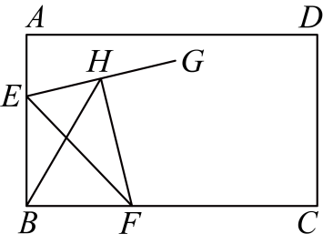

# Mathematics - 题目 2875

**ID**: 141915cc4c7d4780b09118256df42bbf
**年级**: Grade 9
**难度**: Medium-Hard
**题型**: Calculation

## 题目
如图，矩形 $ABCD$ 中， $AB=6$ ， $BC=6\sqrt {3}$ ，点E在边 $AB$ 上运动，点F在 $BC$ 上，且 $BF=\sqrt {3}AE$ ，连接 $EF$ ，将线段 $EF$ 绕点E逆时针旋转 $60{}\degree $ ，得到线段 $EG$ ，点H是 $EG$ 的中点，连接 $BH,HF$ ．（1）若E为 $AB$ 的中点，判断 $\mathrm{△}BFH$ 的形状，并说明理由；​​​​​​​‌（2）试探究，随着E的运动，点H的位置的变化规律，并说明理由．

## 解答

1. （1）解： $\vartriangle BFH$ 为等边三角形，理由如下：
2. ∵四边形 $ABCD$ 是矩形，
3. $\therefore \angle ABC=90{}\degree $ ．
4. 连接 $FG$ ，
5. ∵线段 $EF$ 绕点E逆时针旋转 $60{}\degree $
6. 
7. $\therefore \angle GEF=60{}\degree ,EF=EG$ ，
8. $\therefore △EFG$ 为等边三角形，
9. $\therefore EF=FG$ ， $\angle GFE=60{}\degree $ ，
10. ∵H是 $EG$ 的中点，
11. $\therefore FH\bot EG$ ， $\angle HFE=\frac {1}{2}\angle GFE=30{}\degree $ ，
12. ∴在 ${\rm{R}}{\rm{t}}△EFH$ 中， $FH=EF\cdot {\rm{c}}{\rm{o}}{\rm{s}}\angle HFE=\frac {\sqrt {3}}{2}EF$ ，
13. ∵E为 $AB$ 的中点，
14. $\therefore AE=BE$ ，
15. $\because BF=\sqrt {3}AE$ ，
16. ∴在 ${\rm{R}}{\rm{t}}△BEF$ 中， ${\rm{t}}{\rm{a}}{\rm{n}}\angle BFE=\frac {BE}{BF}=\frac {AE}{\sqrt {3}AE}=\frac {\sqrt {3}}{3}$ ，
17. $\therefore \angle BFE=30{}\degree $ ，
18. $\therefore \angle BFH=60{}\degree $ ，
19. 在 ${\rm{R}}{\rm{t}}△BEF$ 中， $BF=EF\cdot {\rm{c}}{\rm{o}}{\rm{s}}\angle BFE=\frac {\sqrt {3}}{2}EF=FH$ ，
20. $\therefore \vartriangle BFH$ 为等边三角形；
21. （2）H的位置不变；
22. $\because \angle ABC=90{}\degree $ ， $\angle EHF=90{}\degree $
23. 取 $EF$ 中点O，则 $OH=OE=OF=OB$ ，连 $AH$ ，
24. 
25. ∴E、H、F、B四点共圆，
26. $\therefore \angle BEH+\angle BFH=180{}\degree $ ，
27. $\because \angle BEH+\angle AEH=180{}\degree $ ，
28. $\therefore \angle AEH=\angle BFH$ ，
29. $\because BF=\sqrt {3}AE$ ， $HF=\sqrt {3}EH$ ，
30. $\therefore \frac {AE}{BF}=\frac {EH}{HF}$ ，
31. $\therefore △AEH∽△BFH$ ，
32. $\therefore \angle HBF=\angle HAE$ ，
33. $\because \overset{\frown}{{FH}}=\overset{\frown}{{FH}}$ ，
34. $\therefore \angle HBF=\angle GEF=60{}\degree $
35. $\therefore \angle ABH=\angle ABC-\angle HBF=30{}\degree ,\angle ABH=\angle ABF=30{}\degree {\rm \mathit{，}}$
36. $\therefore \angle AHB=90{}\degree {\rm \mathit{，}}$
37. ∴在 ${\rm{R}}{\rm{t}}\mathrm{△}ABH$ 中， $AH=\frac {1}{2}AB=3$ ，
38. 在 ${\rm{R}}{\rm{t}}\mathrm{△}ABC$ 中， ${\rm{t}}{\rm{a}}{\rm{n}}\angle BAC=\frac {BC}{AB}=\sqrt {3}$ ，
39. $\therefore \angle BAC=60{}\degree $ ，
40. ∵ $AH$ 和 $AC$ 都在 $AB$ 的同侧，
41. ∴A，H，C三点共线，
42. ∴H的位置不变．

## 知识点

**中文**:
  - 圆内接四边形
  - 相似三角形的判定与性质综合
  - 解直角三角形

**English**:
  - Cyclic Quadrilaterals
  - Determination and Properties
  - Solving Right Triangles

---
