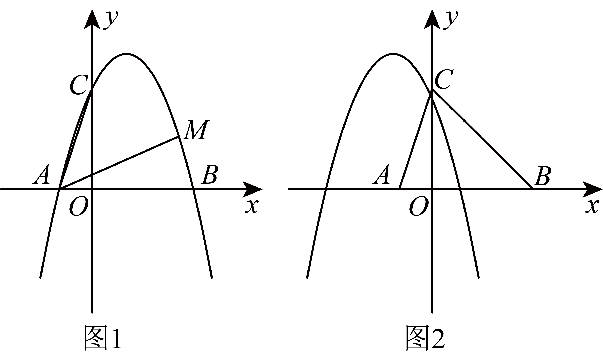

# Mathematics - 题目 3372

**ID**: 142bcb27750c442fbf0eb7e637b8ebe3
**年级**: Grade 9
**难度**: Medium-Hard
**题型**: Calculation

## 题目
如图1，二次函数 $y=-x{^{2}}+bx+3$ 交 $x$ 轴于 $A\left ({-1,0}\right )$ 和 $B$ ，交 $y$ 轴于 $C$ ．(1)求 $b$ 的值．(2) $M$ 为函数图象上一点，满足 $\angle MAB=\angle ACO$ ，求 $M$ 点的横坐标．(3)如图2，将二次函数沿水平方向平移，新的图象记为 $L,L$ 与 $y$ 轴交于点 $D$ ，记 $DC=d$ ，记 $L$ 顶点横坐标为 $n$ ．①求 $d$ 与 $n$ 的函数解析式．②记 $L$ 与 $x$ 轴围成的图象为 $U,U$ 与 $\vartriangle ABC$ 重合部分（不计边界）记为 $W$ ，若 $d$ 随 $n$ 增加而增加，且 $W$ 内恰有2个横坐标与纵坐标均为整数的点，直接写出 $n$ 的取值范围．​​​​​​​‌

## 解答

1. （1）解：∵二次函数 $y=-x{^{2}}+bx+3$ 交 $x$ 轴于 $A\left ({-1,0}\right )$ ，∴ $0=-1-b+3$ ，解得 $b=2$ ；
2. （2）解：∵ $b=2$ ，∴ $y=-x{^{2}}+2x+3=-{\left({x-1}\right)^{2}}+4$ ，
3. 令 $y=0$ ，则 $-{\left({x-1}\right)^{2}}+4=0$ ，解得 $x{\rm{=}}-{{1}}$ 或 $x=3$ ，
4. 令 $y=0$ ，则 $y=3$ ，
5. ∴ $A\left ({-1,0}\right )$ ， $B\left ({3,0}\right )$ ， $C\left ({0,3}\right )$ ，
6. 作 $MN\bot x$ 轴于点 $N$ ，设 $M\left ({m,-m{^{2}}+2m+3}\right )$ ，
7. 当 $M$ 点在 $x$ 轴上方时，如图，
8. 
9. ∵ $\angle MAB=\angle ACO$ ，
10. ∴ $\mathrm{△}MAN∽\mathrm{△}ACO$ ，
11. ∴ $\frac {OC}{OA}=\frac {AN}{MN}$ ，即 $\frac {3}{1}=\frac {m+1}{-m{^{2}}+2m+3}$ ，
12. 解得 $m=\frac {8}{3}$ 或 $-1$ （舍去）；
13. 当 $M$ 点在 $x$ 轴下方时，如图，
14. 
15. ∵ $\angle MAB=\angle ACO$ ，
16. ∴ $\mathrm{△}MAN∽\mathrm{△}ACO$ ，
17. ∴ $\frac {OC}{OA}=\frac {AN}{MN}$ ，即 $\frac {3}{1}=\frac {m+1}{-\left ({-m{^{2}}+2m+3}\right )}$ ，
18. 解得 $m=\frac {10}{3}$ 或 $-1$ （舍去）.
19. ∴ $m=\frac {10}{3}$ 或 $m=\frac {8}{3}$ ；
20. （3）解：①∵将二次函数沿水平方向平移，
21. ∴纵坐标不变是4，
22. ∴图象 $L$ 的解析式为 $y=-{\left({x-n}\right)^{2}}+4=-x{^{2}}+2nx-n{^{2}}+4$ ，∴ $D\left ({0,-n{^{2}}+4}\right )$ ，
23. ∴ $CD=d=\left |{-n{^{2}}+4-3}\right |=\left |{-n{^{2}}+1}\right |$ ，
24. 由题意知： ${\rm \mathit{C}}$ 、 ${\rm \mathit{D}}$ 不重合，则 $n\ne \pm 1$ ，
25. ∴ $d=\begin{cases}n{^{2}}-1\left ({n>1或n<1}\right )\\1-n{^{2}}\left ({-1<n<1}\right )\end{cases}$ ；
26. ②由①得 $d=\begin{cases}n{^{2}}-1\left ({n\geqslant 1或n\leqslant 1}\right )\\1-n{^{2}}\left ({-1<n<1}\right )\end{cases}$ ，则函数图象如图，
27. 
28. ∵ $d$ 随 $n$ 增加而增加，
29. ∴ $-1<n\leqslant 0$ 或 $n>1$ ， $\vartriangle ABC$ 中含 $\left ({0,1}\right )$ ， $\left ({0,2}\right )$ ， $\left ({1,1}\right )$ 三个整数点（不含边界），当 $W$ 内恰有2个整数点 $\left ({0,1}\right )$ ， $\left ({0,2}\right )$ 时，
30. 
31. 当 $x=0$ 时， $y{{}_{L}}>2$ ，当 $x=1$ 时， $y{{}_{L}}\leqslant 1$ ，
32. ∴ $\begin{cases}-n{^{2}}+4>2\\-{\left({1-n}\right)^{2}}+4\leqslant 1\end{cases}$ ，
33. ∴ $-\sqrt {2}<n<\sqrt {2}$ ， $n\geqslant 1+\sqrt {3}$ 或 $n\leqslant 1-\sqrt {3}$ ，
34. ∴ $-\sqrt {2}<n\leqslant 1-\sqrt {3}$ ；
35. ∵ $-1<n\leqslant 0$ 或 $n>1$ ，
36. ∴ $-1<n\leqslant 1-\sqrt {3}$ ；
37. 当 $W$ 内恰有2个整数点 $\left ({0,1}\right )$ ， $\left ({1,1}\right )$ 时，
38. 
39. 当 $x=0$ 时， $1<y{{}_{L}}\leqslant 2$ ，当 $x=1$ 时， $y{{}_{L}}>1$ ，
40. ∴ $\begin{cases}1<-n{^{2}}+4\leqslant 2\\-{\left({1-n}\right)^{2}}+4>1\end{cases}$ ，
41. ∴ $-\sqrt {3}<n\leqslant -\sqrt {2}$ 或 $\sqrt {2}\leqslant n<\sqrt {3}$ ， $1-\sqrt {3}<n<1+\sqrt {3}$ ，
42. ∴ $\sqrt {2}\leqslant n<\sqrt {3}$ ；
43. ∵ $-1<n\leqslant 0$ 或 $n>1$ ，
44. ∴ $\sqrt {2}\leqslant n<\sqrt {3}$ ；
45. 当 $W$ 内恰有2个整数点 $\left ({0,2}\right )$ ， $\left ({1,1}\right )$ 时，
46. 
47. 此情况不存在，舍去，
48. 综上， $n$ 的取值范围为 $\sqrt {2}\leqslant n<\sqrt {3}$ 或 $-1<n\leqslant 1-\sqrt {3}$ ．

## 知识点

**中文**:
  - 二次函数与不等式（组）
  - 二次函数图象的平移
  - 二次函数的综合
  - 相似三角形的判定与性质综合

**English**:
  - Quadratic Functions and Inequalities
  - Translation of Quadratic Graphs
  - Comprehensive Quadratic Function Problems
  - Determination and Properties

---
