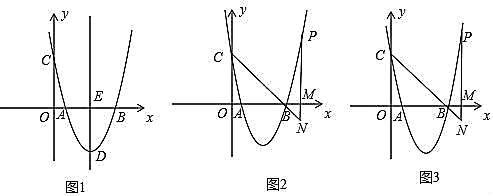

# Mathematics - 题目 1559

**ID**: 14580aef57b340ffa189440e63ca68be
**年级**: Grade 9
**难度**: Medium-Hard
**题型**: Calculation

## 题目
在平面直角坐标系中，抛物线 $y=ax{^{2}}-4ax+4a-1\left ({a>0}\right )$ 与 $x$ 轴交于点 $A、B$ ，与 $y$ 轴交于点C，抛物线对称轴交 $x$ 轴于点 $E$ ，抛物线顶点为点D， $OC=3DE$ ．(1)如图，求抛物线的解析式；​​​​​​​‌(2)如图，连接 $CB$ ，点 $P$ 为第一象限的抛物线上一点，过点 $P$ 作 $PM\bot x$ 轴于点 $M$ ， $PM$ 的延长线交 $CB$ 的延长线于点 $\mathbf{N}$ ，若点 $P$ 的横坐标为 $t$ ， $PN$ 的长为 $d$ ，求 $d$ 与 $t$ 的函数关系式，并写出 $t$ 的取值范围；(3)在(2)的条件下，连接 $PA$ 并延长交 $y$ 轴于点 $F$ ，连接 $FN$ ，点 $R、Q$ 分别为抛物线(点 $R$ 在点 $P、B$ 之间)、 $y$ 轴上的点，分别连接 $RN、QN$ ， $\angle PNF=\angle RNQ$ ，连接 $RQ$ ，点 $S$ 为 $RQ$ 上一点，连接 $NS$ ，将射线 $NS$ 绕点 $N$ 逆时针旋转 $45{}^\circ $ 后，交 $RQ$ 于点 $T$ ，若 ${\tan}\angle PFN=2,RN=QN,RS:ST=4:5$ ，求点 $S$ 的坐标．

## 解答

1. 解：(1)在 $y=ax{^{2}}-4ax+4a-1$ 中，令 $x=0$ ，得 $y=4a-1$ ，∴ $OC=4a-1$ ，
2. 由 $y=ax{^{2}}-4ax+4a-1$
3. $=a{\left({x-2}\right)^{2}}-1$ ,
4. 得 $D\left ({2,-1}\right )$ ，
5. ∴ $DE=1$ ，
6. ∵ $OC=3DE$ ，
7. ∴ $4a-1=3$ ，
8. ∴ $a=1$ ；
9. 故抛物线的解析式为 $y=x{^{2}}-4x+3$ ．
10. (2)在 $y=x{^{2}}-4x+3$ 中，令 $y=0$ ，得 $x{^{2}}-4x+3=0$ ，解得 $x{{}_{1}}=1,x{{}_{2}}=3$ ；
11. ∴ $OB=3,OC=3,MB=t-3$
12. ∵ $PM\bot x$ 轴，
13. ∴ $PN//y$ 轴，
14. ∴ $ΔCBO∽ΔNBM$ ，
15. ∴ $\frac {MN}{OC}=\frac {MB}{OB}$
16. ∴ $\frac {MN}{3}=\frac {t-3}{3}$ ，
17. ∴ $MN=t-3$ ；
18. ∵ $PM=t{^{2}}-4t+3$ ，
19. ∴ $PN=PM+MN=t{^{2}}-4t+3+t-3=t{^{2}}-3t$ ，
20. 故 $d=t{^{2}}-3t\left ({t>3}\right )$ ．
21. (3)如图所示，
22. 
23. 由题意可知， $ΔPAM∽ΔFAO$ ，
24. ∴ $\frac {PM}{OF}=\frac {AM}{OA}$ ，即 $\frac {t{^{2}}-4t+3}{OF}=\frac {t-1}{1}$
25. 解得 $OF=t-3$ ，
26. ∴ $F\left ({0,3-t}\right )$
27. ∵ $N\left ({t,3-t}\right )$ ，
28. $FN//x$ 轴，
29. ∴ $\angle PNF=90{}^\circ $ ，
30. ∵ ${\rm{t}}{\rm{a}}{\rm{n}}\angle PFN=2$ ，
31. $\frac {PN}{FN}=\frac {t{^{2}}-3t}{t}=2$ ，
32. 解得 $t=5$ ，或 $t=0$ (舍)，
33. ∴ $P\left ({5,8}\right ),F\left ({0,-2}\right ),N\left ({5,-2}\right )$ ，
34. ∵ $\angle PNF=\angle RNQ,QN=RN$ ，
35. ∴ $ΔQNR$ 为等腰直角三角形，
36. 过点 $R$ 作 $RE\bot PN$ ，
37. 可知 $ΔREN\cong ΔQFN\left ({AAS}\right )$ ，
38. ∴ $EN=FN=5$ ，
39. ∴点 $R$ 和点 $E$ 的纵坐标都为3，
40. ∵ $C\left ({0,3}\right )$ ，点 $R$ 在抛物线上，根据抛物线的对称性可知点 $R\left ({4,3}\right )$ ，点 $E\left ({5,3}\right )$ ，
41. 过点 $Q$ 作 $QJ\bot RQ$ ，并使 $QJ=RS$ ，连接 $NJ$ ，
42. ∴ $\angle NQJ=\angle SRN=45{}^\circ $ ，
43. ∵ $RN=QN$ ，
44. ∴ $ΔRSN\cong ΔNQJ\left ({SAS}\right )$
45. ∴ $\angle RNS=\angle QNJ,NS=NJ$ ，
46. ∵ $\angle SNT=45{}^\circ $ ，
47. ∴ $\angle RNS+\angle TNQ=45{}^\circ $ ，即 $\angle TNJ=45{}^\circ $ ，
48. ∵ $NT=NT$
49. ∴ $ΔNST\cong ΔNJT\left ({SAS}\right )$ ，
50. ∵ $RS:ST=4:5$ ，设 $RS=4m$ ，则 $ST=5m$ ，
51. ∴ $QJ=4m,JT=5m$ ，
52. 在 $RtΔTQJ$ 中，根据勾股定理得 $TQ=3m$ ，
53. 过 $S$ 作 $SK\bot y$ 轴，
54. $ΔQSK∽ΔQRC$ ,
55. ∴ $\frac {SK}{CR}=\frac {SQ}{RQ}=\frac {QK}{CK}$ ，
56. 即 $\frac {SK}{4}=\frac {8m}{12m}=\frac {QK}{6}$ ，
57. 解得 $SK=\frac {8}{3},QK=4$ ，
58. ∴ $S\left ({\frac {8}{3},1}\right )$ ．

## 知识点

**中文**:
  - 二次函数的综合
  - 相似三角形的判定与性质综合
  - 正切

**English**:
  - Comprehensive Quadratic Function Problems
  - Determination and Properties
  - Tangent

---
