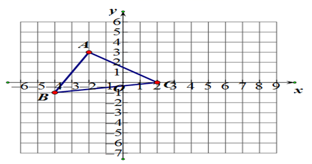

# Mathematics - 题目 3546

**ID**: 1542e938faa04329ac8a743301bccf5c
**年级**: Grade 9
**难度**: Medium-Hard
**题型**: Calculation

## 题目
在平面直角坐标系中，△ABC的顶点坐标是A（﹣2，3），B（﹣4，﹣1）， C（2，0）．点P（m，n）为△ABC内一点，平移△ABC得到△A_{1}B_{1}C_{1}，使点P（m，n）移到P（m+6，n+1）处．（1）画出△A_{1}B_{1}C_{1}（2）将△ABC绕坐标点C逆时针旋转90°得到△A_{2}B_{2}C，画出△A_{2}B_{2}C；​​​​​​​‌（3）在（2）的条件下求BC扫过的面积．

## 解答

1. 解：（1）平移△ABC得到△A_{1}B_{1}C_{1}，点P（m，n）移到P（m+6，n+1）处，
2. ∴△ABC向右平移6个单位，向上平移了一个单位，
3. ∴A_{1}（4，4），B_{1}（2，0），C_{1}（8，1）；
4. 顺次连接A_{1}，B_{1}，C_{1}三点得到所求的△A_{1}B_{1}C_{1}
5. 
6. （2）如图所示：△A_{2}B_{2}C即为所求三角形.
7. 
8. （3）BC的长为： $\sqrt {(-4-2){^{2}}+(-1-0){^{2}}}=\sqrt {(-6){^{2}}+1{^{2}}}=\sqrt {37}$
9. BC扫过的面积 $\frac {1}{4}π{\left({\sqrt {37}}\right)^{2}}=9\frac {1}{4}π$

## 知识点

**中文**:
  - 坐标与图形变化——平移
  - 坐标与图形变换——旋转

**English**:
  - Coordinates and Translation
  - Coordinates and Rotation

---
