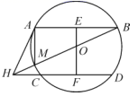

# Mathematics - 题目 2678

**ID**: 15cc7546ca0c4a28a2d539ef8514dd58
**年级**: Grade 9
**难度**: Medium-Hard
**题型**: Calculation

## 题目
如图，AB，CD为 $\odot O$ 的两条平行弦，过点A作 $\odot O$ 的切线，交DC的延长线于点H，若H，O，B在同一条直线上，OH交 $\odot O$ 于点M，过点O作AM的平行线，与AB，CD分别相交于点E，F．（1）求证： $CF=DF$ ；​​​​​​​‌（2）若 $OE:OF=2:3$ ， $HA=\sqrt {5}$ ，求 $HF$ 的长．

## 解答

1. （1）证明： $\therefore BM$ 是 $\odot O$ 的直径，
2. $\therefore AM\bot AB$ ，
3. $\because AM//EF$ ，
4. $\therefore EF\bot AB$ ，
5. $\because AB//CD$ ，
6. $\therefore EF\bot CD$ ，即 $OF\bot CD$
7. $\because OF$ 过圆心O， $CD$ 是 $\odot O$ 的弦，
8. $\therefore CF=DF$ ；
9. （2）连接AO，
10. 
11. $\because HA$ 是 $\odot O$ 的切线，
12. $\therefore OA\bot HA$ ，
13. $\therefore \angle HAM+\angle OAM=90^\circ $ ，
14. $\because AM\bot AB$ ，
15. $\therefore \angle OAM+\angle OAB=90^\circ $ ，
16. $\therefore \angle HAM=\angle OAB$ ，
17. $\because \angle OAB=\angle OBA$ ，
18. $\therefore \angle HAM=\angle OBA$ ，
19. 又 $\because \angle AHM=\angle BHA$ ，
20. $\therefore \vartriangle HAM\sim \vartriangle HBA$ ，
21. $\therefore \frac {HA}{HB}=\frac {HM}{HA}=\frac {AM}{AB}$ ，
22. $\therefore \frac {\sqrt {5}}{OH+OB}=\frac {OH-OM}{\sqrt {5}}$ ，
23. $\because OB=OM$ ，
24. $\therefore OH{^{2}}-OM{^{2}}=5①$
25. $\because AB//CD$ ，
26. $\therefore \frac {OB}{OH}=\frac {OE}{OF}=\frac {BE}{HF}=\frac {2}{3}②$ ，
27. 由①②解得， $OB=2$ ， $OH=3$ ，
28. $\therefore BM=2OB=4$ ， $HB=OH+OB=5$ ，
29. $\therefore \frac {AM}{AB}=\frac {HA}{HB}=\frac {\sqrt {5}}{5}③$
30. 在 $Rt\vartriangle ABM$ 中，
31. $AB{^{2}}+AM{^{2}}=BM{^{2}}=16④$
32. 解③④得， $AB=\frac {2}{3}\sqrt {30}$
33. $\because EF\bot AB$ ，且EF过圆心O， $AB$ 是 $\odot O$ 弦，
34. $\therefore BE=\frac {1}{2}AB=\frac {1}{3}\sqrt {30}$ ，
35. $\therefore \frac {\frac {1}{3}\sqrt {30}}{HF}=\frac {2}{3}$ ，
36. $\therefore HF=\frac {1}{2}\sqrt {30}$ ．

## 知识点

**中文**:
  - 直线和圆的位置关系
  - 相似三角形的判定与性质综合

**English**:
  - Line and Circle Relationship
  - Determination and Properties

---
