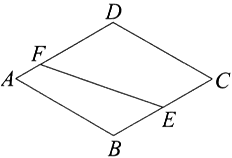

# Mathematics - 题目 231

**ID**: 15e996c67a944937860e7b99cf049062
**年级**: Grade 9
**难度**: Medium-Hard
**题型**: Calculation

## 题目
如图，四边形ABCD是菱形， $\angle BAD=60{}^\circ $ ，点E，F分别在边BC，AD上，且 $BE=EC$ ， $3AD=4DF$ ， $AB=4$ ，则 $EF=$ （       ）​​​​​​​‌

## 解答

1. 解：过点E作EG//CD交AD于点G，过点F作FH⊥EG交EG的延长线于点H，如图，
2. 
3. ∵四边形ABCD是菱形，
4. ∴ $AD=BC=AB=4$ ，AB//CD
5. ∴HE//AB
6. ∴ $\angle DGE=\angle A=60{}^\circ $
7. ∴ $\angle HGF=\angle DGE=60{}^\circ $
8. ∴ $\angle HFG=30{}^\circ $
9. ∵ $BE=EC$
10. ∴ $BE=\frac {1}{2}BC=2$
11. ∵AG//BE
12. ∴四边形ABEG是平行四边形
13. ∴ $AG=BE=2$ ，GE=AB=4
14. ∵ $3AD=4DF$
15. ∴ $4DF=12$
16. ∴ $DF=3$
17. ∴ $AF=1$
18. ∴ $FG=1$
19. ∴ $HG=\frac {1}{2}FG=\frac {1}{2}$
20. ∴ $FH=\frac {HG}{{\tan}\angle HFG}=\frac {\frac {1}{2}}{{\tan}30^\circ }{\rm{=}}\frac {\sqrt {3}}{2}$
21. ∴ $HE=HG+GE=\frac {9}{2}$
22. 由勾股定理得， $EF=\sqrt {FH{^{2}}+HE{^{2}}}=\sqrt {(\frac {\sqrt {3}}{2}){^{2}}+(\frac {9}{2}){^{2}}}=\sqrt {21}$
23. 故选：D

## 知识点

**中文**:
  - 菱形的性质
  - 解直角三角形

**English**:
  - Properties of Rhombuses
  - Solving Right Triangles

---
