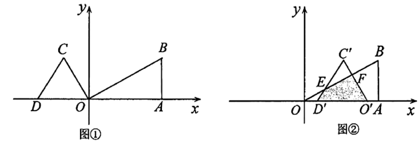

# Mathematics - 题目 929

**ID**: 17f749099480449e80df184ed2d48b91
**年级**: Grade 9
**难度**: Medium-Hard
**题型**: 解答题：本题共8小题，共72分。解答应写出文字说明，证明过程或演算步骤。

## 题目
在平面直角坐标系中， $O$ 为原点，有一张直角三角形纸片 $\mathrm{△}OAB$ 和一张等边三角形纸片 $\vartriangle OCD$ ，其中 $A\left ({3\sqrt {3},0}\right )$ ， $B\left ({3\sqrt {3},3}\right )$ ， $D\left ({-2\sqrt {3},0}\right )$ ，点 $C$ 在第二象限．（1）填空：如图①， $\angle BOA$ 的度数为_，点 $C$ 的坐标为_；​​​​​​​‌（2）将等边三角形纸片 $\vartriangle OCD$ 沿 $x$ 轴向右平移，得到 $\vartriangle O{^{\prime }}C{^{\prime }}D{^{\prime }}$ ，点 $O，C，D$ 的对应点分别为 $O^{′}，C^{′}，D^{′}$ ．设 $OO^{′}=t$ ，等边三角形纸片 $O^{′}C^{′}D^{′}$ 与 $\mathrm{△}OAB$ 重叠部分的面积为 $\mathrm{S}$ ．①如图②， $C{^{\prime }}D{^{\prime }}$ 与 $OB$ 边交于点 $E$ ， $C^{′}O^{′}$ 与 $OB$ 边交于点 $F$ ，当等边三角形 $O^{′}C^{′}D^{′}$ 与 $\mathrm{△}OAB$ 重叠部分为四边形时，试用含有 $t$ 的式子表示 $\mathrm{S}$ ，并直接写出 $t$ 的取值范围；②当 $2\leqslant t\leqslant \frac {9\sqrt {3}}{2}$ 时，求 $\mathrm{S}$ 的取值范围（直接写出结果即可）．

## 解答

1. （1）解：∵ $A\left ({3\sqrt {3},0}\right )$ ， $B\left ({3\sqrt {3},3}\right )$ ， $D\left ({-2\sqrt {3},0}\right )$ ，
2. ∴ $OA=3\sqrt {3}，AB=3，OD=2\sqrt {3}$ ，
3. ∵直角三角形纸片 $\mathrm{△}OAB$ ，
4. ∴ ${\tan}\angle BOA=\frac {AB}{OA}=\frac {3}{3\sqrt {3}}=\frac {\sqrt {3}}{3}$ ，
5. ∴ $\angle BOA=30{}\degree $ ，
6. 过点 $C$ 作 $CE\bot x$ 轴，
7. 
8. ∵等边三角形纸片 $\vartriangle OCD$ ，
9. ∴ $OC=OD=2\sqrt {3}$ ， $OE=DE=\frac {1}{2}OD=\sqrt {3}$ ，
10. ∴ $CE=\sqrt {OC{^{2}}-OE{^{2}}}=3$ ，
11. ∴ $C\left ({-\sqrt {3},3}\right )$ ；
12. （2）①∵等边三角形纸片 $\vartriangle OCD$ ，平移，
13. ∴ $\angle O^{′}D^{′}C^{′}=\angle C^{′}O^{′}D^{′}=60{}\degree ，O^{′}D^{′}=OD=2\sqrt {3}$ ，
14. ∵ $\angle BOA=30{}\degree $ ，
15. ∴ $\angle OED^{′}=\angle C^{′}D^{′}O^{′}-\angle AOB=30{}\degree =\angle AOB$ ， $\angle O^{′}FO=180{}\degree -\angle OO^{′}F-\angle AOB=90{}\degree $ ，
16. ∴ $OD^{′}=D^{′}E$ ，
17. ∵ $OO^{′}=t$ ，
18. ∴ $OD^{′}=t-2\sqrt {3}=D^{′}E$ ，
19. 在 ${\rm{R}}{\rm{t}}\vartriangle OFO^{′}$ 中， $OO^{′}=t$ ， $\angle BOA=30{}\degree $ ，
20. ∴ $O^{′}F=\frac {1}{2}OO^{′}=\frac {1}{2}t，OF=\frac {O^{′}F}{{\tan}30{}\degree }=\sqrt {3}O^{′}F=\frac {\sqrt {3}}{2}t$ ，
21. ∴ $S{{}_{\vartriangle OO^{′}F}}=\frac {1}{2}\cdot \frac {1}{2}t\cdot \frac {\sqrt {3}}{2}t=\frac {\sqrt {3}}{8}t{^{2}}$ ，
22. 作 $EG\bot OA$ ，则： $EG=D^{′}E\cdot \sin 60{}\degree =\left ({t-2\sqrt {3}}\right )\cdot \frac {\sqrt {3}}{2}=\frac {\sqrt {3}}{2}t-3$ ，
23. 
24. ∴ $S{{}_{\vartriangle OD^{′}E}}=\frac {1}{2}\left ({t-2\sqrt {3}}\right )\left ({\frac {\sqrt {3}}{2}t-3}\right )=\frac {\sqrt {3}}{4}t{^{2}}-3t+3\sqrt {3}$ ，
25. ∴ $S=S{{}_{\vartriangle OO^{′}F}}-S{{}_{\vartriangle OD^{′}E}}=\frac {\sqrt {3}}{8}t{^{2}}-\frac {\sqrt {3}}{4}t{^{2}}+3t-3\sqrt {3}=-\frac {\sqrt {3}}{8}t{^{2}}+3t-3\sqrt {3}$ ，
26. 由题意可知：当点 $D$ 与点 $O$ 重合开始（不包括点 $O$ ），到 $O^{′}$ 与点 $\mathrm{A}$ 重合时，等边三角形 $O^{′}C^{′}D^{′}$ 与 $\mathrm{△}OAB$ 重叠部分为四边形，
27. ∴ $2\sqrt {3}<t\leqslant 3\sqrt {3}$ ；
28. 综上： $S=-\frac {\sqrt {3}}{8}t{^{2}}+3t-3\sqrt {3}$ ， $t$ 的取值范围是 $2\sqrt {3}<t\leqslant 3\sqrt {3}$ ；
29. ②当 $2\leqslant t\leqslant 2\sqrt {3}$ 时，如图，
30. 
31. 同①可知： $\vartriangle OO^{′}F$ 为直角三角形， $O^{′}F=\frac {1}{2}OO^{′}=\frac {1}{2}t，OF=\frac {O^{′}F}{{\tan}30{}\degree }=\sqrt {3}O^{′}F=\frac {\sqrt {3}}{2}t$ ，
32. ∴ $S=S{{}_{\vartriangle OO^{′}F}}=\frac {1}{2}\cdot \frac {1}{2}t\cdot \frac {\sqrt {3}}{2}t=\frac {\sqrt {3}}{8}t{^{2}}$ ，
33. ∵ $2\leqslant t\leqslant 2\sqrt {3}$ ，
34. ∴ $\frac {\sqrt {3}}{8}\times 2{^{2}}\leqslant S\leqslant \frac {\sqrt {3}}{8}\times {\left({2\sqrt {3}}\right)^{2}}$ ，即： $\frac {\sqrt {3}}{2}\leqslant S\leqslant \frac {3\sqrt {3}}{2}$ ；
35. 当 $2\sqrt {3}<t\leqslant 3\sqrt {3}$ 时，如图，由①知：
36. 
37. $S=-\frac {\sqrt {3}}{8}t{^{2}}+3t-3\sqrt {3}=-\frac {\sqrt {3}}{8}{\left({t-4\sqrt {3}}\right)^{2}}+3\sqrt {3}$ ，
38. 那么其对称轴为 $t=4\sqrt {3}$ ，开口向下，
39. ∴当 $t=2\sqrt {3}$ 时， $\mathrm{S}$ 有最小值， $S=-\frac {\sqrt {3}}{8}{\left({2\sqrt {3}-4\sqrt {3}}\right)^{2}}+3\sqrt {3}=\frac {3\sqrt {3}}{2}$ ；
40. 当 $t=3\sqrt {3}$ 时， $\mathrm{S}$ 有最大值， $S=-\frac {\sqrt {3}}{8}{\left({3\sqrt {3}-4\sqrt {3}}\right)^{2}}+3\sqrt {3}=\frac {21\sqrt {3}}{8}$ ，
41. ∴ $\frac {3\sqrt {3}}{2}<S\leqslant \frac {21\sqrt {3}}{8}$ ；
42. 当 $3\sqrt {3}<t<4\sqrt {3}$ 时，如图：
43. 
44. 同①可知： $S{{}_{\vartriangle OD^{′}E}}=\frac {1}{2}\left ({t-2\sqrt {3}}\right )\left ({\frac {\sqrt {3}}{2}t-3}\right )=\frac {\sqrt {3}}{4}t{^{2}}-3t+3\sqrt {3}$ ， $S{{}_{\vartriangle OO^{′}F}}=\frac {1}{2}\cdot \frac {1}{2}t\cdot \frac {\sqrt {3}}{2}t=\frac {\sqrt {3}}{8}t{^{2}}$ ，
45. 由题意，得： $O^{′}A=OO^{′}-OA=t-3\sqrt {3}$ ，
46. ∴ $AM=O^{′}A\cdot {\tan}60{}\degree =\left ({t-3\sqrt {3}}\right )\cdot \sqrt {3}=\sqrt {3}t-9$ ，
47. ∴ $S{{}_{\vartriangle O^{′}AM}}=\frac {1}{2}\left ({t-3\sqrt {3}}\right )\left ({\sqrt {3}t-9}\right )=\frac {\sqrt {3}}{2}t{^{2}}-9t+\frac {27\sqrt {3}}{2}$ ，
48. ∴ $S=-\frac {\sqrt {3}}{8}t{^{2}}+3t-3\sqrt {3}-\frac {\sqrt {3}}{2}t{^{2}}+9t-\frac {27\sqrt {3}}{2}$
49. $=-\frac {5\sqrt {3}}{8}t{^{2}}+12t-\frac {33\sqrt {3}}{2}$
50. $=-\frac {5\sqrt {3}}{8}{\left({t-\frac {16\sqrt {3}}{5}}\right)^{2}}+\frac {27\sqrt {3}}{10}$ ，
51. 那么其对称轴为 $t=\frac {16\sqrt {3}}{5}$ ，开口向下，
52. ∴当 $t=\frac {16\sqrt {3}}{5}$ 时， $\mathrm{S}$ 最大为 $\frac {27\sqrt {3}}{10}$ ，
53. 当 $t=4\sqrt {3}$ 时， $\mathrm{S}$ 最小为： $-\frac {5\sqrt {3}}{8}\times {\left({4\sqrt {3}-\frac {16\sqrt {3}}{5}}\right)^{2}}+\frac {27\sqrt {3}}{10}=\frac {3\sqrt {3}}{2}$ ，
54. ∴ $\frac {3\sqrt {3}}{2}<S\leqslant \frac {27\sqrt {3}}{10}$ ；
55. 当 $4\sqrt {3}\leqslant t\leqslant \frac {9\sqrt {3}}{2}$ 时，如图：
56. 
57. $AD^{′}=OA-\left ({OO^{′}-O^{′}D^{′}}\right )=5\sqrt {3}-t$ ，
58. ∴ $AM=AD^{′}{\cdot }{\tan}60{}\degree =\sqrt {3}\left ({5\sqrt {3}-t}\right )=15-\sqrt {3}t$ ，
59. ∴ $S=\frac {1}{2}\left ({5\sqrt {3}-t}\right )\left ({15-\sqrt {3}t}\right )=\frac {\sqrt {3}t{^{2}}}{2}-15t+\frac {75\sqrt {3}}{2}$
60. $=\frac {\sqrt {3}}{2}{\left({t-5\sqrt {3}}\right)^{2}}$ ，
61. 那么其开口向上，对称轴为 $t=5\sqrt {3}$ ，
62. ∴当 $t=4\sqrt {3}$ 时， $\mathrm{S}$ 有最大值，此时 $S=\frac {3\sqrt {3}}{2}$ ，
63. 当 $t=\frac {9\sqrt {3}}{2}$ 时， $\mathrm{S}$ 有最小值，此时 $S=\frac {3\sqrt {3}}{8}$ ，
64. ∴ $\frac {3}{8}\sqrt {3}\leqslant S\leqslant \frac {3\sqrt {3}}{2}$ ；
65. 综上： $\frac {3\sqrt {3}}{8}\leqslant S\leqslant \frac {27\sqrt {3}}{10}$ ．

## 知识点

**中文**:
  - 图形问题
  - 平移的性质
  - 解直角三角形

**English**:
  - Geometric Problems
  - Properties of Translation
  - Solving Right Triangles

---
