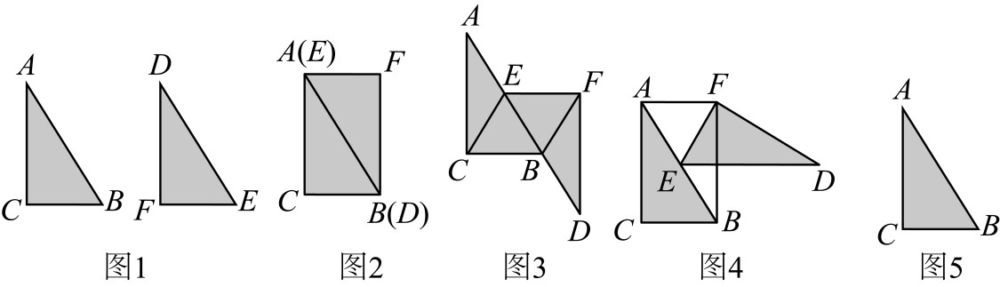

# Mathematics - 题目 1196

**ID**: 18ce5e5c2a504d88a931950f166d8bca
**年级**: Grade 9
**难度**: Medium-Hard
**题型**: Calculation

## 题目
综合与实践：问题背景：在一次综合与实践课上，老师让同学们以两个全等的三角形纸片为操作对象，进行相关问题的研究，下面是创新小组在操作纸片过程中研究的问题，请你解决这些问题，如图 $1$ ， $\mathrm{△}ABC{\rm{≌}}\mathrm{△}DEF$ ，其中 $\angle ACB\mathrm{=}90{}\degree $ ， $\angle ABC=60{}\degree $ ， $BC=2$ ， $AB=2BC$ ．操作与发现：（1）如图 $2$ ，创新小组将两张三角形纸片按如图所示的方式放置后，经过观察发现四边形 $ACBF$ 是矩形，请你证明这个结论．操作与探究：（2）创新小组在图 $2$ 的基础上，将 $\vartriangle DEF$ 纸片沿 $AB$ 方向平移至如图 $3$ 的位置，其中点 $E$ 与 $AB$ 的中点重合，连接 $CE$ ， $BF$ ，经过探究后发现四边形 $BCEF$ 是菱形，请你证明这个结论．（3）创新小组在图 $3$ 的基础上又进行了探究，将 $\vartriangle DEF$ 纸片绕点 $E$ 逆时针旋转至 $DE$ 与 $BC$ 平行的位置，如图 $4$ 所示，连接 $AF$ ， $BF$ ，创新小组经过观与推理后发现四边形 $ACBF$ 是矩形，请你证明这个结论．提出问题：（4）请你参照以上操作，在图 $2$ 的基础上，通过平移或旋转 $\vartriangle DEF$ 构造出的图形，在图 $5$ 中画出这个图形，标明字母，说明构图方法，写出你发现的结论，不必证明．​​​​​​​‌

## 解答

1. （1）证明： $\because \vartriangle ABC\mathrm{≌}\vartriangle DEF$ ，
2. $\therefore AC=DF=BF$ ， $BC=EF=AF$ ，
3. 在四边形 $ACBF$ 中， $AC=BF$ ， $BC=AF$ ，
4. $\therefore $ 四边形 $ACBF$ 是平行四边形，
5. $\because \angle ACB=90{}\degree $ ，
6. ∴平行四边形 $ACBF$ 是矩形；
7. （2）证明：在 ${\rm{R}}{\rm{t}}\mathrm{△}ABC$ 中， $\angle ABC=60{}\degree $ ，
8. $\therefore \angle A=30{}\degree $ ，
9. $\because \vartriangle ABC\mathrm{≌}\vartriangle DEF$ 与平移可知， $BC=EF$ ， $BC\mathrm{/\mskip-4mu/}EF$ ，
10. $\therefore $ 四边形 $BCEF$ 是平行四边形，
11. $\because \angle ACB=90{}\degree $ ， $\angle A=30{}\degree $ ，
12. $\mathrm{∴}BC=\frac {1}{2}AB$  ，
13. $\therefore $ 点 $E$ 与 $AB$ 的中点重合， $\angle ACB\mathrm{=}90{}\degree $ ，
14. $\therefore CE=\frac {1}{2}AB$ ，
15. $\therefore BC=CE=\frac {1}{2}AB$ ，
16. 在平行四边形 $BCEF$ 中， $BC=CE$ ，
17. $\therefore $ 平行四边形 $BCEF$ 是菱形；
18. （3）证明：在 ${\rm{R}}{\rm{t}}\mathrm{△}ABC$ 中， $\angle ABC=60{}\degree $ ，
19. $\because \vartriangle ABC\mathrm{≌}\vartriangle DEF$ ，点 $E$ 是 $AB$ 中点， $\angle BAC=30{}\degree $ ，
20. $\therefore EF=AE=BC$ ， $\angle DEF=60{}\degree $ ，
21. $\because DE\mathrm{/\mskip-4mu/}BC$ ，
22. $\therefore ∠BED=∠ABC=60{}\degree $ ，
23. $\therefore ∠AEF=180{}\degree -∠DEF-∠BED=60{}\degree $ ，
24. $\therefore \vartriangle AEF$ 是等边三角形，
25. $\therefore \angle EAF=60{}\degree $ ， $AF=AE$ ，
26. $\because AE=BC$ ， $AF=BC$ ，
27. $\because ∠EAF=∠ABC=60{}\degree $ ，
28. $\therefore AF\parallel BC$ ，
29. 在四边形 $ACBF$ 中， $AF=BC$ ， $AF\parallel BC$ ，
30. $\therefore $ 四边形 $ACBF$ 是平行四边形，
31. $\because \angle ACB=90{}\degree $ ，
32. $\therefore $ 平行四边形 $ACBF$ 是矩形；
33. （4）解：构图方法：
34. 如图所示，将 $\vartriangle DEF$ 向下平移 $DF$ 的长度，得到四边形 $ACDB$ 为平行四边形．理由如下，
35. 
36. 由平移可得： $AC=BD$ ， $AB=CD$ ，
37. $\therefore $ 四边形 $ACDB$ 为平行四边形．

## 知识点

**中文**:
  - 矩形的判定
  - 等边三角形的判定与性质
  - 菱形的判定

**English**:
  - Determination of Rectangles
  - Determination and Properties
  - Determination of Rhombuses

---
