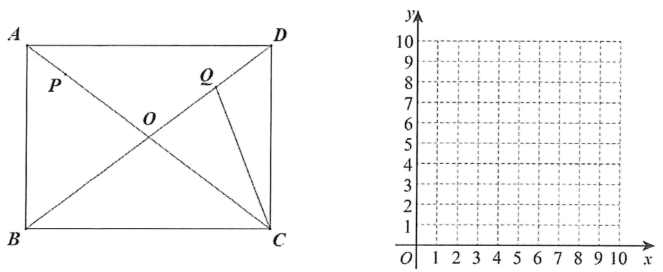

# Mathematics - 题目 3233

**ID**: 19255619c4ea4bfb877c9d7d1cbbb342
**年级**: Grade 9
**难度**: Medium-Hard
**题型**: Calculation

## 题目
如图1，在矩形 $ABCD$ 中， $AB=6$ ， $BC=8$ ，对角线 $AC$ 、 $BD$ 交于点 $O$ ．动点 $P$ 以每秒1个单位长度的速度从点 $\mathrm{A}$ 出发，沿着 $A\to O\to B$ 运动，同时动点 $Q$ 从点 $B$ 出发，以相同的速度沿 $B\to D$ 运动，设点 $P$ 、 $Q$ 运动的时间都为 $x\left ({0<x<10}\right )$ ，点 $P$ 到 $AB$ 的距离与点 $P$ 到 $BC$ 的距离的和为 $y{{}_{1}}$ ， $\vartriangle BQC$ 的面积为 $y{{}_{2}}$ ．图1                              图2(1)请直接写出 $y{{}_{1}}$ ， $y{{}_{2}}$ 关于 $x$ 的函数关系式，并写出自变量的取值范围；(2)在给定的平面直角坐标系中画出 $y{{}_{1}}$ 的图象，并写出函数 $y{{}_{1}}$ 的一条性质；(3)结合函数图象，请直接写出当 $y{{}_{1}}<\frac {x}{6}\cdot y{{}_{2}}$ 时 $x$ 的取值范围．（近似值保留小数点后一位，误差不超过0.​​​​​​​‌2）

## 解答

1. （1）解：在矩形 $ABCD$ 中， $AB=CD=6,BC=AD=8$ ， $\angle ABC=\angle BAD=\angle BCD=\angle ADC=90{}\degree $ ，
2. ∴ $AC=BD=\sqrt {AB{^{2}}+BC{^{2}}}=\sqrt {8{^{2}}+6{^{2}}}=10$ ，
3. ∴ $AO=BO=CO=DO=5$ ，
4. 当 $0<x\leqslant 5$ 时，如图，作 $PF\bot AB$ ， $PG\bot BC$ ，垂足分别为点F和点G，
5. 
6. 则 $\angle AFP=\angle CGP=90{}\degree $ ，
7. ∴ $\sin \angle BAC=\frac {CB}{AC}=\frac {PF}{AP}$ ， $\sin \angle BCA=\frac {AB}{AC}=\frac {PG}{PC}$ ，
8. 即 $\frac {8}{10}=\frac {PF}{x}$ ， $\frac {6}{10}=\frac {PG}{10-x}$ ，
9. ∴ $PF=\frac {4}{5}x$ ， $PG=-\frac {3}{5}x+6$ ，
10. ∴当 $0<x\leqslant 5$ 时， $y{{}_{1}}=PF+PG=\frac {4}{5}x-\frac {3}{5}x+6=\frac {1}{5}x+6$ ，
11. 当 $5<x<10$ 时，如图，作 $PM\bot AB$ ， $PN\bot BC$ ，垂足分别为点M和点N，
12. 
13. 则 $\angle BMP=\angle PNB=90{}\degree $ ，
14. ∴ $\sin \angle ABD=\frac {AD}{BD}=\frac {PM}{BP}$ ， $\sin \angle CBD=\frac {CD}{BD}=\frac {PN}{PB}$ ，
15. 即 $\frac {8}{10}=\frac {PM}{10-x}$ ， $\frac {6}{10}=\frac {PN}{10-x}$ ，
16. ∴ $PM=-\frac {4}{5}x+8$ ， $PN=-\frac {3}{5}x+6$ ，
17. ∴当 $5<x<10$ 时， $y{{}_{1}}=PN+PM=-\frac {7}{5}x+14$ ，
18. ∴ $y{{}_{1}}=\begin{cases}\frac {1}{5}x+6\left ({0<x\leqslant 5}\right )\\-\frac {7}{5}x+14\left ({5<x<10}\right )\end{cases}$ ；
19. 如图，作 $QE\bot BC$ ，垂足为点E，
20. 
21. 则 $\angle BCD=\angle BEQ=90{}\degree $ ，
22. ∴ $\sin \angle CBD=\frac {CD}{BD}=\frac {QE}{BQ}$ ，即 $\frac {6}{10}=\frac {QE}{x}$ ，
23. ∴ $QE=\frac {3}{5}x$ ，
24. ∵ $S{{}_{\vartriangle BQE}}=\frac {1}{2}BC·QE=\frac {1}{2}\times 8\times \frac {3}{5}x=\frac {12}{5}x\left ({0<x<10}\right )$ ，
25. ∴ $y{{}_{2}}=\frac {12}{5}x\left ({0<x<10}\right )$ ；
26. （2）解：函数图象如图所示：
27. 在 $0<x\leqslant 5$ 时，函数 $y{{}_{1}}$ 随着x的增大而增大； $5<x<10$ 时，函数 $y{{}_{1}}$ 随着x的增大而减小
28. 
29. （3）解：令 $y{{}_{3}}=\frac {x}{6}·y{{}_{2}}=\frac {x}{6}\times \frac {12}{5}x=\frac {2}{5}x{^{2}}$ ，
30. 在（2）函数图象的基础上画出函数 $y{{}_{3}}$ 的图象，
31. 
32. 根据图象估计当 $y{{}_{1}}<\frac {x}{6}·y{{}_{2}}$ 时，即函数 $y{{}_{1}}$ 图象在函数 $y{{}_{3}}$ 图象下方，交点在 $4<x<5$ 之间，
33. 令 $\frac {1}{5}x+6=\frac {2}{5}x{^{2}}$ ，即 $2x{^{2}}-x-30=0$ ，
34. 解得： $x{{}_{1}}=\frac {1+\sqrt {241}}{4}\approx 4.1,x{{}_{2}}=\frac {1-\sqrt {241}}{4}$ （舍去）
35. 根据图象估计当 $y{{}_{1}}<\frac {x}{6}·y{{}_{2}}$ 时，x的取值范围是 $4.1<x<10$ ．

## 知识点

**中文**:
  - y=ax²的图象与性质
  - 列一次函数解析式
  - 解直角三角形

**English**:
  - Graph and Properties of y=ax²
  - Writing Linear Function Expressions
  - Solving Right Triangles

---
