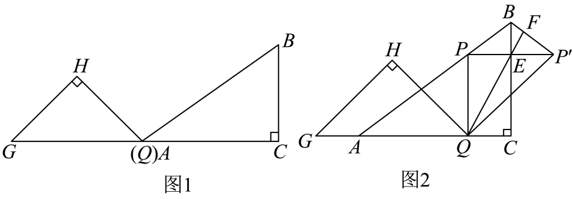

# Mathematics - 题目 3281

**ID**: 1c0980e9ae204347827755346259cedd
**年级**: Grade 9
**难度**: Medium-Hard
**题型**: Calculation

## 题目
已知：把 ${\rm{R}}{\rm{t}}\mathrm{△}GHQ$ 和 ${\rm{R}}{\rm{t}}\mathrm{△}ACB$ 按图 $1$ 方式摆放（点 $Q$ 与点 $\mathrm{A}$ 重合），点 $G$ 、 $A\left ({Q}\right )$ ， $C$ 在同一条直线上 ${\rm ．}\angle H=\angle C=90{}\degree $ ， $\angle HGQ=45{}\degree $ ， $GQ=AC=8{\rm{c}}{\rm{m}}$ ， $BC=6{\rm{c}}{\rm{m}}$ ．如图 $2$ ， $\vartriangle GHQ$ 从图1位置出发，以 $2{\rm{c}}{\rm{m}}/{\rm{s}}$ 的速度沿 $AC$ 方向向点 $C$ 匀速移动，在 $\vartriangle GHQ$ 移动的同时，点 $P$ 从点 $B$ 出发，以 $1{\rm{c}}{\rm{m}}/{\rm{s}}$ 的速度沿 $BA$ 方向向点 $\mathrm{A}$ 匀速移动．当 $Q$ 与 $C$ 重合时， $\vartriangle GHQ$ 与点 $P$ 都停止移动 ${\rm ．}P$ 关于 $BC$ 的对称点为 $P^{′}$ ， $PP^{′}$ 交 $BC$ 于点 $E$ ， $QE$ 交 $BP^{′}$ 于点 $F$ ，设移动时间为 $t\left ({{\rm{s}}}\right )$ ．解答下列问题：(1) $t$ 为何值时， $\angle HQP=45{}\degree $ ？(2)设 $\mathrm{△}QEP^{′}$ 的面积为 $y{\rm{c}}{\rm{m}}{^{2}}$ ，求 $y$ 与 $t$ 的函数关系式？(3)是否存在某个时刻 $t$ ，使得 $QF\bot BP^{′}$ ？若存在，请求出 $t$ 值；​​​​​​​‌若不存在，请说明理由．

## 解答

1. （1）解：如图，
2. 
3. ∵ $\angle H=\angle C=90{}\degree $ ， $\angle HGQ=45{}\degree $ ， $\angle HQP=45{}\degree $ ，
4. ∴ $\angle AQP=\angle HQG+\angle HPQ=90{}\degree $ ，
5. ∴ $\angle AQP=\angle C=90{}\degree $ ，
6. ∴ $PQ{\rm{/\mskip-4mu/}}BC$ ，
7. ∴ $\vartriangle APQ∽\vartriangle ABC$ ，
8. ∴ $\frac {AQ}{AC}=\frac {AP}{AB}$ ，
9. 由勾股定理得： $AB=\sqrt {AC{^{2}}+BC{^{2}}}=\sqrt {8{^{2}}+6{^{2}}}=10\left ({{\rm{c}}{\rm{m}}}\right )$ ，
10. ∵ $PB=t{\rm{c}}{\rm{m}}$ ， $AP=\left ({10-t}\right ){\rm{c}}{\rm{m}}$ ， $AQ=2t{\rm{c}}{\rm{m}}$ ，
11. ∴ $\frac {10-t}{10}=\frac {2t}{8}$ ，
12. 解得： $t=\frac {20}{7}$ ；
13. （2）解：∵ $P$ 与 $P^{′}$ 关于 $BC$ 对称，
14. ∴ $PP^{′}{\bot }BC$ ， $PE=P^{′}E$
15. ∴ $\angle PEB=\angle C=90\mathrm{°}$ ，
16. ∴ $PE{\rm{/\mskip-4mu/}}AC$ ，
17. ∴ $△BPE∽△BAC$ ，
18. ∴ $\frac {BP}{AB}=\frac {PE}{AC}=\frac {BE}{6}$ ，
19. ∴ $\frac {t}{10}=\frac {PE}{8}=\frac {BE}{6}$ ，
20. ∴ $PE=\frac {4}{5}t$ ， $BE=\frac {3}{5}t$ ，
21. ∴ $CE=BC-BE=6-\frac {3}{5}t$ ， $PE=P^{′}E=\frac {4}{5}t$ ，
22. ∴ $y=\frac {1}{2}P^{′}E\times CE=\frac {1}{2}\left ({6-\frac {3}{5}t}\right )\times \frac {4}{5}t=-\frac {6}{25}t{^{2}}+\frac {12}{5}t$ ；
23. （3）解：存在，理由，
24. 如图， $QF\bot BP^{′}$ 时，
25. 
26. ∴ $\angle BFE=\angle C=90{}\degree $ ，
27. ∵ $\angle ECQ=\angle EFB$ ，
28. ∴ $\vartriangle ECQ∽\vartriangle EFB$ ，
29. ∴ $\frac {EC}{EF}=\frac {CQ}{FB}$ ，
30. ∴ $\frac {CQ}{CE}=\frac {BF}{EF}$ ，
31. 由（ $2$ ）得： $\frac {PE}{8}=\frac {BE}{6}$ ， $BE=\frac {3}{5}t$ ， $CE=6-\frac {3}{5}t$ ，
32. ∴ $\frac {BE}{PE}=\frac {6}{8}=\frac {3}{4}$ ，
33. ∵ $P$ 与 $P^{′}$ 关于 $BC$ 对称，
34. ∴ $PB=P^{′}B$ ， $\angle PEB=\angle P^{′}EB=90{}\degree $ ，
35. ∵ $BE=BE$ ，
36. ∴ $\vartriangle PEB≌\vartriangle P^{′}EB\left ({{\rm{S}}{\rm{A}}{\rm{S}}}\right )$ ，
37. ∴ $\angle BPE=\angle BP^{′}E=\angle BEF$ ，
38. ∴ ${\tan}\angle BPE={\tan}\angle BEF$
39. ∴ $\frac {BE}{PE}=\frac {BF}{EF}=\frac {CQ}{CE}=\frac {3}{4}$ ，
40. ∴ $\frac {8-2t}{6-\frac {3}{5}t}=\frac {3}{4}$ ，
41. ∴ $t=\frac {70}{31}$ ．

## 知识点

**中文**:
  - 正切
  - 轴对称的性质
  - 相似三角形的判定与性质综合

**English**:
  - Tangent
  - Properties of Axial Symmetry
  - Determination and Properties

---
