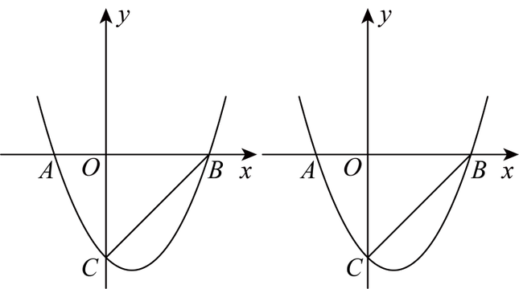

# Mathematics - 题目 1271

**ID**: 1c3ae48a72934ad0924067e96d4ec46a
**年级**: Grade 9
**难度**: Medium-Hard
**题型**: Calculation

## 题目
如图1，抛物线 $y=ax{^{2}}+bx-4$ 交x轴于点 $A\left ({-2，0}\right )$ 和点 $B\left ({4，0}\right )$ ，交 $y$ 轴于点 $C$ ．(1)求抛物线的表达式；​​​​​​​‌(2)若点 $P$ 是直线 $BC$ 下方抛物线上动点，连接 $PC$ ， $PB$ ，当 $\vartriangle BPC$ 的面积最大时，求点 $P$ 的坐标及面积的最大值；(3)在（2）的条件下，若点 $N$ 是直线 $BC$ 上的动点，在平面内，是否存在点 $Q$ ，使得以 $P$ ， $B$ ， $N$ ， $Q$ 分别为顶点的四边形是菱形？若存在，请求出符合条件的所有 $Q$ 点的坐标，若不存在，请说明理由．

## 解答

1. （1）解： $\because y=ax{^{2}}+bx-4$ 交 $x$ 轴于点 $A\left ({-2，0}\right )$ 和点 $B\left ({4，0}\right )$ ，
2. $\therefore $  $\begin{cases}0=4a-2b-4\\0=16a+4b-4\end{cases}$ ，
3. $\therefore $  $\begin{cases}a=\frac {1}{2}\\b=-1\end{cases}$ ，
4. $\therefore $  $y=\frac {1}{2}x{^{2}}-x-4$ ；
5. （2）解：当 $x=0$ 时， $y=-4$ ，
6. $\therefore C\left ({0，-4}\right )$ ，
7. 过点 $P$ 作 $PD\mathrm{/\mskip-4mu/}y$ 轴交 $BC$ 于点 $D$ ，
8. 
9. 设直线 $BC$ 的解析式为 $y=kx+t$ ，
10. 代入 $B\left ({4，0}\right )$ ， $C\left ({0，-4}\right )$ ，
11. 得 $\begin{cases}4k+t=0\\t=-4\end{cases}$ ，
12. 解得 $\begin{cases}k=1\\t=-4\end{cases}$ ，
13. $\therefore $ 直线 $BC$ 的解析式为 $y=x-4$ ，
14. 设点 $P\left ({x，\frac {1}{2}x{^{2}}-x-4}\right )\left ({0<x<4}\right )$ ，
15. $\therefore D\left ({x，x-4}\right )$ ，
16. $\therefore PD=\left ({x-4}\right )-\left ({\frac {1}{2}x{^{2}}-x-4}\right )=-\frac {1}{2}x{^{2}}+2x$ ，
17. $\because $  $S{{}_{\vartriangle PBC}}=\frac {1}{2}\cdot PD\cdot \left |{x{{}_{B}}-x{{}_{C}}}\right |=\frac {1}{2}\cdot \left ({-\frac {1}{2}x{^{2}}+2x}\right )\cdot 4=-x{^{2}}+4x=-{\left({x-2}\right)^{2}}+4$ ，
18. $\because $  $-1<0$ ，且 $0<x<4$ ，
19. $\therefore $ 当 $x=2$ ，即点 $P\left ({2，-4}\right )$ 时， $\mathrm{△}PBC$ 的面积取得最大值，最大值为4；
20. （3）解： $B\left ({4，0}\right )$ ， $P\left ({2，-4}\right )$ ， $N\left ({x，x-4}\right )$ ， $Q\left ({m，n}\right )$ ，
21. ①以 $BN$ ， $PQ$ 为对角线时， $BP=PN$ ，
22. $\therefore $  $\begin{cases}\frac {4+x}{2}=\frac {2+m}{2}\\\frac {0+x-4}{2}=\frac {-4+n}{2}\\{\left({4-2}\right)^{2}}+{\left({0+4}\right)^{2}}={\left({x-2}\right)^{2}}+{\left({x-4+4}\right)^{2}}\end{cases}$ ，
23. $\therefore $  $\begin{cases}x=-2\\m=0\\n=-2\end{cases}$ 或 $\begin{cases}x=4\\m=6\\n=4\end{cases}$ （舍 $)$ ，
24. $\therefore Q\left ({0，-2}\right )$ ；
25. ②以 $BQ$ ， $NP$ 为对角线时， $BP=BN$ ，
26. $\therefore $  $\begin{cases}\frac {4+m}{2}=\frac {x+2}{2}\\\frac {0+n}{2}=\frac {x-4-4}{2}\\{\left({4-2}\right)^{2}}+{\left({0+4}\right)^{2}}={\left({x-4}\right)^{2}}+{\left({x-4}\right)^{2}}\end{cases}$ ，
27. $\therefore $  $\begin{cases}x=4+\sqrt {10}\\m=2+\sqrt {10}\\n=\sqrt {10}-4\end{cases}$ 或 $\begin{cases}x=4-\sqrt {10}\\m=2-\sqrt {10}\\n=-4-\sqrt {10}\end{cases}$ ，
28. $\therefore Q\left ({2+\sqrt {10}，\sqrt {10}-4}\right )$ 或 $Q\left ({2-\sqrt {10}，-4-\sqrt {10}}\right )$ ；
29. ③以 $BP$ ， $NQ$ 为对角线， $BN=PN$ ，
30. $\therefore $  $\begin{cases}\frac {4+2}{2}=\frac {x+m}{2}\\\frac {0-4}{2}=\frac {x-4+n}{2}\$x-4){^{2}}+(x-4){^{2}}=(x-2){^{2}}+(x-4+4){^{2}}\end{cases}$ ，
31. $\therefore $  $\begin{cases}x=\frac {7}{3}\\m=\frac {11}{3}\\n=-\frac {7}{3}\end{cases}$ ，
32. $\therefore Q\left ({\frac {11}{3}，-\frac {7}{3}}\right )$ ；
33. 综上所述： $Q\left ({0，-2}\right )$ 或 $Q\left ({2+\sqrt {10}，\sqrt {10}-4}\right )$ 或 $Q\left ({2-\sqrt {10}，-4-\sqrt {10}}\right )$ 或 $Q\left ({\frac {11}{3}，-\frac {7}{3}}\right )$ ．

## 知识点

**中文**:
  - 二次函数的综合

**English**:
  - Comprehensive Quadratic Function Problems

---
