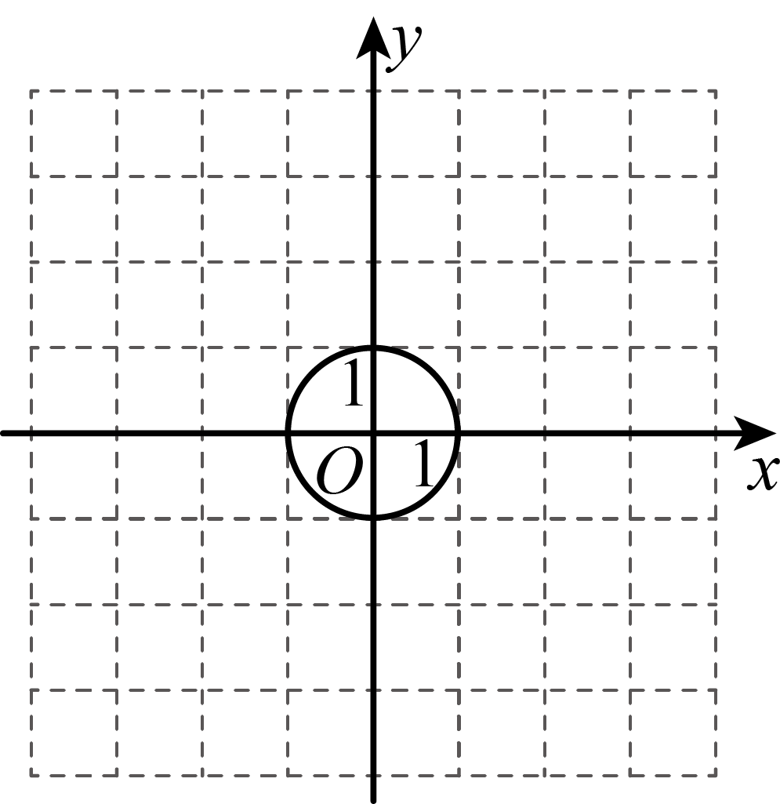

# Mathematics - 题目 2751

**ID**: 1f3f23c64e054292bb440bbca6cd0cae
**年级**: Grade 9
**难度**: Medium-Hard
**题型**: Calculation

## 题目
对于平面直角坐标系 $xOy$ 中的点P与 $\odot C$ ，若将点P绕着点C旋转 $α\left ({0{}\degree <α<180{}\degree }\right )$ 得到点Q，直线 $PQ$ 刚好与 $\odot C$ 相切，则称点P为 $\odot C$ 的“ $α$ 旋切点”．(1)已知 $\odot O$ 的半径为1，①在点 $P{{}_{1}}\left ({\frac {1}{2},\frac {1}{2}}\right )$ ， $P{{}_{2}}\left ({-1,0}\right )$ ， $P{{}_{3}}\left ({0,\sqrt {2}}\right )$ 中，点_是 $\odot O$ 的“ $α$ 旋切点”，其中 $α=$ _；​​​​​​​‌②已知点 $M\left ({\frac {\sqrt {3}}{2},\frac {1}{2}}\right )$ ，点N为 $\odot O$ 的“ $120{}\degree $ 旋切点”，且 $MN=\sqrt {3}$ ，求点 $N$ 的坐标；(2)已知点 $A\left ({-4,0}\right )$ ， $B\left ({0,3}\right )$ ， $C\left ({0,t}\right )$ ，若线段 $AB$ 上每个点都是 $\odot C$ 的“ $α$ 旋切点”，且 $0<α\leqslant 90{}\degree $ ，直接写出 $t$ 的取值范围．

## 解答

1. （1）解：如图：
2. 
3. 点 $P{{}_{1}}\left ({\frac {1}{2},\frac {1}{2}}\right )$ 绕点O旋转 $α$ 的对应点在以点O为圆心，半径为 $\frac {1}{2}$ 的圆上，此时，点 $P{{}_{1}}\left ({\frac {1}{2},\frac {1}{2}}\right )$ 与其对应点所在直线为 $\odot O$ 的弦，不会与 $\odot O$ 相切；
4. 点 $P{{}_{2}}\left ({-1,0}\right )$ 绕点O旋转 $α$ 的对应点在以点O为圆心，半径为 $1$ 的圆上，即两点都在 $\odot O$ 上，此时，点 $P{{}_{2}}\left ({-1,0}\right )$ 与其对应点所在直线为 $\odot O$ 的弦，不会与 $\odot O$ 相切；
5. 点 $P{{}_{3}}\left ({0,\sqrt {2}}\right )$ 绕点O旋转 $α$ 的对应点在以点O为圆心，半径为 $\sqrt {2}$ 的圆上，此时，点 $P{{}_{3}}\left ({0,\sqrt {2}}\right )$ 与其对应点所在直线会与 $\odot O$ 相切；
6. 如图，设点 $P{{}_{3}}\left ({0,\sqrt {2}}\right )$ 绕点O旋转 $α$ 的对应点为点 $T$ ，过点 $O$ 作 $OE\bot P{{}_{3}}T$ ，
7. 
8. 此时，点E在 $\odot O$ 上，即 $OE=1$ ， $\angle OEP{{}_{3}}=90{}\degree $ ，
9. ∵ $OP{{}_{3}}=\sqrt {2}$ ，
10. ∴ $P{{}_{3}}E=\sqrt {OP{{}_{3}}{^{2}}-OE{^{2}}}=1$ ，
11. ∴ $OP{{}_{3}}=OE$ ，
12. ∴ $\vartriangle OEP{{}_{3}}$ 是等腰直角三角形，
13. ∴ $\angle EOP{{}_{3}}=45{}\degree $ ，
14. 由旋转的性质得 $OP{{}_{3}}=OT$ ，
15. ∵ $\angle TEO=\angle P{{}_{3}}EO=90{}\degree ,OE=OE$ ，
16. ∴ ${\rm{R}}{\rm{t}}\vartriangle OEP{{}_{3}}≌{\rm{R}}{\rm{t}}\vartriangle OET\left ({{\rm{H}}{\rm{L}}}\right )$ ，
17. ∴ $\angle TOE=\angle EOP{{}_{3}}=45{}\degree $ ，
18. ∴ $\angle TOP{{}_{3}}=90{}\degree $ ，
19. ∴ $α=90{}\degree $ ；
20. ②∵ $M\left ({\frac {\sqrt {3}}{2},\frac {1}{2}}\right )$ ，
21. ∴ $OM=\sqrt {{\left({\frac {\sqrt {3}}{2}}\right)^{2}}+{\left({\frac {1}{2}}\right)^{2}}}=1$ ，
22. ∴点M在 $\odot O$ 上，
23. ∵ $MN=\sqrt {3}$ ，
24. ∴点 $N$ 在以点M为圆心，半径为 $\sqrt {3}$ 的圆上，
25. 设点N绕着点O旋转 $120{}\degree $ 得到点 $N^{′}$ ，连接 $NN^{′}$ ，过点 $M$ 作 $MG\bot x$ 轴，垂足为 $G$ ，根据题意 $NN^{′}$ 是 $\odot O$ 的切线，设切点为F，
26. 如图，当点N绕着点O逆时针旋转 $120{}\degree $ 时，
27. 
28. 则 $\angle NON^{′}=120{}\degree $ ，
29. 同理①得： $\angle NOF=\angle N^{′}OF=\frac {1}{2}\angle NON^{′}=60{}\degree $ ，
30. ∴ $\angle ONF=\angle ON^{′}F=30{}\degree $ ，
31. ∵ $\angle OFN=90{}\degree ,OF=1$ ，
32. ∴ $NF=OF·{\tan}\angle NOE=\sqrt {3}$ ，
33. ∴ $MN=NF$ ，
34. ∵ $OF=OM,ON=ON$ ，
35. ∴ $\vartriangle ONF≌\vartriangle ONM\left ({{\rm{S}}{\rm{S}}{\rm{S}}}\right )$ ，
36. ∴ $\angle OMN=\angle OFN=90{}\degree ,\angle ONM=\angle ONF,\angle NOF=\angle NOM=60{}\degree $ ，
37. ∴ $\angle NOM+\angle NON^{′}=180{}\degree $ ，
38. ∴ $M,O,N^{′}$ 三点共线，
39. ∵点 $M\left ({\frac {\sqrt {3}}{2},\frac {1}{2}}\right )$ ， $MG\bot x$ 轴，
40. ∴ $MG=\frac {1}{2},OG=\frac {\sqrt {3}}{2}$ ，
41. ∴ ${\tan}\angle MOG=\frac {MG}{OG}=\frac {\sqrt {3}}{3}$ ，
42. ∴ $\angle MOG=30{}\degree $ ，
43. ∴ $\angle NOM+\angle MOG=90{}\degree $ ，
44. ∴ $N$ 点在y轴上，
45. ∵ $ON=\sqrt {OM{^{2}}+MN{^{2}}}=2$ ，
46. ∴ $N\left ({0,2}\right )$ ；
47. 如图，当点N绕着点O顺时针旋转 $120{}\degree $ 时，
48. 
49. 同理可得： $N^{′}$ 点在y轴上，且 $N^{′}{\left ({0,2}\right )}$ ，
50. ∴ $ON^{′}=2$ ，
51. 此时，点 $F,M$ 重合，
52. 由旋转的性质得： $ON=ON^{′}=2$ ，
53. ∵ $\angle NON^{′}=120{}\degree $ ，
54. ∴ $\angle NOH=60{}\degree $ ，
55. ∵ $\angle NHO=90{}\degree $ ，
56. ∴ $OH=ON·{\cos}\angle NOH=1$ ， $NH=ON·\sin \angle NOH=\sqrt {3}$ ，
57. ∴ $N\left ({\sqrt {3},-1}\right )$ ；
58. 综上，点N的坐标为 $\left ({0,2}\right )$ 或 $\left ({\sqrt {3},-1}\right )$ ；
59. （2）解：设 $\odot C$ 半径为r，如图，点P绕着点C顺时针旋转 $α\left ({0{}\degree <α\leqslant 90{}\degree }\right )$ 得到点 $P^{′}$ ，点P绕着点C逆时针旋转 $α\left ({0{}\degree <α\leqslant 90{}\degree }\right )$ 得到点 $P{^{^{′′}}}$ ，点P为 $\odot C$ 的“ $α$ 旋切点”时，
60. 
61. 由（1）可得： $\angle CPP^{′}=\angle 1=45{}\degree $ ，
62. ∴ $CP=\sqrt {2}r$ ，
63. 同理： $CG=\frac {\sqrt {2}}{2}r$ ，
64. 则要使点P是 $\odot C$ 的“ $α$ 旋切点”，需满足 $\frac {\sqrt {2}}{2}r\leqslant CP\leqslant \sqrt {2}r$ ，
65. ∴要使得线段 $AB$ 上每个点都是 $\odot C$ 的“ $α$ 旋切点”，且 $0<α\leqslant 90{}\degree $ ，
66. 则线段 $AB$ 上每个点都得在以点C为圆心，半径为 $\frac {\sqrt {2}}{2}r$ 的圆的外部，且在以点C为圆心，半径为 $\sqrt {2}r$ 的圆的内部（或圆上），
67. 如图，过点C作 $CH\bot AB$ 于点H，以 $CH$ 为腰在 $CH$ 左侧作等腰直角三角形 $CHD$ ，则点D在直线 $AB$ 上，则 $CD=\sqrt {2}CH$ ，以 $CH$ 为斜边在 $CH$ 下方作等腰直角三角形 $CHG$ ，则 $CG=\frac {\sqrt {2}}{2}r$ ，
68. 
69. ∴当线段 $AB$ 上每个点都得在以点C为圆心， $CG$ 为半径的圆的外部，且在以点C为圆心， $CD$ 为半径的圆的内部（或圆上）时，线段 $AB$ 上每个点都是 $\odot C$ 的“ $α$ 旋切点”，且 $0<α\leqslant 90{}\degree $ ，即 $CD\geqslant CA$ 且 $CD\geqslant CB$ ，
70. 当点C在点B下方时，即 $t<3$ ，
71. 
72. ∵ $A\left ({-4,0}\right )$ ， $B\left ({0,3}\right )$ ， $C\left ({0,t}\right )$ ，
73. ∴ $OA=4,OB=3$ ， $BC=3-t$ ，
74. ∴ $AB=\sqrt {OA{^{2}}+OB{^{2}}}=5$ ， $OC=\left |{t}\right |$ ，
75. ∴ $\sin \angle OBA=\frac {OA}{AB}=\frac {4}{5}=\frac {CH}{BC}$ ，
76. ∴ $CH=\frac {4}{5}BC=\frac {12-4t}{5}$ ，即 $r=\frac {12-4t}{5}$ ，
77. 当 $CA=\sqrt {2}\times \frac {12-4t}{5}$ 时，则 $\angle HAC=45{}\degree $ ，即 $A,D$ 两点重合，
78. 此时，点C在x轴下方，则 $OC=-t$ ，
79. 满足 $CA{^{2}}=OA{^{2}}+OC{^{2}}$ ，即 ${\left({\sqrt {2}\times \frac {12-4t}{5}}\right)^{2}}=16+{\left({-t}\right)^{2}}$ ，
80. 整理得： $7t{^{2}}-192t-112=0$ ，即 $\left ({t-28}\right )\left ({7t+4}\right )=0$ ，
81. 解得： $t=-\frac {4}{7}$ 或 $t=28>3$ （舍去）
82. 此时， $CA=\frac {19\sqrt {2}}{5}$ ， $CB=3-\left ({-\frac {7}{4}}\right )=\frac {19}{4}$ ，
83. ∵ $\frac {19\sqrt {2}}{5}>\frac {19}{4}$ ，
84. ∴当 $CD\geqslant \frac {19\sqrt {2}}{5}$ 时，线段 $AB$ 上每个点都得在以点C为圆心， $CH$ 为半径的圆的外部，且在以点C为圆心， $CD$ 为半径的圆的内部（或圆上），符合题意；
85. ∴ $t\leqslant -\frac {4}{7}$ ；
86. 当点C与点B上重合时，即 $t=3$ ，不符合题意；
87. 当点C在点B上方时，即 $t>3$ ，
88. 
89. 同理得： $CH=\frac {4t-12}{5}$ ，
90. 当 $CA=\sqrt {2}\times \frac {4t-12}{5}$ 时，则 $\angle HAC=45{}\degree $ ，即 $A,D$ 两点重合，
91. 此时， $OC=t$ ，
92. 满足 $CA{^{2}}=OA{^{2}}+OC{^{2}}$ ，即 ${\left({\sqrt {2}\times \frac {4t-12}{5}}\right)^{2}}=16+t{^{2}}$ ，
93. 整理得： $7t{^{2}}-192t-112=0$ ，即 $\left ({t-28}\right )\left ({7t+4}\right )=0$ ，
94. 解得： $t=-\frac {4}{7}<3$ （舍去）或 $t=28$ ，
95. 此时， $CA=20\sqrt {2}$ ， $CB=28-3=25$ ，
96. ∵ $20\sqrt {2}>25$ ，
97. ∴当 $CD\geqslant 20\sqrt {2}$ 时，线段 $AB$ 上每个点都得在以点C为圆心， $CH$ 为半径的圆的外部，且在以点C为圆心， $CD$ 为半径的圆的内部（或圆上），符合题意；
98. ∴ $t\geqslant 28$ ；
99. 综上， $t$ 的取值范围为： $t\leqslant -\frac {4}{7}$ 或 $t\geqslant 28$ ．

## 知识点

**中文**:
  - 几何变换——旋转综合题
  - 切线的性质定理
  - 解直角三角形

**English**:
  - Rotation Comprehensive Problems
  - Tangent Properties Theorem
  - Solving Right Triangles

---
