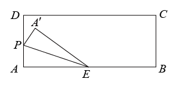

# Mathematics - 题目 3436

**ID**: 1f68828350e1493c9b4c70e04dfc54d3
**年级**: Grade 9
**难度**: Medium-Hard
**题型**: Calculation

## 题目
如图，在矩形 $ABCD$ 中， $AB=10$ ， $AD=4$ ，点 $E$ 为边 $AB$ 的中点．动点 $P$ 从点 $A$ 出发，沿射线 $AD$ 以每秒1个单位长度的速度运动，当点 $P$ 不与点A重合时，连接 $PE$ ．作点A关于直线 $PE$ 的对称点 $A^{′}$ ，连接 $A^{′}P$ 、 $A^{′}E$ ，设点 $P$ 的运动时间为 $t\left ({t>0}\right )$ 秒．(1)线段 $A^{′}E$ 的长为．(2)用含 $t$ 的代数式表示线段 $DP\left ({DP>0}\right )$ 的长．(3)当 ${\tan}\angle A^{′}EB=\frac {3}{4}$ 时，求 $t$ 的值．(4)当点 $A^{′}$ 在矩形 $ABCD$ 内部（不包括边界）时，直接写出 $t$ 的取值范围．​​​​​​​‌

## 解答

1. （1）解： $\because AB=10$ ，点 $E$ 为边 $AB$ 的中点，
2. $\therefore AE{\rm{=}}5$ ，
3. $\because $ 点A关于直线 $PE$ 的对称点是点 $A^{′}$ ，
4. $\therefore A\prime E{\rm{=}}AE{\rm{=}}5$ ，
5. 故答案为：5；
6. （2）解：当点P在线段AD上时， $DP=4-t\left ({0{\rm{<}}t\leqslant 4}\right )$ ，
7. 当点P在点D的上方时， $DP{\rm{=}}t-4\left ({t{\rm{>}}4}\right )$ ，
8. 故 $DP=\left \{\begin{array}{}4-t(0<t\leqslant 4)\\t-4(t>4)\end{array}\right.$ ；
9. （3）解：如图：过点 $A′$ 作 $A\prime M\bot AB$ 于点 $M$ ， $A\prime N\bot AD$ 于点N，
10. 
11. $\because {\tan}\angle A^{′}EB{\rm{=}}\frac {A\prime M}{EM}=\frac {3}{4}$ ，
12. $\therefore $ 设 $A\prime M{\rm{=}}3x$ ，EM=4x，
13. 在 $Rt{\rm{△}}A\prime EM$ 中， $\because A\prime E{\rm{=}}5$ ， $A\prime E{{}^{2}}{\rm{=}}AM{{}^{2}}+EM{{}^{2}}$ ，
14. $\therefore 5{{}^{2}}{\rm{=}}\left ({3x}\right ){{}^{2}}+\left ({4x}\right ){{}^{2}}$ ，解得x=1(负值舍去)，
15. $\therefore A\prime M{\rm{=}}3$ ， $EM{\rm{=}}4$ ，
16. $\because \angle A{\rm{=}}\angle A\prime NA{\rm{=}}\angle A\prime ME{\rm{=}}90{}^\circ $ ，
17. $\therefore $ 四边形 $AMA\prime N$ 是矩形，
18. $\therefore $  $A\prime M{\rm{=}}AN{\rm{=}}3$ ， $A\prime N{\rm{=}}AM{\rm{=}}{\rm{5}}{\rm{+}}{\rm{4}}{\rm{=}}9$ ，
19. $\because PN{\rm{=}}AP-AN{\rm{=}}t-3$ ， $PA\prime {\rm{=}}AP{\rm{=}}t$ ， $A\prime P{{}^{2}}{\rm{=}}PN{{}^{2}}+A\prime N{{}^{2}}$ ，
20. $\therefore t{{}^{2}}=\left ({t-3}\right ){{}^{2}}+9{{}^{2}}$ ，
21. 解得t=15；
22. （4）解：当点 $A′$ 在DC边上时，过点E作 $EM\bot DC$ 于点M，
23. 
24. 则EM=BC=4， $A\prime E{\rm{=}}AE{\rm{=}}5$ ，DM=AE=5， $A\prime P{\rm{=}}AP{\rm{=}}t$ ，DP=4-t，
25. $\because A\prime E{{}^{2}}{\rm{=}}A\prime M{{}^{2}}+EM{{}^{2}}$ ，
26. $\therefore 5{{}^{2}}{\rm{=}}A\prime M{{}^{2}}+4{{}^{2}}$ ，解得 $A\prime M{\rm{=}}3$ (负值舍去)，
27. $\therefore A\prime D{\rm{=}}DM-A\prime M{\rm{=}}5-3{\rm{=}}2$
28. $\because A\prime P{{}^{2}}{\rm{=}}A\prime D{{}^{2}}+DP{{}^{2}}$ ，
29. $\therefore t{{}^{2}}=2{{}^{2}}+\left ({4-t}\right ){{}^{2}}$ ，解得 $t=\frac {5}{2}$ ，
30. 故当 $0{\rm{<}}t{\rm{<}}\frac {5}{2}$ 时，点 $A^{′}$ 在矩形 $ABCD$ 内部；
31. 当点 $A′$ 在DC边上时，过点 $A^{′}$ 作 $A\prime N\bot AB$ 于点N，
32. 
33. 则 $A^{′}N{\rm{=}}BC{\rm{=}}4$ ， $A\prime E{\rm{=}}AE{\rm{=}}5$ ， $A\prime P{\rm{=}}AP{\rm{=}}t$ ，DP=t-4，
34. $\because A\prime E{{}^{2}}{\rm{=}}A\prime N{{}^{2}}+EN{{}^{2}}$ ，
35. $\therefore 5{{}^{2}}{\rm{=}}EN{{}^{2}}+4{{}^{2}}$ ，解得 $EN{\rm{=}}3$ (负值舍去)，
36. $\therefore A\prime D=AN{\rm{=}}AE+EN{\rm{=}}5+3{\rm{=}}{\rm{8}}$
37. $\because A\prime P{{}^{2}}{\rm{=}}A\prime D{{}^{2}}+DP{{}^{2}}$ ，
38. $\therefore t{{}^{2}}=8{{}^{2}}+\left ({t-4}\right ){{}^{2}}$ ，解得 $t=10$ ，
39. 故当 $t{\rm{>}}10$ 时，点 $A^{′}$ 在矩形 $ABCD$ 内部，
40. 综上，当 $0<t<\frac {5}{2}$ 或 $t>10$ 时，点 $A^{′}$ 在矩形 $ABCD$ 内部．
41. 【点睛】本题考查了轴对称图形的性质，动点问题中的用字母表示相关线段的长，正切函数的定义，勾股定理，矩形的判定与性质，采用分类讨论的思想是解决本题的关键．

## 知识点

**中文**:
  - 正切
  - 矩形的判定与性质综合
  - 轴对称的性质

**English**:
  - Tangent
  - Determination and Properties of Rectangles
  - Properties of Axial Symmetry

---
