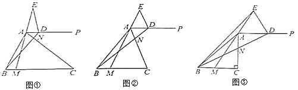

# Mathematics - 题目 3154

**ID**: 210d27aea1014bc0a91b2c1e4b3e41cd
**年级**: Grade 9
**难度**: Medium-Hard
**题型**: Calculation

## 题目
在 $\Delta ABC$ 中， $CA=CB$ ， $0°<\angle C\leqslant 90°$ .​​​​​​​‌过点 $A$ 作射线 $AP//BC$ ，点 $BC$ 、 $AC$ 分别在边 $BC$ 、 $AC$ 上（点 $M$ 、 $N$ 不与所在线段端点重合），且 $BM=AN$ ，连结 $BN$ 并延长交 $AP$ 于点 $D$ ，连结 $MA$ 并延长交 $AD$ 的垂直平分线于点 $E$ ，连结 $ED$ .（猜想）如图①，当 $\angle C=45°$ 时，可证 $\Delta BCN\cong \Delta ACM$ .从而得出 $\angle CBN=\angle CAM$ ，进而得出 $\angle BDE$ 的大小为多少度.（探究）如图②，若 $\angle C=\alpha $ .（1）求证： $\Delta BCN\cong \Delta ACM$ .（2） $\angle BDE$ 的大小为多少度（用含 $\alpha $ 的代数式表示）（应用）如图③，当 $\angle C=90°$ 时，连结 $BE$ .若 $BC=3$ ， $\angle BAM=15°$ ，则 $\Delta BDE$ 的面积为多少.

## 解答

1. 解：
2. [猜想] $\angle BDE$ 的大小为 $135$ °．
3. ，
4. 理由如下：证明： $\because $   $CA=CB$ ， $BM=AN$
5. $\therefore $   $CA-AN=CB-BM$
6. $\therefore $   $MC=NC$
7. 又 $\because $   $\angle C=\angle C$
8. $\because $   $\Delta BCN\cong \Delta ACM$ ．
9. ∴ $\angle CBN=\angle CAM$ ，
10. ∵AD∥BC，
11. ∴∠DBC=∠BDA，∠CAD=∠C=45°.
12. ∴∠BDA=∠CAM，
13. 又∵E点在的垂直平分线上.
14. ∴AE=DE
15. ∴∠EDA=∠EAD，
16. ∴∠BDA+∠EDA=∠CAM+∠EAD，
17. ∴∠BDE=180°-∠CAD=180°-45°=135°.
18. [探究]（1）证明： $\because $   $CA=CB$ ， $BM=AN$
19. $\therefore $   $CA-AN=CB-BM$
20. $\therefore $   $MC=NC$
21. 又 $\because $   $\angle C=\angle C$
22. $\because $   $\Delta BCN\cong \Delta ACM$ ．
23. （2） $\angle BDE$ 的大小为（ $180°-\alpha $ ）度．
24. 理由如下：由（1）得： $\Delta BCN\cong \Delta ACM$ ．
25. ∴ $\angle CBN=\angle CAM$ ，
26. ∵AD∥BC，
27. ∴∠DBC=∠BDA，∠CAD=∠C=α.
28. ∴∠BDA=∠CAM，
29. 又∵E点在的垂直平分线上.
30. ∴AE=DE
31. ∴∠EDA=∠EAD，
32. ∴∠BDA+∠EDA=∠CAM+∠EAD，
33. ∴∠BDE=180°-∠CAD=180°-α.
34. [应用] $\Delta BDE$ 的面积为 $9\sqrt{3}-9$ ，
35. 
36. 过D点作DH垂直于BC交BC延长线于H点，
37. ∵∠ACB=90°，BC=AC，
38. ∴∠ABC=∠BAC=45°，
39. 又∵ $\angle BAM=15°$ ，
40. ∴∠DBC=30°，
41. ∵AD∥BC，DH⊥BC，AC⊥BC，
42. ∴四边形ACHD是矩形，
43. ∴AC=DH=BC=3，AD=CH,
44. ∴BD=6，BH= $\sqrt{B{D}^{2}-D{H}^{2}}$ = $3\sqrt{3}$ ，
45. ∴AD=CH= $3\sqrt{3}$ -3，
46. 由（2）的∠EDB=∠C=90°，∠ADB=∠DBC=30°，
47. ∴∠ADE=60°，
48. ∴DE=AD= $3\sqrt{3}$ -3，
49. ∴Rt△BDE的面积= $\frac{1}{2}×BD×DE$ = $\frac{1}{2}×6×(3\sqrt{3}-3)$ = $9\sqrt{3}-9$ .

## 知识点

**中文**:
  - 全等三角形实际应用
  - 等边三角形的判定与性质
  - 含30度角的直角三角形
  - 勾股定理的应用

**English**:
  - Applications of Congruent Triangles
  - Determination and Properties
  - Right Triangle with 30° Angle
  - Applications of Pythagorean Theorem

---
