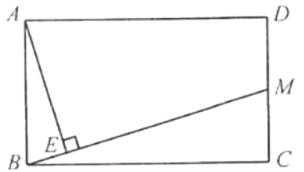
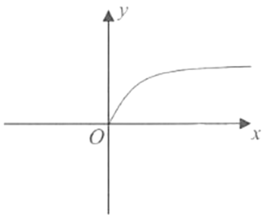

# Mathematics - 题目 2547

**ID**: 21a7f50737384d0da51f427610cb3bc3
**年级**: Grade 9
**难度**: Medium-Hard
**题型**: Calculation

## 题目
【问题情境  建构函数】（1）如图1，在矩形 $ABCD$ 中， $AB=4,M$ 是 $CD$ 的中点， $AE⊥BM$ ，垂足为 $E$ ．设 $BC=x,AE=y$ ，试用含 $x$ 的代数式表示 $y$ ．【由数想形  新知初探】（2）在上述表达式中， $y$ 与 $x$ 成函数关系，其图像如图2所示．若 $x$ 取任意实数，此时的函数图像是否具有对称性？若有，请说明理由，并在图2上补全函数图像．【数形结合  深度探究】（3）在“ $x$ 取任意实数”的条件下，对上述函数继续探究，得出以下结论：①函数值 $y$ 随 $x$ 的增大而增大；​​​​​​​‌②函数值 $y$ 的取值范围是 $-4\sqrt {2}<y<4\sqrt {2}$ ；③存在一条直线与该函数图像有四个交点；④在图像上存在四点 $A、B、C、D$ ，使得四边形 $ABCD$ 是平行四边形．其中正确的是．（写出所有正确结论的序号）【抽象回归  拓展总结】（4）若将（1）中的“ $AB=4$ ”改成“ $AB=2k$ ”，此时 $y$ 关于 $x$ 的函数表达式是；一般地，当 $k\ne 0,x$ 取任意实数时，类比一次函数、反比例函数、二次函数的研究过程，探究此类函数的相关性质（直接写出3条即可）．

## 解答

1. （1）在矩形 $ABCD$ 中， $\angle ABC=\angle BCM=90{}^\circ $ ，
2. ∴ $\angle ABE+\angle MBC=90{}^\circ $ ．
3. ∵ $AE⊥BM$ ，
4. ∴ $\angle AEB=90{}^\circ $ ，
5. ∴ $\angle BAE+\angle ABE=90{}^\circ $ ．
6. ∴ $\angle AEB=\angle BCM,\angle MBC=\angle BAE$ ．
7. ∴ ${\rm{R}}{\rm{t}}\vartriangle ABE∽{\rm{R}}{\rm{t}}\vartriangle BMC$ ，∴ $\frac {AB}{BM}=\frac {AE}{BC}$ ．
8. ∵ $AB=4$ ，点 $M$ 是 $CD$ 的中点，∴ $CM=\frac {1}{2}CD=\frac {1}{2}AB=2$ ．
9. 在 ${\rm{R}}{\rm{t}}\mathrm{△}BMC$ 中， $BM=\sqrt {BC{{}^{2}}+CM{{}^{2}}}=\sqrt {x{{}^{2}}+2{{}^{2}}}=\sqrt {x{{}^{2}}+4}$ ，
10. ∴ $\frac {4}{\sqrt {x{{}^{2}}+4}}=\frac {y}{x}$ ．∴ $y=\frac {4x}{\sqrt {x{{}^{2}}+4}}=\frac {4x\sqrt {x{{}^{2}}+4}}{x{{}^{2}}+4}$ ．
11. ∴ $y$ 关于 $x$ 的表达式为： $y=\frac {4x\sqrt {x{{}^{2}}+4}}{x{{}^{2}}+4}(x>0)$ ．
12. （2） $x$ 取任意实数时，对应的函数图像关于原点成中心对称．
13. 理由如下：
14. 若 $P\left ({a,b}\right )$ 为图像上任意一点，则 $b=\frac {4a\sqrt {a{{}^{2}}+4}}{a{{}^{2}}+4}$ ．
15. 设 $P\left ({a,b}\right )$ 关于原点的对称点为 $Q$ ，则 $Q\left ({-a,-b}\right )$ ．
16. 当 $x=-a$ 时，
17. $y=\frac {4\left ({-a}\right )\sqrt {\left ({-a}\right ){{}^{2}}+4}}{\left ({-a}\right ){{}^{2}}+4}=-\frac {4a\sqrt {a{{}^{2}}+4}}{a{{}^{2}}+4}=-b$ ．
18. ∴ $Q\left ({-a,-b}\right )$ 也在 $y=\frac {4x\sqrt {x{{}^{2}}+4}}{x{{}^{2}}+4}$ 的图像上．
19. ∴当 $x$ 取任意实数时， $y=\frac {4x\sqrt {x{{}^{2}}+4}}{x{{}^{2}}+4}$ 的图像关于原点对称．
20. 函数图像如图所示．
21. 
22. （3）根据函数图象可得①函数值 $y$ 随 $x$ 的增大而增大，故①正确，
23. ②由(1)可得函数值 $\left |{y}\right |<AB$ ，故函数值的范围为 $-4<y<4$ ，故②错误；
24. ③根据中心对称的性质，不存在一条直线与该函数图像有四个交点，故③错误；
25. ④因为平行四边形是中心对称图形，则在图像上存在四点 $A、B、C、D$ ，使得四边形 $ABCD$ 是平行四边形，故④正确；
26. 故答案为：①④．
27. （4） $y$ 关于 $x$ 的函数表达式为 $y=\frac {2kx\sqrt {x{{}^{2}}+k{{}^{2}}}}{x{{}^{2}}+k{{}^{2}}}(x>0,k>0)$ ；
28. 当 $k\ne 0,x$ 取任意实数时，有如下相关性质：
29. 当 $k>0$ 时，图像经过第一、三象限，函数值 $y$ 随 $x$ 的增大而增大， $y$ 的取值范围为 $-2k<y<2k$ ；
30. 当 $k<0$ 时，图像经过第二、四象限，函数值 $y$ 随 $x$ 的增大而减小， $y$ 的取值范围为 $2k<y<-2k$ ；
31. 函数图像经过原点；
32. 函数图像关于原点对称；
33. 【点睛】本题考查了相似三角形的性质，中心对称的性质，根据函数图象获取信息，根据题意求得解析式是解题的关键．

## 知识点

**中文**:
  - 关于原点对称的点的坐标
  - 相似三角形的判定与性质综合

**English**:
  - Points Symmetric about Origin
  - Determination and Properties

---
