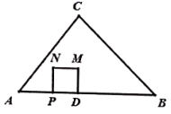

# Mathematics - 题目 2057

**ID**: 21d3a6a79db2464b9c24a6e69f10821d
**年级**: Grade 9
**难度**: Medium-Hard
**题型**: Calculation

## 题目
在中，，，，点D在边AB上，且，动点P从点A出发，以每秒1个单位长度的速度向终点B运动，以PD为边向上做正方形，设点P运动的时间为秒，正方形与重叠部分的面积为．（1）用含有的代数式表示线段的长．（2）当点落在的边上时，求的值．（3）求与的函数关系式．（4）当点P在线段AD上运动时，做点N关于CD的对称点，当与的某一个顶点的连线平分的面积时，求的值．​​​​​​​‌

## 解答

1. 解：（1）如图1中，作CD′⊥AB于D．
2. 
3. ∵∠B＝45°，BC＝4，
4. ∴CD′＝BD′＝4，
5. 又∵CD′⊥AB，，
6. ∴在Rt△ACD′中，
7. AD′＝，
8. ∵AD＝3，
9. ∴AD＝AD′，
10. ∴D′与D重合，
11. 当0＜t⩽3时，PD＝3﹣t．
12. 当3＜t⩽7时，PD＝t﹣3．
13. （2）①如图2中，当点N在AC上时，
14. 
15. ∵MN∥AD，
16. ∴，
17. ∴，
18. 解得t＝．
19. ②如图3中，当点N在BC上时，
20. 
21. ∵MN∥BD，
22. ∴，
23. ∴，
24. 解得t＝5
25. 综上所述，满足条件的t的值为s或5s．
26. （3）①如图4中，当0＜t⩽时，重叠部分是五边形EFPDM，
27. 
28. s＝S_{正方形}_{MDPN}﹣S_{△}_{NEF}＝（3﹣t）^{2}﹣
29. ②如图5或6中，当＜t⩽5时，重叠部分是正方形PDMN，s＝t^{2}﹣6t+9
30. 
31. ③如图7中，当5＜t⩽7时，重叠部分是五边形EFPDM，s＝S_{正方形}_{MNPD}﹣S_{△}_{EFN}＝（t﹣3）^{2}﹣•[（t﹣3）﹣（7﹣t）]^{2}＝﹣t^{2}+14t﹣41．
32. 
33. 综上所述，．
34. （4）如图8中，当点N′落在中线AE上时，作EK⊥BC于K，N′J⊥AB于J．
35. 
36. ∵JN′∥EK，
37. ∴，
38. 则有，
39. 解得t＝1．
40. 如图9中，当点N′落在中线BG上时，作GK⊥BC于K，N′J⊥AB于J．
41. 
42. ∵N′J∥GK，
43. ∴，
44. ∴，
45. 解得t＝．
46. 如图10中，当点N′落在中线CF上时，
47. 
48. ∵MN′∥DF，
49. ∴，
50. ∴，
51. 解得t＝．
52. 综上所述，满足条件的t的值为1s或s或s．

## 知识点

**中文**:
  - 四边形综合
  - 正方形的性质
  - 轴对称的性质
  - 平行线分线段成比例定理
  - 相似三角形的判定与性质综合
  - 解直角三角形

**English**:
  - Comprehensive Quadrilateral Problems
  - Properties of Squares
  - Properties of Axial Symmetry
  - Parallel Lines Intercept Theorem
  - Determination and Properties
  - Solving Right Triangles

---
