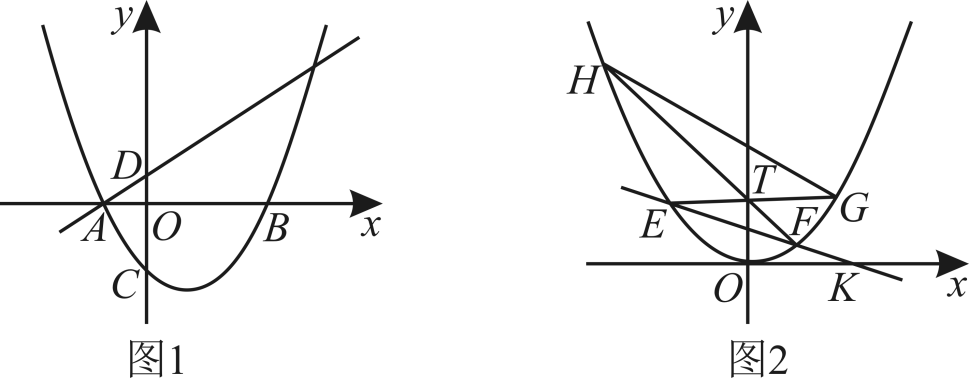

# Mathematics - 题目 916

**ID**: 25ba48a6b47f48329e30bfe03a21de34
**年级**: Grade 9
**难度**: Medium-Hard
**题型**: Calculation

## 题目
如图，抛物线 $y=a{\left({x-1}\right)^{2}}-4a$ 与x轴交于A，B两点，与y轴负半轴交于点 ${\rm \mathit{C}，}OC=\frac {3}{2}$ ．(1)直接写出抛物线的解析式为；​​​​​​​‌(2)如图1，若 $D\left ({0,\frac {1}{2}}\right )$ 为y轴上一点，M是直线 $AD$ 上一点（不与D重合），点N是抛物线上一点．若线段 $MN$ 与 $CD$ 恰好关于平面内一点P成中心对称，求点P的横坐标；(3)如图2，平移抛物线使其顶点为原点，过 $K\left ({2,0}\right )$ 的直线交平移后的抛物线于E，F两点， $T\left ({0,t}\right )$ 是y轴正半轴上一点，直线 $ET$ 交抛物线于另一点G，直线 $FT$ 交抛物线于另一点H，设直线 $HG$ 的解析式为 $y=px+q$ ，试求 $\frac {t}{p}$ 的值．

## 解答

1. （1）解：∵ $OC=\frac {3}{2}$ ，
2. ∴ $C\left ({0,-\frac {3}{2}}\right )$ ，
3. 将 $C\left ({0,-\frac {3}{2}}\right )$ 代入 $y=a{\left({x-1}\right)^{2}}-4a$ 得 $a-4a=-\frac {3}{2}$ ，
4. 解得 $a=\frac {1}{2}$ ，
5. ∴抛物线的解析式为 $y=\frac {1}{2}{\left({x-1}\right)^{2}}-2=\frac {1}{2}x{^{2}}-x-\frac {3}{2}$ ，
6. 故答案为 $y=\frac {1}{2}x{^{2}}-x-\frac {3}{2}$ 或 $y=\frac {1}{2}{\left({x-1}\right)^{2}}-2$ ；
7. （2）解：令 $y=\frac {1}{2}{\left({x-1}\right)^{2}}-2=0$ ，解得 $x{{}_{1}}=3,x{{}_{2}}=-1$ ，
8. ∴ $A\left ({-1,0}\right )$ ， $B\left ({3,0}\right )$ ，
9. 设直线 $AD$ 解析式为 $y=k{{}_{4}}x+b{{}_{4}}$ ，代入 $D\left ({0,\frac {1}{2}}\right )$ ， $A\left ({-1,0}\right )$ 得 $\begin{cases}\frac {1}{2}=b{{}_{4}}\\0=-k{{}_{4}}+b{{}_{4}}\end{cases}$ ，解得 $k{{}_{4}}=b{{}_{4}}=\frac {1}{2}$ ，
10. ∴直线 $AD$ 解析式为 $y=\frac {1}{2}x+\frac {1}{2}$ ，
11. ∵线段 $MN$ 与 $CD$ 恰好关于平面内一点P成中心对称， $CD$ 都在 $y$ 轴上，
12. ∴点P是以 $MN$ 和 $CD$ 为对边的平行四边形的对角线交点，
13. ∴ $MN\bot x$ 轴，且 $MN=CD=2$ ，点P的横坐标为 $\frac {x{{}_{M}}}{2}$ ，
14. ∵M是直线 $AD$ 上一点（不与D重合），点N是抛物线上一点，
15. ∴设 $M\left ({m,\frac {1}{2}m+\frac {1}{2}}\right )$ ， $N\left ({m,\frac {1}{2}m{^{2}}-m-\frac {3}{2}}\right )$ ，
16. ∴ $MN=\left |{\frac {1}{2}m+\frac {1}{2}-\left ({\frac {1}{2}m{^{2}}-m-\frac {3}{2}}\right )}\right |=\left |{-\frac {1}{2}m{^{2}}+\frac {3}{2}m+2}\right |$ ，点P的横坐标为 $\frac {m}{2}$ ，
17. ∵ $MN=CD=2$ ，
18. ∴ $\left |{-\frac {1}{2}m{^{2}}+\frac {3}{2}m+2}\right |=2$ ，
19. 分以下两种情况：
20. 当 $-\frac {1}{2}m{^{2}}+\frac {3}{2}m+2=2$ 时，解得 $m{{}_{1}}=0$ （不合题意，舍去）， $m{{}_{2}}=3$ ，此时点P的横坐标为 $\frac {3}{2}$ ；
21. 当 $-\frac {1}{2}m{^{2}}+\frac {3}{2}m+2=-2$ 时，解得 $m{{}_{1}}=\frac {3+\sqrt {41}}{2}$ ， $m{{}_{2}}=\frac {3-\sqrt {41}}{2}$ ，此时点P的横坐标为 $\frac {3+\sqrt {41}}{4}$ ， $\frac {3-\sqrt {41}}{4}$ ；
22. 综上所述，点P的横坐标为 $\frac {3}{2}$ 或 $\frac {3+\sqrt {41}}{4}$ 或 $\frac {3-\sqrt {41}}{4}$ ；
23. （3）解：依题意，平移后的抛物线为 $y=\frac {1}{2}x{^{2}}$ ，
24. 设直线 $EF$ 的解析式为 $y=kx+b$ ，
25. ∵ $K\left ({2,0}\right )$ 在直线 $EF$ 上，
26. ∴ $0=2k+b$ ，解得 $b=-2k$ ，
27. ∴直线 $EF$ 的解析式为 $y=kx-2k$ ，
28. 联立 $\begin{cases}y=\frac {1}{2}x{^{2}}\\y=kx-2k\end{cases}$ ，消去y得 $\frac {1}{2}x{^{2}}-kx+2k=0$ ，
29. 由根与系数的关系，得 $x{{}_{E}}+x{{}_{F}}=2k$ ， $x{{}_{E}}\cdot x{{}_{F}}=4k$ ，
30. ∵ $T\left ({0,t}\right )$ ，
31. ∴设直线 $ET$ 的解析式为 $y=k{{}_{1}}x+t$ ，直线 $FT$ 的解析式为 $y=k{{}_{2}}x+t$ ，
32. 联立 $\begin{cases}y=\frac {1}{2}x{^{2}}\\y=k{{}_{1}}x+t\end{cases}$ ，消去y得 $\frac {1}{2}x{^{2}}-k{{}_{1}}x-t=0$ ，
33. 由根与系数的关系得 $x{{}_{E}}\cdot x{{}_{G}}=-2t$ ，
34. ∴ $x{{}_{G}}=-\frac {2t}{x{{}_{E}}}$ ，
35. 同理可得 $x{{}_{H}}=-\frac {2t}{x{{}_{F}}}$ ，
36. 联立 $\begin{cases}y=\frac {1}{2}x{^{2}}\\y=px+q\end{cases}$ ，消去y得 $\frac {1}{2}x{^{2}}-px-q=0$ ，
37. 由根与系数的关系得 $x{{}_{G}}+x{{}_{H}}=2p$ ，
38. ∴ $-\frac {2t}{x{{}_{E}}}-\frac {2t}{x{{}_{F}}}=2p$ ，即 $-\frac {2t\left ({x{{}_{E}}+x{{}_{F}}}\right )}{x{{}_{E}}\cdot x{{}_{F}}}=2p$ ，
39. ∴ $\frac {2t\cdot 2k}{4k}=2p$ ，
40. 整理得 $\frac {t}{p}=-2$ ．

## 知识点

**中文**:
  - 中心对称的性质
  - 二次函数图象的平移
  - 二次函数的综合

**English**:
  - Properties of Central Symmetry
  - Translation of Quadratic Graphs
  - Comprehensive Quadratic Function Problems

---
