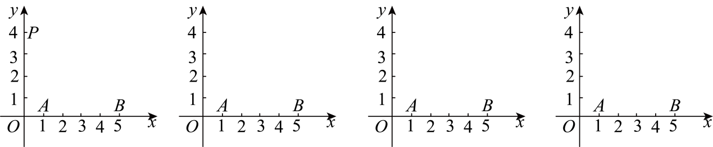

# Mathematics - 题目 3718

**ID**: 2638d11f6f2543368e6d1f4de3b72be2
**年级**: Grade 9
**难度**: Medium-Hard
**题型**: Calculation

## 题目
给出如下定义：在平面内，把一个图形 $M$ 上任意一点与另一个图形  $N$ 上任意一点之间的距离的最小值，称为这两个图形 $M$ ， $N$ 之间的距离． 已知，在平面直角坐标系中，点  $A\left ({1，0}\right )，B\left ({5，0}\right )$(1)若点  $P\left ({0，4}\right )$①点 $P$ 到线段  $AB$ 的距离为，点  $P$ 到以线段 $AB$ 为直径的圆的距离为；​​​​​​​‌②当线段 $AB$ 绕 $AB$ 中点旋转时，则点 $P$ 到线段 $AB$ 距离 $d{{}_{1}}$ 的取值范围为；③以 $AB$ 为边，在 $x$ 轴下方做矩形 $ABCD$ ，其中 $BC$ 平行 $y$ 轴， $BC=2$ ，当矩形绕着点 $\left ({3，-1}\right )$ 旋转时，则点 $P$ 到矩形  $ABCD$ 的距离  $d{{}_{2}}$ 的取值范围为；(2)当点 $P$ 在圆心 $C\left ({m，\sqrt {3}m}\right )\left ({0<m\leqslant 3}\right )$ ，半径为 $1$ 的圆上运动时，求点 $P$ 到线段 $AB$ 的距离 $d{{}_{3}}$ 的取值范围？

## 解答

1. （1） $①$ 如图，根据点到直线的距离可知，点 $P$ 到线段 $AB$ 的距离为 $OP=4$ ，
2. 
3. ∵ $A\left ({1,0}\right )$ ， $B\left ({5,0}\right )$ ，
4. ∴ $AB=4$ ，
5. ∴ $\odot M$ 的半径为 $2$ ，
6. 在 ${\rm{R}}{\rm{t}}\vartriangle POM$ 中，由勾股定理得： $PM=\sqrt {OP{^{2}}+AM{^{2}}}=\sqrt {4{^{2}}+3{^{2}}}=5$ ，
7. ∴点 $P$ 到以线段 $AB$ 为直径的圆的距离为 $5-2=3$ ，
8. 故此题答案为： $4$ ， $3$ ；
9. $②$ 如图，由（ $1$ ）得 $PM=5$ ，
10. 
11. ∵ $PH\bot BM$ ，
12. ∴ $\angle PHM=90{}^\circ $ ，
13. ∴点 $H$ 在以 $PM$ 为直径的圆上运动，
14. ∴点 $P$ 到线段 $AB$ 距离 $d{{}_{1}}$ 的取值范围为 $0\leqslant d{{}_{1}}\leqslant 5$ ，
15. 故此题答案为： $0\leqslant d{{}_{1}}\leqslant 5$ ；
16. $③$ 如图，同 $②$ 理，可得：圆心 $Q\left ({3,-1}\right )$ ，
17. 
18. ∴ $PQ=\sqrt {{\left({0-3}\right)^{2}}+{\left({-1-4}\right)^{2}}}=\sqrt {34}$ ，圆半径为 $\sqrt {{\left({1-3}\right)^{2}}+{\left({-1-0}\right)^{2}}}=\sqrt {5}$ ，
19. ∴ $\sqrt {34}-\sqrt {5}\leqslant d{{}_{2}}\leqslant \sqrt {34}+\sqrt {5}$ ，
20. 故此题答案为： $\sqrt {34}-\sqrt {5}\leqslant d{{}_{2}}\leqslant \sqrt {34}+\sqrt {5}$ ；
21. （2）由圆心 $C\left ({m,\sqrt {3}m}\right )$ ，
22. ∴点 $C$ 在 $y=\sqrt {3}x$ 直线上，
23. 如图，
24. 
25. 同理 $0\leqslant d{{}_{1}}\leqslant 3\sqrt {3}+1$ ．

## 知识点

**中文**:
  - 两点间的距离公式
  - 勾股定理
  - 点和圆的位置关系
  - 直线和圆的位置关系

**English**:
  - Distance Formula
  - Pythagorean Theorem
  - Point and Circle Relationship
  - Line and Circle Relationship

---
