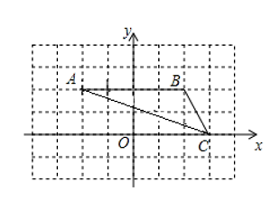
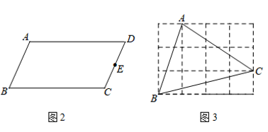

# Mathematics - 题目 2398

**ID**: 279ad2c446884fd7a84b8e831d2cc58c
**年级**: Grade 9
**难度**: Medium-Hard
**题型**: Calculation

## 题目
（1）在正方形方格纸中，我们把顶点均在“格点”上的三角形称为“格点三角形”，如图△ABC是一个格点三角形，点A的坐标为（-2，2）．（1）点B的坐标为，△ABC的面积为；​​​​​​​‌（2）在所给的方格纸中，请你以原点O为位似中心，将△ABC缩小为原来的一半（仅用直尺）；（3）在（2）中，若P（a，b）为线段AC上的任一点，则缩小后点P的对应点P_{1}的坐标为．（4）按要求作图，不要求写作法，但要保留作图痕迹．我们知道，三角形具有性质：三边的垂直平分线相交于同一点，三条角平分线相交于一点，三条中线相交于一点，事实上，三角形还具有性质：三条高所在直线相交于一点．请运用上述性质，只用直尺（不带刻度）作图．①如图2，在平行四边形ABCD中，E为CD的中点，作BC的中点F．②如图3，在由小正方形组成的4×3的网格中，△ABC的顶点都在小正方形的顶点上，作△ABC的高AH．

## 解答

1. 解：（1）根据图上点B的位置，点B的坐标是 $\left ({2,2}\right )$ ，
2. $S{{}_{\vartriangle ABC}}=\frac {1}{2}\times 4\times 2=4$ ，
3. 故答案是： $\left ({2,2}\right )$ ，4；
4. （2）如图，连接OA取，OA中点记作点 $A{{}_{1}}$ ，用同样的方法找到点 $B{{}_{1}}$ 和点 $C{{}_{1}}$ ，就得到缩小后的 $△A{{}_{1}}B{{}_{1}}C{{}_{1}}$ ；
5. 
6. （3）根据（2）中的做法，点 $P{{}_{1}}$ 就是OP的中点，根据中点坐标公式， $P{{}_{1}}\left ({\frac {a}{2},\frac {b}{2}}\right )$ ，
7. 故答案是： $\left ({\frac {a}{2},\frac {b}{2}}\right )$ ；
8. （4）①如图，连接AC、BD交于点O，连接EB交AC于点G，连接DG并延长交CB于点F，F即为所求，
9. 根据平行四边形的性质，O是BD中点，
10. ∴CO是 $\mathrm{△}BCD$ 的中线，
11. ∵E是CD中点，
12. ∴BE也是 $\mathrm{△}BCD$ 的中线，
13. 根据三条中线交于一点，所以连接DG并延长，得到 $\mathrm{△}BCD$ 的最后一条中线，则F是BC中点；
14. 
15. ②如图，分别过点B、C作 $2\times 3$ 的矩形对角线BD， $3\times 1$ 的矩形对角线CE，
16. $BD\bot AC$ ， $CE\bot AB$ ，则直线BD与CE的交点F就是 $\vartriangle ABC$ 的高所在直线的交点，
17. 连接AF角BC于点H，线段AH就是所求的 $\vartriangle ABC$ 的高．
18. 

## 知识点

**中文**:
  - 位似——作图

**English**:
  - Construction: Homothety

---
