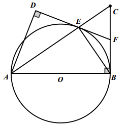

# Mathematics - 题目 1868

**ID**: 281de91fccf240dda92baddf5486c981
**年级**: Grade 9
**难度**: Medium-Hard
**题型**: Calculation

## 题目
如图，已知 $Rt\vartriangle ABC$ ， $\angle ABC=90{}^\circ $ ， $AB$ 为 $\odot O$ 的直径，斜边 $AC$ 交 $\odot O$ 于点 $E$ ， $AC$ 平分 $\angle DAB$ ， $ED\bot AD$ 于点 $D$ ， $DE$ 的延长线与 $BC$ 交于点 $F$ ．（1）求证： $CF=EF$ ；​​​​​​​‌（2）连结 $BE$ ，若半径为3， $AE=2\sqrt {6}$ ，求 $CE$ 的长．

## 解答

1. （1）证明： $\because $   $ED\bot AD$ 于点 $D$
2. $\therefore $  $\angle ADE{\rm{=}}90{}^\circ $ ， $\angle DAE+\angle DEA{\rm{=}}90{}^\circ $
3. $\because $  $\angle ABC=90{}^\circ $
4. $\therefore $  $\angle CAB+\angle C{\rm{=}}90{}^\circ $
5. $\because $  $AC$ 平分 $\angle DAB$
6. $\therefore $  $\angle DAE=\angle CAB$
7. $\therefore $  $\angle DEA=\angle C$
8. 又 $\because $  $\angle CEF=\angle DEA$
9. $\therefore $  $\angle C=\angle CEF$
10. $\therefore $  $CF=EF$
11. （2） $\because $  $AB$ 为 $\odot O$ 的直径，斜边 $AC$ 交 $\odot O$ 于点 $E$
12. $\therefore $  $\angle AEB{\rm{=}}90{}^\circ $ ， $AB=6$
13. $\therefore $  $BE{^{2}}=AB{^{2}}-AE{^{2}}=6{^{2}}-{\left({2\sqrt {6}}\right)^{2}}=12$
14. 设 $CE=x$
15. 在 $Rt△BEC$ 中，  $BC{^{2}}=CE{^{2}}+BE{^{2}}=x{^{2}}+12$
16. 在 $Rt\vartriangle ABC$ 中，  $BC{^{2}}=AC{^{2}}-AB{^{2}}={\left({AE+CE}\right)^{2}}-AB{^{2}}={\left({2\sqrt {6}+x}\right)^{2}}-6{^{2}}$
17. $\therefore $  $x{^{2}}+12={\left({2\sqrt {6}+x}\right)^{2}}-6{^{2}}$
18. 解得 $x=\sqrt {6}$ ，即 $CE=\sqrt {6}$ ．

## 知识点

**中文**:
  - 圆的综合问题

**English**:
  - Comprehensive Circle Problems

---
