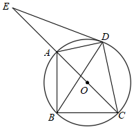

# Mathematics - 题目 533

**ID**: 29fb69429e6d4b1a86965531410d2091
**年级**: Grade 9
**难度**: Medium-Hard
**题型**: Calculation

## 题目
如图，四边形ABCD内接于 $\odot O$ ，AC是直径， $AB=BC$ ，连接BD，过点D的直线与CA的延长线相交于点E，且 $\angle EDA=\angle ABD$ ．（1）求证：直线DE是 $\odot O$ 的切线；​​​​​​​‌（2）若 $AD=6$ ， $CD=8$ ，①求BD的长．②若 $\angle CAD$ 的平分线交BD于F，求OF的长．

## 解答

1. （1）证明：连接OD，如下图,
2. ∵OC=OD，
3. ∴∠OCD=∠ODC，
4. 
5. ∵AC是直径，
6. ∴∠ADC=90°，
7. ∵∠EDA=∠ACD，
8. ∴∠ADO+∠ODC=∠EDA+∠ADO，
9. ∴∠EDO=∠EDA+∠ADO=90°，
10. ∴OD⊥DE，
11. ∵OD是半径，
12. ∴直线DE是⊙O的切线．
13. （2）①解：过点A作AG⊥BD于点G，如上图，则∠AGB=∠AGD=90°，
14. ∵AC是直径，
15. ∴∠ABC=∠ADC=90°，
16. 在Rt△ACD中，AD=6，CD=8，
17. ∴ $AC{^{2}}=AD{^{2}}+DC{^{2}}=6{^{2}}+8{^{2}}=100$ ，
18. ∴AC=10，
19. ∵在Rt△ABC中，AB=BC，
20. ∴∠BAC=∠ACB=45°，
21. ∵sin∠ACB= $\frac {AB}{AC}$ ，
22. ∴AB=sin45°⋅AC= $5\sqrt {2}$ ，
23. ∵∠ADB=∠ACB=45°，
24. 在Rt△ADG中，AD=6，
25. ∴cos∠ADG= $\frac {DG}{AD}$ ，
26. ∴DG=cos45°⋅AD= $3\sqrt {2}$ ，
27. ∴AG= $3\sqrt {2}$ ，
28. 在Rt△ABG中，
29. ∴ $BG{^{2}}=AB{^{2}}-AG{^{2}}=50-18=32$ ，
30. ∴BF= $4\sqrt {2}$ ，
31. ∴BD=BG+DG= $4\sqrt {2}$ + $3\sqrt {2}$ = $7\sqrt {2}$ ，
32. ②如图，连接AF并延长，交圆于点H，连接HC，HD，
33. ∵∠HAC=∠HAD，∴HD=HC，
34. ∴H是 $\overset ⌢{{CD}}$ 的中点，连接OH，交CD于点M，
35. 根据垂径定理的推论，得HM⊥CD，
36. ∴MC=4，OC=5，
37. ∴OM= $\sqrt {OC{^{2}}-MC{^{2}}}=\sqrt {5{^{2}}-4{^{2}}}$ =3，
38. ∴MH=2，根据勾股定理，
39. ∴HC= $\sqrt {HM{^{2}}{\rm{+}}MC{^{2}}}=\sqrt {2{^{2}}+4{^{2}}}$ =2 $\sqrt {5}$ ，
40. ∵OF⊥AH，
41. ∴AF=FH，
42. ∴OF是中位线，
43. ∴OF= $\frac {1}{2}HC{\rm{=}}\sqrt {5}$ ．
44. ．

## 知识点

**中文**:
  - 直线和圆的位置关系
  - 解直角三角形

**English**:
  - Line and Circle Relationship
  - Solving Right Triangles

---
