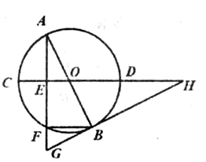

# Mathematics - 题目 2629

**ID**: 2c4ecf788d6f41699c57da230e6a57fc
**年级**: Grade 9
**难度**: Medium-Hard
**题型**: Calculation

## 题目
如图，⊙O是直径为 $6\sqrt {5}$ 的圆， $AB$ ， $CD$ 是⊙O的直径， $F$ 为⊙O上一点， $AF\bot CD$ 于点 $E$ ， $AF=12$ ，点 $H$ 在 $CD$ 的延长线上， $AF$ 和 $HB$ 相交于点 $G$ ．（1）若 ${\tan}\angle G=\frac {3}{2}$ ，求 $GH$ 的长度；​​​​​​​‌（2）若 $OH=15$ ，求证： $GH$ 是⊙O的切线．

## 解答

1. （1）解：∵ $AB$ 是 $\odot O$ 的直径，
2. ∴ $\angle AFB=90{}^\circ $ ，
3. ∴在 $Rt\vartriangle ABF$ 中， $BF=\sqrt {AB{^{2}}-AF{^{2}}}=\sqrt {{\left({6\sqrt {5}}\right)^{2}}-12{^{2}}}=6$ ，
4. ∴在 $Rt\vartriangle BFG$ 中， ${\tan}\angle G=\frac {3}{2}=\frac {BF}{FG}$ ，
5. ∴ $FG=4$ ，
6. ∵ $AF\bot CD$ ，AF=12，
7. ∴AE=EF=6，
8. ∴EG=EF+FG=10,
9. ∴在 $Rt\vartriangle HEG$ 中， ${\tan}\angle G=\frac {3}{2}=\frac {EH}{EG}=\frac {EH}{10}$ ，
10. ∴EH=15,
11. ∴ $GH=\sqrt {EH{^{2}}+EG{^{2}}}=\sqrt {10{^{2}}+15{^{2}}}=5\sqrt {13}$ ．
12. （2）证明：连接 $OF$ ，则 $OA=OF=r=3\sqrt {5}$ ，
13. 
14. 又∵ $AF\bot CD$ ，
15. ∴ $AE=\frac {1}{2}AF=6$ （三线合一）
16. 在 $Rt\vartriangle AEO$ 中，
17. $EO=\sqrt {OA{^{2}}-AE{^{2}}}=\sqrt {{\left({3\sqrt {5}}\right)^{2}}-6{^{2}}}=\sqrt {9}=3$ ，
18. ∴ $\frac {OA}{OE}=\frac {3\sqrt {5}}{3}=\sqrt {5}$ ， $\frac {OH}{OB}=\frac {15}{3\sqrt {5}}=\sqrt {5}$ ，
19. 在 $\mathrm{△}AEO$ 和 $\mathrm{△}HBO$ 中，
20. ∵ $\begin{cases}\frac {OA}{OE}=\frac {OH}{OB},\\\angle AOE=\angle HOB\end{cases}$ ．
21. ∴ $\mathrm{△}AEO$ ∽ $\mathrm{△}HBO$ ，
22. ∴ $\angle HBO=\angle AEO=90\mathrm{°}$ ，
23. ∴ $GH$ 是 $\odot O$ 的切线．

## 知识点

**中文**:
  - 正切
  - 直线和圆的位置关系
  - 相似三角形的判定与性质综合

**English**:
  - Tangent
  - Line and Circle Relationship
  - Determination and Properties

---
