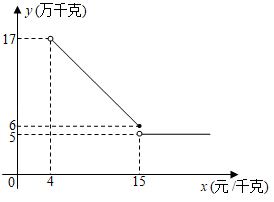

# Mathematics - 题目 823

**ID**: 2c94f00831fe4ac3a02871d72ba054bd
**年级**: Grade 9
**难度**: Medium-Hard
**题型**: Calculation

## 题目
小李回乡创业，销售一种批发价为4元/千克的水产品．根据市场调查发现，此种水产品的年销售量y（万千克）与售价x（元/千克）之间的关系如图所示：（1）求出销售此种水产品的年销售量y与售价x之间的函数表达式；​​​​​​​‌（2）市场调查还发现：销售此种水产品需要先投入成本10万元（不含以批发价购入这种水产品所需资金），如果市场管理部门规定此种水产品的销售价不准超过20元/千克，求销售此种水产品售价为多少元时，获得的年利润最大？最大年利润是多少？

## 解答

1. 解：（1）当4＜x⩽15时，设函数解析式为y＝kx+b，将（4，17），（15，6）代入得：
2. $\begin{cases}17=4k+b\\6=15k+b\end{cases}$ ，
3. 解得： $\begin{cases}k=-1\\b=21\end{cases}$ ，
4. ∴y＝﹣x+21；
5. 当x＞15时，y＝5．
6. ∴年销售量y与售价x之间的函数表达式为：y＝ $\begin{cases}-x+21(4<x\leqslant 15)\\5(x>15)\end{cases}$ .
7. （2）设获得的年利润为w万元，则由题意得：
8. 当4＜x⩽15时，
9. w＝（x﹣4）（﹣x+21）﹣10
10. ＝﹣（x﹣12.5）^{2}+62.25，
11. ∵二次项系数为﹣1＜0，
12. ∴当x＝12.5时，w有最大值，为62.25万元；
13. 当15＜x⩽20时，
14. w＝（x﹣4）×5﹣10＝5x﹣30，
15. ∴当x＝20时，w有最大值，为70万元，
16. ∵70＞62.25，
17. ∴销售此种水产品售价为20元时，获得的年利润最大，最大年利润是70万元．

## 知识点

**中文**:
  - 最大利润问题
  - 销售问题

**English**:
  - Maximum Profit Problems
  - Sales Problems

---
