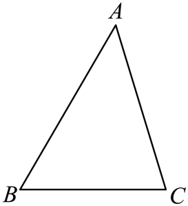

# Mathematics - 题目 3894

**ID**: 2c9ef71478dc4b9184b4cb7a9c355bfd
**年级**: Grade 9
**难度**: Medium-Hard
**题型**: Calculation

## 题目
某数学兴趣小组活动，准备将一张三角形纸片（如图）进行如下操作，并进行猜想和证明．(1)用三角板分别取 $AB,AC$ 的中点 $D,E$ ，连接 $DE$ ，画 $AF\bot DE$ 于点 $F$ ；​​​​​​​‌(2)用（1）中所画的三块图形经过旋转或平移拼出一个四边形（无缝隙无重叠），并用三角板画出示意图；(3)请判断（2）中所拼的四边形的形状，并说明理由．

## 解答

1. （1）解：如图所示：
2. 
3. （2）解：方法一：四边形为所求作的四边形.
4. 
5. 方法二：四边形是所求的四边形．
6. 
7. 方法三：四边形是所求的四边形．
8. 
9. （3）解：方法一（图1），
10. 
11. ∵，∴点在同一直线上，∵点 $D,E$ 分别是 $AB,AC$ 的中点，∴ $DE$ 为 $\vartriangle ABC$ 的中位线，∴ $DE{\rm{/\mskip-4mu/}}BC$ 且 $BC=2DE$ ．∵ $MD+EN=DE$ ，∴ $MN=MD+DE+EN=BC$ 且 $MN/\mskip-4mu/BC$ ，∴四边形 $MBCN$ 为平行四边形．∵ $AF\bot DE$ ， $\angle M=90{}^\circ $ ，∴平行四边形 $MBCN$ 为矩形．
12. 方法二（图2），
13. 
14. ∵ $\angle DEC+\angle MEC=180{}^\circ ,\angle EMC+\angle NMC=180{}^\circ $ ，∴点 $D,E,M,N$ 在同一直线上．∵点 $D,E$ 分别是 $AB,AC$ 的中点，∴ $DE$ 为 $\vartriangle ABC$ 的中位线，∴ $DE{\rm{/\mskip-4mu/}}BC$ 且 $BC=2DE$ ．∵ $EN=DE$ ，∴ $DN=BC$ 且 $DN/\mskip-4mu/BC$ ，∴四边形 $DBCN$ 为平行四边形．
15. 方法三（图3），
16. 
17. ∵ $\angle MNB+\angle BND=180{}^\circ ,\angle NDB+\angle BDE=180{}^\circ $ ，∴点 $M,N,D,E$ 在同一直线上．∵点 $D,E$ 分别是 $AB,AC$ 的中点，∴ $DE$ 为 $\vartriangle ABC$ 的中位线，∴ $DE{\rm{/\mskip-4mu/}}BC$ 且 $BC=2DE$ ．∵ $MD=DE$ ，∴ $ME=BC$ 且 $ME\mathrm{/\mskip-4mu/}BC$ ，∴四边形 $MBCE$ 为平行四边形．
18. 【思路引导】（1）根据题意画出图形即可；
19. （2）方法一：将 $\mathrm{△}ADF$ 绕点D逆时针旋转 $180{}^\circ $ 到 $\mathrm{△}DBM$ ，将 $\mathrm{△}AEF$ 绕E点逆时针旋转 $180{}^\circ $ 到 $\vartriangle CEN$ 即可得出四边形 $BCNM$ ；
20. 方法二：将 $\mathrm{△}AEF$ 绕E点逆时针旋转 $180{}^\circ $ 到 $\vartriangle CEM$ ，将 $\mathrm{△}ADF$ 绕点D逆时针旋转 $180{}^\circ $ 后再沿 $BC$ 向右平移到 $\vartriangle CMN$ ，即可得出四边形 $DBCN$ ；
21. 方法三：将 $\mathrm{△}ADF$ 绕点D逆时针旋转 $180{}^\circ $ 到 $\vartriangle DBN$ ，将 $\mathrm{△}AEF$ 绕E点逆时针旋转 $180{}^\circ $ 后沿 $CB$ 向左平移到 $\vartriangle BNM$ ，即可得出四边形 $MBCE$ ；
22. （3）方法一：先证明点 $M,D,E,N$ 在同一直线上，根据 $DE$ 为 $\vartriangle ABC$ 的中位线，得出 $DE{\rm{/\mskip-4mu/}}BC$ 且 $BC=2DE$ ．证明 $MN=MD+DE+EN=BC$ 且 $MN/\mskip-4mu/BC$ ，得出四边形 $MBCN$ 为平行四边形，根据 $\angle M=90{}^\circ $ ，得出平行四边形 $MBCN$ 为矩形．
23. 方法二：证明点 $D,E,M,N$ 在同一直线上，根据 $DE$ 为 $\vartriangle ABC$ 的中位线，得出 $DE{\rm{/\mskip-4mu/}}BC$ 且 $BC=2DE$ ，证明 $EN=DE$ ，得出 $DN=BC$ 且 $DN/\mskip-4mu/BC$ ，证明四边形 $DBCN$ 为平行四边形．
24. 方法三：证明点 $M,N,D,E$ 在同一直线上，根据 $DE$ 为 $\vartriangle ABC$ 的中位线，得出 $DE{\rm{/\mskip-4mu/}}BC$ 且 $BC=2DE$ ，证明 $ME=BC$ 且 $ME\mathrm{/\mskip-4mu/}BC$ ，得出四边形 $MBCE$ 为平行四边形．

## 知识点

**中文**:
  - 利用平移、轴对称、旋转、中心对称设计图案
  - 旋转的性质

**English**:
  - Designing Patterns with Transformations
  - Properties of Rotation

---
