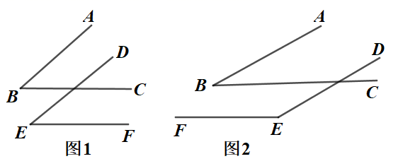

# Mathematics - 题目 2546

**ID**: 2df6374a53a04679a793603d9b71221e
**年级**: Grade 9
**难度**: Medium-Hard
**题型**: Calculation

## 题目
已知， $\angle ABC$ 和 $\angle DEF$ 中， $AB{\rm{/}}{\rm{/}}DE$ ， $BC{\rm{/}}{\rm{/}}EF$ ．试探究：（1）如图1， $\angle B$ 与 $\angle E$ 的关系是；​​​​​​​‌（2）如图2，写出 $\angle B$ 与 $\angle E$ 的关系，并说明理由；（3）根据上述探究，请归纳得到一个真命题．

## 解答

1. 证明：如下图：
2. 
3. 设DE交BC于点G
4. ∵ $AB{\rm{/}}{\rm{/}}DE$
5. ∴ $\angle B=\angle DGC$
6. 又∵ $BC{\rm{/}}{\rm{/}}EF$
7. ∴ $\angle DGC=\angle E$
8. ∴ $\angle B=\angle E$
9. （2）如下图：设BC与DE交于点G
10. 
11. ∵ $AB{\rm{/}}{\rm{/}}DE$ ，
12. ∴ $\angle B=\angle DGC$
13. 又∵ $BC{\rm{/}}{\rm{/}}EF$
14. ∴ $\angle E+\angle BGE=180{}^\circ $ ，
15. ∵ $\angle BGE=\angle DGC$
16. ∴ $\angle B+\angle E=180{}^\circ $ ．
17. （3）如果两个角的两边分别平行，那么这两个角相等或者互补．

## 知识点

**中文**:
  - 两直线平行同位角相等
  - 两直线平行同旁内角互补

**English**:
  - Parallel Lines have Equal Corresponding Angles
  - Parallel Lines have Supplementary Consecutive Angles

---
