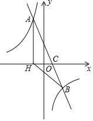

# Mathematics - 题目 18

**ID**: 30db4b88ba6c4cb8a1d38404eb3e4a4c
**年级**: Grade 9
**难度**: Medium-Hard
**题型**: Calculation

## 题目
如图，在平面直角坐标系中，一次函数y_{1}=ax+b（a≠0）的图象与反比例函数y_{2}= $\frac {k}{x}$ （k≠0）的图象交于A、B两点，与x轴交于点C，过点A作AH⊥x轴于点H，点O是线段CH的中点，AC=4 $\sqrt {5}$ ，cos∠ACH= $\frac {\sqrt {5}}{5}$ ．（1）求该反比例函数和一次函数的解析式；​​​​​​​‌（2）在x轴上是否存在点P，使三角形PAC是等腰三角形？若存在，请求出P点坐标；不存在，请说明理由．

## 解答

1. (1)∵AC＝ $4\sqrt {5}$ ，cos∠ACH＝ $\frac {\sqrt {5}}{5}$ ，
2. ∴ $\frac {CH}{4\sqrt {5}}＝\frac {\sqrt {5}}{5}$ ，
3. 解得CH＝4，
4. 由勾股定理得，AH＝ $\sqrt {AC{^{2}}-CH{^{2}}}$ ＝8，
5. ∵点O是线段CH的中点，
6. ∴点A的坐标为(﹣2，8)，点C的坐标为(2，0)，
7. ∴反比例函数的解析式为：y_{2}＝﹣ $\frac {16}{x}$ ，
8. 由点A，C的坐标列方程组 $\begin{cases}2a+b＝0\\-2a+b＝8\end{cases}$ ，
9. 解得， $\begin{cases}a＝-2\\b＝4\end{cases}$ ，
10. ∴一次函数解析式为y_{1}＝﹣2x＋4；
11. (2)设P点坐标为(m，0)，
12. ①当点A为等腰三角形的顶点时，PH＝CH＝4，则OP＝6，
13. ∴P点坐标为(﹣6，0)；
14. ②当点C为等腰三角形的顶点时，PC＝CA＝ $4\sqrt {5}$ ，
15. 则OP＝ $4\sqrt {5}$ ＋2或 $4\sqrt {5}$ ﹣2，
16. ∴P点坐标为(2﹣ $4\sqrt {5}$ ，0)或( $4\sqrt {5}$ ＋2，0)；
17. ③当点P为顶点时，点P为AC垂直平分线与x轴的交点，PA＝PC，
18. 则(2﹣m)^{2}＝(﹣2﹣m)^{2}＋8^{2}，
19. 解得，m＝﹣8，
20. ∴P点坐标为(﹣8，0)．，

## 知识点

**中文**:
  - 余弦
  - 反比例函数综合
  - 勾股定理的应用

**English**:
  - Cosine
  - Comprehensive Inverse Proportionality Problems
  - Applications of Pythagorean Theorem

---
