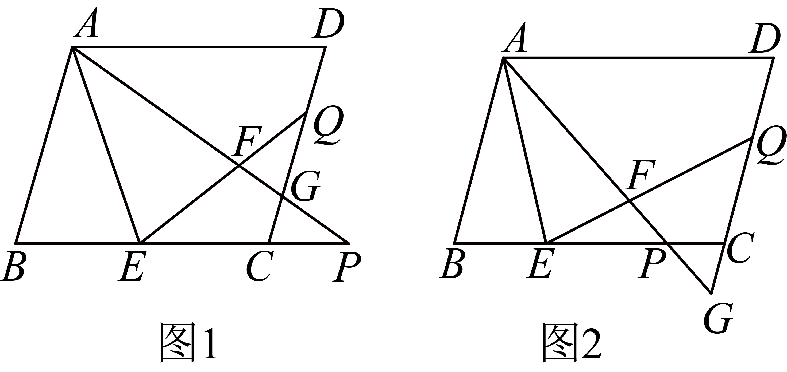

# Mathematics - 题目 3797

**ID**: 30fcffa43fc04f80873f6901639d45ef
**年级**: Grade 9
**难度**: Medium-Hard
**题型**: B卷-解答题（本大题共3个小题，共30分）

## 题目
如图，在 $▱ABCD$ 中，点 $E$ 在 $BC$ 边上，点 $B$ 关于直线 $AE$ 的对称点 $F$ 落在 $▱ABCD$ 内，射线 $AF$ 交射线 $DC$ 于点 $G$ ，交射线 $BC$ 于点 $P$ ，射线 $EF$ 交 $CD$ 边于点 $Q$ ．【特例感知】（1）如图1，当 $CE=BE$ 时，点 $P$ 在 $BC$ 延长线上，求证： $\mathrm{△}EFP≌\mathrm{△}ECQ$ ；​​​​​​​‌【问题探究】（2）在（1）的条件下，若 $CG=3$ ， $GQ=5$ ，求 $DQ$ 的长；【拓展延伸】（3）如图2，当 $CE=2BE$ 时，点 $P$ 在 $BC$ 边上，若 $\frac {CQ}{DQ}=\frac {1}{n}$ ，求 $\frac {CG}{DG}$ 的值．（用含 $n$ 的代数式表示）

## 解答

1. 解：（1）由折叠的性质得 $\angle B=\angle AFE,BE=FE$ ，
2. ∵四边形 $ABCD$ 是平行四边形，
3. ∴ $AB/\mskip-4mu/CD$ ，
4. ∴ $\angle B=\angle PCG$ ，
5. ∴ $\angle AFE=\angle PCG$ ，
6. ∵ $\angle AFE=\angle QFG$ ，
7. ∴ $\angle PCG=\angle QFG$ ，
8. ∵ $\angle FGQ=\angle CGP$ ，
9. ∴ $\angle CQE=\angle P$ ，
10. ∵ $CE=BE$ ， $BE=EF$
11. ∴ $EF=EC$ ，
12. 又∵ $\angle CEQ=\angle FEP$ ，
13. ∴ $\vartriangle EFP≌\vartriangle ECQ\left ({{\rm{A}}{\rm{A}}{\rm{S}}}\right )$ ；
14. （2）∵ $\mathrm{△}EFP≌\mathrm{△}ECQ$ ，
15. ∴ $EQ=EP$ ，
16. ∵ $EF=EC$ ，
17. ∴ $FQ=CP$ ，
18. ∵ $\angle FGQ=\angle CGP$ ， $\angle CQE=\angle P$ ，
19. ∴ $\vartriangle FQG≌\vartriangle CPG$ ，
20. ∴ $FG=CG=3,GQ=GP=5$ ，
21. 由折叠的性质得 $AF=AB$ ，
22. ∵四边形 $ABCD$ 是平行四边形，
23. ∴ $AB/\mskip-4mu/CD$ ， $AB=CD$ ，
24. ∴ $\vartriangle CGP∽\vartriangle BAP$ ，
25. ∴ $\frac {CG}{AB}=\frac {PG}{AP}$ ，
26. ∴ $\frac {3}{AB}=\frac {5}{AB+3+5}$ ，解得 $AB=12$ ，
27. ∴ $CD=12$ ，
28. ∴ $DQ=CD-CG-QG=4$ ；
29. （3）解：如图，延长 $AD,EQ$ 交于点 $M$ ，
30. 
31. 设 $CQ=a$ ， $BE=b$ ,
32. ∵ $\frac {CQ}{DQ}=\frac {1}{n}$ ， $CE=2BE$ ,
33. ∴ $DQ=an$ ， $EC=2b$ ，
34. ∴ $AB=CD=\left ({n+1}\right )a$ ， $AD=3b$ ,
35. ∵折叠，
36. ∴ $AF=AB=\left ({n+1}\right )a$ ,
37. ∵ $AD{\rm{/\mskip-4mu/}}BC$ ，即 $DM{\rm{/\mskip-4mu/}}EC$ ,
38. ∴ $\vartriangle DQM∽\vartriangle CQE$ ,
39. ∴ $\frac {DM}{EC}=\frac {DQ}{CQ}$ 即 $\frac {DM}{2b}=\frac {an}{a}=n$ ,
40. ∴ $DM=2bn$ ,
41. ∵四边形 $ABCD$ 是平行四边形，
42. ∴ $\angle B=\angle ADQ$ ,
43. 又∵折叠，
44. ∴ $\angle AFE=\angle B$ ,
45. ∵ $\angle AFQ+\angle AFE=180{}\degree $ ,
46. ∴ $\angle AFQ+\angle ADQ=180{}\degree $ ,
47. ∴ $\angle DAF+\angle DQF=180{}\degree $ ,
48. ∵ $\angle EQC+\angle DQF=180{}\degree $ ,
49. ∴ $\angle EQC=\angle DAF$ ,
50. ∵ $AD{\rm{/\mskip-4mu/}}BC$ ,
51. ∴ $\angle DAF=\angle FPE$ ,
52. ∴ $\angle EQC=\angle FPE$ ,
53. 又∵ $\angle FEP=\angle CEQ$ ,
54. ∴ $\vartriangle FEP∽\vartriangle CEQ$ ,
55. ∴ $\frac {EF}{EC}=\frac {FP}{CQ}$ 即 $\frac {b}{2b}=\frac {FP}{a}$ ,
56. ∴ $PF=\frac {1}{2}a$ ,
57. ∵ $AB{\rm{/\mskip-4mu/}}CD$ ,
58. ∴ $\vartriangle AMF∽\vartriangle PEF$ ,
59. ∴ $\frac {EP}{AM}=\frac {AF}{PF}$ ,
60. ∴ $\frac {EP}{\left ({3+2n}\right )b}=\frac {\left ({n+1}\right )a}{\frac {1}{2}a}$ ,
61. 解得 $EP=\frac {3+2n}{2n+2}b$ ,
62. ∴ $CP=EC-EP=2b-\frac {3+2n}{2n+2}b=\frac {\left ({2n+1}\right )b}{2n+2}$ ,
63. 又∵ $PC{\rm{/\mskip-4mu/}}AD$ ,
64. ∴ $\vartriangle GPC∽\vartriangle GAD$ ,
65. ∴ $\frac {CG}{DG}=\frac {CP}{AD}=\frac {\frac {\left ({2n+1}\right )b}{2n+2}}{3b}=\frac {2n+1}{6n+6}$ ．

## 知识点

**中文**:
  - 平行四边形的性质
  - 相似三角形的判定与性质综合
  - 折叠问题

**English**:
  - Properties of Parallelograms
  - Determination and Properties
  - Folding Problems

---
