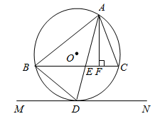

# Mathematics - 题目 749

**ID**: 32098005fd8849d09093de3cbcfc8739
**年级**: Grade 9
**难度**: Medium-Hard
**题型**: Calculation

## 题目
如图，△ABC内接于⊙O，AD平分∠BAC交BC边于点E，交⊙O于点D，过点A作AF⊥BC于点F，设⊙O的半径为R，AF＝h．（1）过点D作直线MN∥BC，求证：MN是⊙O的切线；​​​​​​​‌（2）求证：AB•AC＝2R•h；（3）设∠BAC＝2α，求 $\frac {AB+AC}{AD}$ 的值（用含α的代数式表示）．

## 解答

1. 解：（1）证明：如图1，连接OD，
2. 
3. ∵AD平分∠BAC，∴∠BAD＝∠CAD，∴＝，
4. 又∵OD是半径，∴OD⊥BC，
5. ∵MN∥BC，∴OD⊥MN，∴MN是⊙O的切线；
6. （2）证明：如图2，连接AO并延长交⊙O于H，
7. ∵AH是直径，∴∠ABH＝90°＝∠AFC，
8. 又∵∠AHB＝∠ACF，
9. ∴△ACF∽△AHB，
10. ∴ $\frac {AC}{AH}=\frac {AF}{AB}$ ，
11. ∴AB•AC＝AF•AH＝2R•h；
12. （3）如图3，过点D作DQ⊥AB于Q，DP⊥AC，交AC延长线于P，连接CD，
13. ∵∠BAC＝2α，AD平分∠BAC，
14. ∴∠BAD＝∠CAD＝α，∴＝，∴BD＝CD，
15. ∵∠BAD＝∠CAD，DQ⊥AB，DP⊥AC，∴DQ＝DP，
16. ∴Rt△DQB≌Rt△DPC（HL），∴BQ＝CP，
17. ∵DQ＝DP，AD＝AD，
18. ∴Rt△DQA≌Rt△DPA（HL），∴AQ＝AP，
19. ∴AB+AC＝AQ+BQ+AC＝2AQ，
20. ∵cos∠BAD＝ $\frac {AQ}{AD}$ ，∴AD＝ $\frac {AQ}{{\rm{c}}{\rm{o}}{\rm{s}}α}$ ，∴ $\frac {AB+AC}{AD}$ ＝ $\frac {2AQ}{\frac {AQ}{{\rm{c}}{\rm{o}}{\rm{s}}α}}$ ＝2cosα．
21. （1）连接OD，由角平分线的性质可得∠BAD＝∠CAD，可得＝，由垂径定理可得OD⊥BC，可证OD⊥MN，可得结论；（2）连接AO并延长交⊙O于H，通过证明△ACF∽△AHB，可得 $\frac {AC}{AH}=\frac {AF}{AB}$ ，可得结论；（3）由“HL”可证Rt△DQB≌Rt△DPC，Rt△DQA≌Rt△DPA，可得BQ＝CP，AQ＝AP，可得AB+AC＝2AQ，由锐角三角函数可得AD＝ $\frac {AQ}{{\rm{c}}{\rm{o}}{\rm{s}}α}$ ，即可求解．
22. 【点评】本题是圆的综合题，考查了圆的有关知识，角平分线的性质，全等三角形的判定和性质，相似三角形的判定和性质，添加恰当辅助线构造全等三角形或相似三角形是本题的关键．

## 知识点

**中文**:
  - 圆的综合问题
  - 垂径定理的应用

**English**:
  - Comprehensive Circle Problems
  - Applications of Perpendicular Chord Theorem

---
