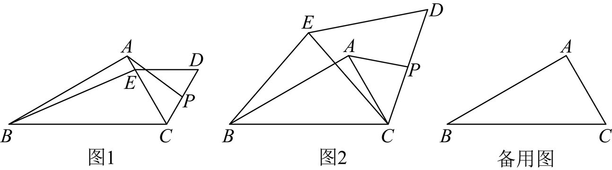

# Mathematics - 题目 1098

**ID**: 35a1a34583764550ad7f29d353db04ee
**年级**: Grade 9
**难度**: Medium-Hard
**题型**: Calculation

## 题目
综合与实践【问题背景】有两个三角形，一个是直角三角形，一个是等边三角形．① ${\rm{R}}{\rm{t}}\vartriangle ABC，\angle BAC=90{}\degree $ ， $\angle ABC=30{}\degree $ ；​​​​​​​‌②等边 $△DCE$ ．两个三角形的点 $C$ 互相重合， $△DCE$ 可以绕点 $C$ 转动 $AC\ne CD$ ，点 $P$ 是 $CD$ 的中点，连接 $BE、AP$ ．【解决问题】（1）如图1，当 $AC>CD$ 时，若点 $E$ 在线段 $AC$ 上， $EC=4AE，BC=10$ ，则 $BE=$．【观察猜想】（2）如图1，直接写出 $BE$ 与 $AP$ 的数量关系：．【类比探究】（3）如图2，当 $AC<CD$ ，点 $D$ 在线段 $AB$ 上方时，其他条件不变，延长 $AP$ 交 $BE$ 于点 $F$ ，探究 $\angle EFA$ 的度数是否为定值？若是定值，请求出 $\angle EFA$ 的度数；若不能求出 $\angle EFA$ 的度数，请说明理由．【拓展提升】（4）若 $BC=12$ ， $CE=6$ ，当点 $B$ ， $D$ ， $E$ 在同一条直线上时，请直接写出线段 $BE$ 的长．

## 解答

1. 解：（1）∵ ${\rm{R}}{\rm{t}}\vartriangle ABC，\angle BAC=90{}\degree $ ， $\angle ABC=30{}\degree $ ，且 $BC=10$ ，
2. ∴ $AC=\frac {1}{2}BC=5$ ， $AB=\sqrt {BC{^{2}}-AC{^{2}}}=5\sqrt {3}$ ，
3. ∵ $EC=4AE$ ，
4. ∴ $AE=\frac {1}{5}AC=1$ ，
5. ∴ $BE=\sqrt {AB{^{2}}+AE{^{2}}}=\sqrt {75+1}=2\sqrt {19}$ .
6. （2） $BE=2AP$ ．理由如下，
7. 取 $BE$ 的中点 ${\rm \mathit{G}，}BC$ 的中点H，连接 $AH{\rm{，}}AG{\rm{，}}GH$ ，
8. 
9. ∵G、H分别是 $BE、BC$ 的中点，
10. ∴ $GH=\frac {1}{2}EC$ ， $GH{\rm{/\mskip-4mu/}}AC$ ，
11. ∴ $\angle BHG=\angle ACB$ ；
12. ∵ $\angle ABC=30{}\degree ，\angle BAC=90{}\degree $ ，
13. ∴ $\angle ACB=60{}\degree $ ；
14. ∵ $G，H$ 分别是 ${\rm{R}}{\rm{t}}\vartriangle ABE，{\rm{R}}{\rm{t}}\vartriangle ABC$ 斜边上的中点，
15. ∴ $AG=BG，BH=AH$ ，
16. ∵ $GH=GH$ ，
17. ∴ $△AGH≌△BGH({\rm{S}}{\rm{S}}{\rm{S}}{\rm{)}}$ ；
18. ∴ $\angle AHG=\angle BHG=60{}\degree $ ，
19. ∴ $\angle AHG=\angle ACB=60{}\degree $ ；
20. ∵ $\mathrm{△}EDC$ 是等边三角形，
21. ∴ $CD=EC$ ；
22. ∵P是 $CD$ 的中点，
23. ∴ $CP=\frac {1}{2}CD=\frac {1}{2}EC$ ， $\angle DCE=60{}\degree $ ；
24. ∴ $GH=CP$ ；
25. ∵H是 $BC$ 中点， $\angle BAC=90{}\degree $ ，
26. ∴ $AH=CH$ ；
27. ∵ $\angle ACB=60{}\degree $ ，
28. ∴ $\vartriangle AHC$ 是等边三角形，
29. ∴ $AH=AC$ ；
30. 在 $\vartriangle AHG$ 与 $\mathrm{△}ACP$ 中，
31. $\begin{cases}AH=AC\\\angle AHG=\angle DCE=60{}\degree \\GH=PC\end{cases}$ ，
32. ∴ $\vartriangle AHG≌\vartriangle ACP$ ，
33. ∴ $AG=AP$ ；
34. ∵ $BE=2AG$ ，
35. ∴ $BE=2AP$ ；
36. （3） $\angle EFA$ 的度数是定值，理由如下：
37. 如图所示，
38. 
39. 由题意得 $CE=CD$ ， $\angle DCE=60{}\degree $ ， $\angle ACB=60{}\degree $ ，
40. ∴ $\angle ACP=\angle BCE$ ，
41. ∵ $\frac {CP}{CE}=\frac {CP}{CD}=\frac {1}{2}=\frac {AC}{BC}$ ，
42. ∴ $△ACP∽△BCE$ ，
43. ∴ $\angle CAP=\angle CBE$ ，
44. ∵ $\angle FAC+\angle CAP=180{}\degree $ ，
45. ∴ $\angle FAC+\angle CBF=180{}\degree $ ，
46. ∴ $\angle F+\angle ACB=360{}\degree -\left ({\angle FAC+\angle CBF}\right )=180{}\degree $ ，
47. ∵ $\angle ACB=60{}\degree $ ，
48. ∴ $\angle F=180{}\degree -\angle ACB=120{}\degree $ ，即 $\angle EFA=120{}\degree $ ；
49. （4）∵ ${\rm{R}}{\rm{t}}\vartriangle ABC，\angle BAC=90{}\degree $ ， $\angle ABC=30{}\degree $ ，且 $BC=12$ ，
50. ∴ $AC=\frac {1}{2}BC=5$ ， $AB=\sqrt {BC{^{2}}-AC{^{2}}}=6\sqrt {3}$ ，
51. 当点E在线段 $BD$ 上时，如图，过点C作 $CN\bot DE$ 于N；
52. 
53. ∵ $CP=2{\rm ，\mathit{P}}$ 是 $CD$ 的中点，
54. ∴ $CD=2CP=4$ ，
55. ∵ $\mathrm{△}CED$ 是等边三角形，P是 $CD$ 的中点，
56. ∴ $CD=CE=DE=6$ ， $CP=DP=\frac {1}{2}CD=3$ ，
57. ∵ $CN\bot DE$ ，
58. ∴ $EN=\frac {1}{2}DE=3$ ；
59. ∴ $CN=\sqrt {CE{^{2}}-EN{^{2}}}=3\sqrt {3}$ ；
60. 在 ${\rm{R}}{\rm{t}}\vartriangle BCN$ 中，由勾股定理得： $BN=\sqrt {BC{^{2}}-CN{^{2}}}=3\sqrt {13}$ ，
61. ∴ $BE=BN-EN=3\sqrt {13}-3$ ，
62. 当点E在线段 $BD$ 的延长线上时，如图，过点C作 $CN\bot DE$ 于N；
63. 
64. 同理，得 $EN=DN=3，CN=3\sqrt {3}，BN=3\sqrt {13}$ ，
65. ∴ $BE=BN+EN=3\sqrt {13}+3$ ；
66. 综上所述，线段 $BE$ 的长为 $3\sqrt {13}-3$ 或 $3\sqrt {13}+3$ ．

## 知识点

**中文**:
  - 直角三角形斜边上的中线
  - 等边三角形的判定与性质
  - 相似三角形的判定与性质综合

**English**:
  - Median to Hypotenuse of Right Triangle
  - Determination and Properties
  - Determination and Properties

---
