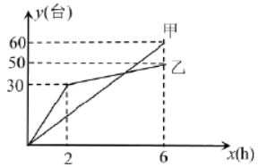

# Mathematics - 题目 1208

**ID**: 35f060b8706f497ba4de854daa33e80a
**年级**: Grade 9
**难度**: Medium-Hard
**题型**: Calculation

## 题目
有甲，乙两个电子团队整理一批电脑数据，整理电脑的台数为 $y$ （台）与整理需要的时间 $x$ 之间关系如下图所示，请依据图象提供的信息解答下列问题：（1）乙队工作 $2$ 小时整理台电脑，工作 $6h$ 时两队一共整理了台；​​​​​​​‌（2）求甲、乙两队 $y$ 与 $x$ 的关系式．（3）甲、乙两队整理电脑台数相等时，直接写出 $x$ 的值．

## 解答

1. 解：（1）依题意得乙队整理 $30$ 台时，用了 $2h$ ；
2. 工作 $6h$ 时，甲队和乙队一共整理： $60+50=110$ 台；
3. 故答案为：30；110；
4. （2）设甲队在 $0\leqslant x\leqslant 6$ 的时段内 $y$ 与 $x$ 之间的函数关系式 $y=k{{}_{1}}x$ ，
5. 由图可知，函数图象过点 $(6,60)$ ，
6. ∴ $6k{{}_{1}}=60$ ，
7. 解得： $k{{}_{1}}=10$ ，
8. $\therefore y=10x$ ， $\left ({0\leqslant x\leqslant 6}\right )$ ；
9. 设乙队在 $0\leqslant x\leqslant 2$ 的的时段内 $y$ 与 $x$ 之间的函数关系式 $y=k{{}_{2}}x$ ，函数图像经过 $\left ({2,30}\right )$
10. $\therefore 2k{{}_{2}}=30$ ，解得： $k{{}_{2}}=15$ ，
11. $\therefore y=15x$  $\left ({0\leqslant x\leqslant 2}\right )$ ，
12. 设乙队在的时段内 $y$ 与 $x$ 之间的函数关系式为 $y=k{{}_{3}}x+b$ ，由图可知，函数图象过点 $\left ({2,30}\right )$ ， $\left ({6,50}\right )$ ，
13. $\therefore \begin{cases}2k{{}_{3}}+b=30\\6k{{}_{3}}+b=50\end{cases}$ ，解得： $\begin{cases}k{{}_{3}}=5\\b=20\end{cases}$ ，
14. $y=5x+20$ ； $\left ({2\leqslant x\leqslant 6}\right )$
15. $\therefore $ 乙队的函数关系是为： $\begin{cases}y=15x(0\leqslant x\leqslant 2)\\y=5x+20(2\leqslant x\leqslant 6)\end{cases}$ ；
16. （3）由题意，得 $10x=5x+20$ ，
17. 解得： $x=4(h)$ ．
18. $\therefore $ 当 $x$ 为 $4h$ 时，甲，乙两队整理电脑台数相等．

## 知识点

**中文**:
  - 二元一次方程的解
  - 其他问题
  - 从函数的图象获取信息

**English**:
  - Solution of Linear Equation
  - Other Problems
  - Extracting Information from Graphs

---
