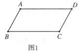

# Mathematics - 题目 3216

**ID**: 36c07c6e7ace4904a105aabadec4eb89
**年级**: Grade 9
**难度**: Medium-Hard
**题型**: Calculation

## 题目
邻边不相等的平行四边形纸片，剪去一个菱形，余下一个四边形，称为第一次操作；​​​​​​​‌在余下的四边形纸片中再剪去一个菱形，又余下一个四边形，称为第二 次操作;……依此类推，若第n次操作余下的四边形是菱形，则称原平行四边形为n阶准菱形．如图1，平行四边形ABCD中，若AB=1，BC=2，则平行四边形ABCD为1阶准菱形．（1）判断与推理：①邻边长分别为2和3的平行四边形是阶准菱形；②为了剪去一个菱形，进行如下操作：如图2，把平行四边形ABCD沿BE折叠（点E在AD上），使点A落在BC边上的点F，得到四边形ABFE，请证明四边形ABFE是菱形；（2）操作与计算：已知平行四边形ABCD的邻边长分别为l，a（a>1），且是3阶准菱形，请画出平行四边形ABCD及裁剪线的示意图，并在图形下方写出a的值．

## 解答

1. 解：（1）①邻边长分别为2和3的平行四边形是2阶准菱形.
2. ②如图2，由BE是四边形ABFE的对称轴，即知 ${\rm ∠ABE=∠FBE}$ ，且AB=BF，EA=EF，又因为AE∥BF，所以 ${\rm ∠AEB=∠FBE}$ ，从而有 ${\rm ∠AEB=∠ABE}$ ，因此AB=AE，据此可知AB=AE=EF=BF，故四边形ABFE为菱形；
3. 
4. （2）如图，必为a＞3，且a=4；
5. 
6. 如图，必为2<a<3，且a=2.5；
7. 
8. 如图，必为 $\frac {3}{2}$ <a<2，且 ${\rm a-1+}\frac {1}{2}(a-1)=1$ ，解得 ${\rm a=}\frac {5}{3}$ ；
9. 
10. 如图，必为1<a< $\frac {3}{2}$ ，且3（a−1）=1，解得 ${\rm a=}\frac {4}{3}$
11. 
12. 综上所述，a的值分别是： ${\rm a_{1}=4，a_{2}=}\frac {5}{2}{\rm ，a_{3}=}$  $\frac {5}{3}{\rm ，a_{4}=}$  $\frac {4}{3}$ ．

## 知识点

**中文**:
  - 平行四边形的对边平行且相等
  - 规律型：图形的变化类
  - 菱形的判定

**English**:
  - Opposite Sides Parallel and Equal
  - Patterns: Geometric Variations
  - Determination of Rhombuses

---
