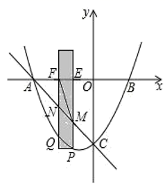

# Mathematics - 题目 2853

**ID**: 36ea89b46bc646d2a53a04ff6fde05a7
**年级**: Grade 9
**难度**: Medium-Hard
**题型**: Calculation

## 题目
如图，抛物线 $y=\frac {1}{3}x{^{2}}+bx+c$ 与 $x$ 轴交于点 $A$ 和点 $B$ ，与 $y$ 轴交于点 $C$ ，点 $B$ 的坐标为 $\left ({3,0}\right )$ ，点 $C$ 的坐标为 $\left ({0,-5}\right )$ .​​​​​​​‌有一宽度为1，长度足够长的矩形（阴影部分）沿 $x$ 轴方向平移，与 $y$ 轴平行的一组对边交抛物线于点 $P$ 和点 $Q$ ，交直线 $AC$ 于点 $M$ 和点 $N$ ，交 $x$ 轴于点 $E$ 和点 $F$ .（1）求抛物线的解析式及点 $A$ 的坐标；（2）当点 $M$ 和 $N$ 都在线段 $AC$ 上时，连接 $MF$ ，如果 ${\sin}\angle AMF=\frac {\sqrt {10}}{10}$ ，求点 $Q$ 的坐标；（3）在矩形的平移过程中，是否存在以点 $P$ ， $Q$ ， $M$ ， $N$ 为顶点的四边形是平行四边形，若存在，求出点 $M$ 的坐标；若不存在，请说明理由.

## 解答

1. （1） $\because $ 抛物线上的点 $B$ 的坐标为 $\left ({3,0}\right )$ ，点 $C$ 的坐标为 $\left ({0,-5}\right )$
2. $\therefore $ 将其代入 $y=\frac {1}{3}x{^{2}}+bx+c$ ，得 $\begin{cases}3+3b+c=0\\c=-5\end{cases}$ ，
3. 解得 $b=\frac {2}{3}$ ， $c=-5$ .
4. $\therefore $ 抛物线的解析式为 $y=\frac {1}{3}x{^{2}}+\frac {2}{3}x-5$ .
5. $\therefore $ 点 $A$ 的坐标是 $\left ({-5,0}\right )$ .
6. （2）作 $FG\bot AC$ 于 $G$ ，设点 $F$ 坐标 $\left ({m,0}\right )$ ，
7. 
8. 则 $AF=m+5$ ， $AE=EM=m+6$ ， $FG=\frac {\sqrt {2}}{2}\left ({m+5}\right )$ ，
9. $FM=\sqrt {EF{^{2}}+EM{^{2}}}=\sqrt {1+{\left({m+6}\right)^{2}}}$ ，
10. $\because {\rm{s}}{\rm{i}}{\rm{n}}\angle AMF=\frac {\sqrt {10}}{10}$ ，
11. $\therefore \frac {FG}{FM}=\frac {\sqrt {10}}{10}$ ，
12. $\therefore \frac {\frac {\sqrt {2}}{2}\left ({m+5}\right )}{\sqrt {1+{\left({m+6}\right)^{2}}}}=\frac {\sqrt {10}}{10}$ ，
13. 整理得到 $2m{^{2}}+19m+44=0$ ，
14. $\therefore \left ({m+4}\right )\left ({2m+11}\right )=0$ ，
15. $\therefore m=-4$ 或 $-5.5$ （舍弃），
16. $\therefore $ 点 $Q$ 坐标 $\left ({-4,-\frac {7}{3}}\right )$ .
17. （3）①当 $MN$ 是对角线时，点 $M$ 在 $y$ 轴的右侧，设点 $F\left ({m,0}\right )$ ，
18. $\because $ 直线 $AC$ 解析式为 $y=-x-5$ ，
19. $\therefore $ 点 $N\left ({m,-m-5}\right )$ ，点 $M\left ({m+1,-m-6}\right )$ ，
20. $\because QN=PM$ ，
21. $\therefore -m-5-\left ({\frac {1}{3}m{^{2}}+\frac {2}{3}m-5}\right )=\left [\frac {1}{3}{\left({m+1}\right)^{2}}+\frac {2}{3}\left ({m+1}\right )-5\right ]-\left ({-m-6}\right )$ ，
22. 解得 $m=-3+\sqrt {6}$ 或 $-3-\sqrt {6}$ （舍弃），
23. 此时 $M\left ({-2+\sqrt {6},-3-\sqrt {6}}\right )$ ，
24. 当 $MN$ 是对角线时，点 $N$ 在点 $A$ 的左侧时，设点 $F\left ({m,0}\right )$ .
25. $\therefore \left ({\frac {1}{3}m{^{2}}+\frac {2}{3}m-5}\right )-\left ({-m-5}\right )=\left ({-m-6}\right )-\left [\frac {1}{3}{\left({m+1}\right)^{2}}+\frac {2}{3}\left ({m+1}\right )-5\right ]$ .
26. 解得 $m=-3-\sqrt {6}$ 或 $-3+\sqrt {6}$ （舍弃），
27. 此时 $M\left ({-2-\sqrt {6},-3+\sqrt {6}}\right )$ ；
28. ②当 $MN$ 为边时，设点 $Q\left ({m,\frac {1}{3}m{^{2}}+\frac {2}{3}m-5}\right )$ ，则点 $P\left ({m+1,\frac {1}{3}m{^{2}}+\frac {2}{3}m-6}\right )$ ，
29. $\because NQ=PM$ ，
30. $\therefore \frac {1}{3}m{^{2}}+\frac {2}{3}m-6=\frac {1}{3}{\left({m+1}\right)^{2}}+\frac {2}{3}\left ({m+1}\right )-5$ ，
31. 解得 $m=-3$ .
32. $\therefore $ 点 $M$ 坐标 $\left ({-2,-3}\right )$ ，
33. 综上所述，以点 $P$ ， $Q$ ， $M$ ， $N$ 为顶点的四边形是平行四边形时，点 $M$ 的坐标为 $\left ({-2,-3}\right )$ 或 $\left ({-2+\sqrt {6},-3-\sqrt {6}}\right )$ 或 $\left ({-2-\sqrt {6},-3+\sqrt {6}}\right )$ .

## 知识点

**中文**:
  - 三角函数综合
  - 二次函数的综合
  - 勾股定理
  - 待定系数法求二次函数解析式

**English**:
  - Comprehensive Trig Problems
  - Comprehensive Quadratic Function Problems
  - Pythagorean Theorem
  - Finding Quadratic Expressions by Undetermined Coefficients

---
