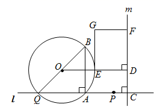

# Mathematics - 题目 2580

**ID**: 37000b6ad27948e2bb69fe7c2d31e675
**年级**: Grade 9
**难度**: Medium-Hard
**题型**: Calculation

## 题目
如图，点 $A$ 和动点 $P$ 在直线 $l$ 上，点 $P$ 关于点 $A$ 的对称点为 $Q$ ，以 $AQ$ 为边作 $Rt△ABQ$ ，使 $\angle BAQ=90{}^\circ $ ， $AQ:AB=3:4$ ，作 $\mathrm{△}ABQ$ 的外接圆 $O$ ．点 $C$ 在点 $P$ 右侧， $PC=4$ ，过点 $C$ 作直线 $m\bot l$ ，过点 $O$ 作 $OD\bot m$ 于点 $D$ ，交 $AB$ 右侧的圆弧于点 $E$ ．在射线 $CD$ 上取点 $F$ ，使 $DF=\frac {3}{2}CD$ ，以 $DE$ ， $DF$ 为邻边作矩形 $DEGF$ ．设 $AQ=3x$ ．（1）用关于 $x$ 的代数式表示 $BQ=$， $DF=$．（2）当点 $P$ 在点 $A$ 右侧时，若矩形 $DEGF$ 的面积等于90，求 $AP$ 的长．（3）当点 $P$ 在点 $A$ 右侧时，作直线 $BG$ 交 $\odot O$ 于点 $N$ ，若 $BN$ 的弦心距为1，求 $AP$ 的长．​​​​​​​‌

## 解答

1. 解：（1）如图，设AB和OE交于点H．
2. 
3. 在 $Rt△ABQ$ 中，
4. ∵ $AQ:AB=3:4$ ， $AQ=3x$ ，
5. ∴ $AB=4x$ ，
6. ∴ $BQ=5x$ ，
7. ∵ $OD\bot m$ ， $m\bot l$ ，
8. ∴ $OD//l$ ，
9. ∵ $OB=OQ$ ，
10. ∴ ${\rm{A}}{\rm{H}}={\rm{B}}{\rm{H}}=\frac {1}{2}{\rm{A}}{\rm{B}}=2{\rm{x}}$ ，
11. ∴ $CD=2x$ ，
12. ∴ ${\rm{F}}{\rm{D}}=\frac {3}{2}{\rm{C}}{\rm{D}}=3{\rm{x}}$ ，
13. 故答案为： $5x$ ， $3x$ ；
14. （2）∵ $AP=AQ=3x$ ， $PC=4$ ，
15. ∴ $CQ=6x+4$ ，
16. 作 $OM\bot AQ$ 于点 $M$ ，如图，
17. ∴ $OM//AB$ ，
18. ∵ $\odot O$ 是 $\mathrm{△}ABQ$ 的外接圆， $\angle BAQ=90{}^\circ $ ，
19. ∴点 $O$ 是 $BQ$ 的中点，
20. ∴ ${\rm{Q}}{\rm{M}}={\rm{A}}{\rm{M}}=\frac {3}{2}{\rm{x}}$ ，
21. ∴ ${\rm{O}}{\rm{D}}={\rm{M}}{\rm{C}}=\frac {3}{2}{\rm{x}}+3x+4=\frac {9}{2}{\rm{x}}+4$ ，
22. ∴ ${\rm{O}}{\rm{E}}=\frac {1}{2}{\rm{B}}{\rm{Q}}=\frac {5}{2}{\rm{x}}$ ，
23. ∴ $ED=\frac {9}{2}{\rm{x}}+4-\frac {5}{2}=2x+4$ ，
24. $S{{}_{矩形DEGF}}=DF\cdot DE=3x\left ({2x+4}\right )=90$ ，
25. 解得： $x{{}_{1}}=-5$ （舍去）， $x{{}_{2}}=3$ ，
26. ∴ $AP=3x=9$ ；
27. 
28. （3）如图，连接 $NQ$ ，过点 $B$ 作 $BM\bot EG$ 于点 $M$ ，由点 $O$ 到 $BN$ 的弦心距为1，得 $NQ=2$ ，
29. 由（1）（2）可知 $OH=\sqrt {OB{^{2}}-BH{^{2}}}=\frac {3}{2}x$ ， $OD=\frac {9}{2}x+4$ ， $ED=2x+4$ ，
30. ∴ $BM=HE=OD-OH-ED=\frac {9}{2}x+4x-\frac {3}{2}x-2x-4=x$ ，
31. ∵ $GM=EG-EM=3x-2x=x$ ，
32. ∴ $GM=BM=x$ ，
33. ∴ $\angle GBM=45{}^\circ $ ，
34. ∴ $BM//AQ$ ，
35. ∴ $AI=AB=4x$ ，
36. ∴ $IQ=x$ ，
37. ∴ $NQ=\frac {\sqrt {2}}{2}IQ=\frac {\sqrt {2}}{2}x=2$ ，
38. ∴ $x=2\sqrt {2}$ ，
39. ∴ $AP=3x=6\sqrt {2}$ ．
40. 

## 知识点

**中文**:
  - 垂径定理的应用
  - 解直角三角形

**English**:
  - Applications of Perpendicular Chord Theorem
  - Solving Right Triangles

---
