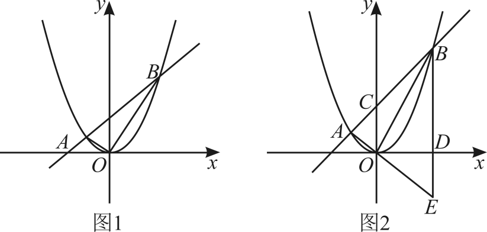

# Mathematics - 题目 681

**ID**: 37124e0e7e3c40c397af92a05f71b725
**年级**: Grade 9
**难度**: Medium-Hard
**题型**: Calculation

## 题目
如图1，抛物线 $y=\frac {1}{2}x{^{2}}$ 与一次函数 $y=kx+b\left ({k>0,b>0}\right )$ 交于A、B两点，连接OA，OB．（1）当 $k=\frac {3}{2}$ ， $b=2$ 时，求A、B两点的坐标．（2）若 $b=2$ ，作 $OP\bot AB$ ，则点P到y轴距离的最大值为．（3）如图2，若 $k=1$ ，设直线AB与y轴交于点C，过点B作x轴垂线交AO延长线于点E，交x轴于点D．①求证： $CO=DE$ ；​​​​​​​‌②连接CE，交OD于点F，请判断直线BF与抛物线的公共点个数，并说明理由．

## 解答

1. （1）解：把 $k=\frac {3}{2}$ ， $b=2$ 代入 $y=kx+b$ ，得
2. $y=\frac {3}{2}x+2$
3. 联立 $\begin{cases}y=\frac {3}{2}x+2\\y=\frac {1}{2}x{^{2}}\end{cases}$ ，解得： $\begin{cases}x{{}_{1}}=-1\\y{{}_{1}}=\frac {1}{2}\end{cases}$ ， $\begin{cases}x{{}_{2}}=4\\y{{}_{2}}=8\end{cases}$ ，
4. ∴ $A\left ({-1,\frac {1}{2}}\right )$ ， $B\left ({4,8}\right )$ ．
5. （2）解：设直线 $AB$ 交y轴于C，如图，
6. 
7. ∵ $OP\bot AB$
8. ∴ $\angle OPC=90{}\degree $
9. ∴点P在以 $OC$ 为直径的圆上，
10. 过点P作 $PD\bot OC$ 于D，
11. ∴当 $PD=\frac {1}{2}OC$ 时， $PD$ 最大，最大值为 $\frac {1}{2}OC$ ，
12. ∵ $b=2$ ，
13. ∴ $OC=b=2$ ，
14. ∴ $PD$ 最大 $=\frac {1}{2}OC=1$ ，即点P到y轴距离的最大值为1．
15. （3）①证明：∵ $k=1$ ，
16. ∴ $y=x+b$
17. 当 $x=0$ ， $y=b$ ，
18. ∴ $C\left ({0,b}\right )$
19. ∵ $b>0$
20. ∴ $OC=b$
21. 联立得： $\begin{cases}y=x+b\\y=\frac {1}{2}x{^{2}}\end{cases}$ ，
22. 解得： $\begin{cases}x{{}_{1}}=1-\sqrt {1+2b}\\y{{}_{1}}=\frac {1}{2}{\left({1-\sqrt {1+2b}}\right)^{2}}\end{cases}$ ， $\begin{cases}x{{}_{2}}=1+\sqrt {1+2b}\\y{{}_{2}}=\frac {1}{2}{\left({1+\sqrt {1+2b}}\right)^{2}}\end{cases}$ ，
23. ∴ $A\left ({1-\sqrt {1+2b},\frac {1}{2}{\left({1-\sqrt {1+2b}}\right)^{2}}}\right )$ ， $B\left ({1+\sqrt {1+2b},\frac {1}{2}{\left({1+\sqrt {1+2b}}\right)^{2}}}\right )$ ，
24. 设直线 $OA$ 解析式为 $y=sx$ ，
25. 把 $A\left ({1-\sqrt {1+2b},\frac {1}{2}{\left({1-\sqrt {1+2b}}\right)^{2}}}\right )$ 代入，得
26. $s\left ({1-\sqrt {1+2b}}\right )=\frac {1}{2}{\left({1-\sqrt {1+2b}}\right)^{2}}$
27. ∴ $s=\frac {1}{2}\left ({1-\sqrt {1+2b}}\right )$
28. ∴直线 $OA$ 解析式为 $y=\frac {1}{2}\left ({1-\sqrt {1+2b}}\right )x$
29. ∵ $BE⊥x$ 轴于D，
30. ∴点E横坐标与点B横坐标相同，
31. 把 $x=1+\sqrt {1+2b}$ 代入 $y=\frac {1}{2}\left ({1-\sqrt {1+2b}}\right )x$ ，得 $y=-b$
32. ∴ $E\left ({1+\sqrt {1+2b},-b}\right )$
33. ∵ $b>0$
34. ∴ $DE=\left |{-b}\right |=b$ ，
35. ∴ $OC=DE$ ；
36. ②解：如图，
37. 
38. ∵ $\angle COF=\angle EDF=90{}\degree $  $\angle OFC=\angle DFE$ ， $OC=DE$ ，
39. ∴ $\vartriangle OCF≌\vartriangle DEF\left ({{\rm{A}}{\rm{A}}{\rm{S}}}\right )$ ，
40. ∴ $OF=FD$ ，
41. ∴ $OF=\frac {1}{2}OD$ ，
42. ∵ $B\left ({1+\sqrt {1+2b},\frac {1}{2}{\left({1+\sqrt {1+2b}}\right)^{2}}}\right )$ ，
43. ∴ $F\left ({\frac {1}{2}\left ({1+\sqrt {1+2b}}\right ),0}\right )$ ，
44. 设直线 $BF$ 解析式为 $y=mx+n$ ，
45. 把 $F\left ({\frac {1}{2}\left ({1+\sqrt {1+2b}}\right ),0}\right )$ ， $B\left ({1+\sqrt {1+2b},\frac {1}{2}{\left({1+\sqrt {1+2b}}\right)^{2}}}\right )$ 代入，得
46. $\begin{cases}\frac {1}{2}\left ({1+\sqrt {1+2b}}\right )m+n=0\\\left ({1+\sqrt {1+2b}}\right )m+n=\frac {1}{2}{\left({1+\sqrt {1+2b}}\right)^{2}}\end{cases}$ ，解得 $\begin{cases}m=1+\sqrt {1+2b}\\n=-\frac {1}{2}{\left({1+\sqrt {1+2b}}\right)^{2}}\end{cases}$ ，
47. ∴直线 $BF$ 解析式为 $y=\left ({1+\sqrt {1+2b}}\right )x-\frac {1}{2}{\left({1+\sqrt {+2b}}\right)^{2}}$ ，
48. 联立，得 $\begin{cases}y=\left ({1+\sqrt {1+2b}}\right )x-\frac {1}{2}{\left({1+\sqrt {+2b}}\right)^{2}}\\y=\frac {1}{2}x{^{2}}\end{cases}$ ，
49. ∴ $\left ({1+\sqrt {1+2b}}\right )x-\frac {1}{2}{\left({1+\sqrt {+2b}}\right)^{2}}=\frac {1}{2}x{^{2}}$ ，
50. 即 $x{^{2}}-2\left ({1+\sqrt {1+2b}}\right )x+{\left({1+\sqrt {+2b}}\right)^{2}}=0$ ，
51. ${\rm{Δ}}=\left [-2\left ({1+\sqrt {+2b}}\right )\right ]{^{2}}-4{\left({1+\sqrt {+2b}}\right)^{2}}=0$ ，
52. ∴方程 $x{^{2}}-2\left ({1+\sqrt {1+2b}}\right )x+{\left({1+\sqrt {+2b}}\right)^{2}}=0$ 有两相等实数根，
53. ∴直线 $BF$ 与抛物线只有一个交点．
54. 即直线BF与抛物线的公共点个数为1个．

## 知识点

**中文**:
  - 90°的圆周角所对的弦是直径
  - 二次函数与一元二次方程
  - 二次函数的综合

**English**:
  - Chord of 90° Inscribed Angle is Diameter
  - Quadratic Functions and Quadratic Equations
  - Comprehensive Quadratic Function Problems

---
