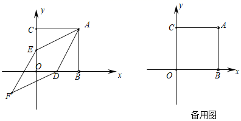

# Mathematics - 题目 784

**ID**: 38c8f6d42fb14ef7a40f5bc2e55c0529
**年级**: Grade 9
**难度**: Medium-Hard
**题型**: Calculation

## 题目
如图，在平面直角坐标系中，正方形ABOC的两直角边分别在坐标轴的正半轴上，分别过OB，OC的中点D，E作AE，AD的平行线，相交于点F， 已知OB=8．（1）求证：四边形AEFD为菱形．（2）求四边形AEFD的面积．（3）若点P在x轴正半轴上(异于点D)，点Q在y轴上，平面内是否存在点G，使得以点A，P，Q，G为顶点的四边形与四边形AEFD相似？若存在，求点P的坐标；​​​​​​​‌若不存在，试说明理由．

## 解答

1. （1）∵DF∥AE，EF∥AD，
2. ∴四边形AEFD是平行四边形.
3. ∵四边形ABOC是正方形，
4. ∴OB＝OC＝AB＝AC，∠ACE＝∠ABD＝90°.
5. ∵点D，E是OB，OC的中点，
6. ∴CE＝BD，
7. ∴△ACE≌△ABD(SAS)，
8. ∴AE＝AD，
9. ∴ $▱AEFD$ 是菱形
10. （2）如图1，连结DE
11. ∵S_{△A}_{BD}＝ $\frac {1}{2}$ AB·BD＝ $\frac {1}{2}\times 8\times 4{\rm{=}}{\rm{1}}{\rm{6}}$ ， S_{△ODE}＝ $\frac {1}{2}$ OD·OE＝ $\frac {1}{2}\times 4\times 4{\rm{=}}8$ ，
12. ∴S_{△AED}＝S_{正方形}_{ABOC}－2 S_{△ABD}－ S_{△ODE}＝64－2 $\times 16$ －8＝24，
13. ∴S_{菱形}_{AEFD}＝2S_{△AED}＝48
14. （3）由图1，连结AF与DE相交于点K，易得△ADK的两直角边之比为1:3
15. 
16. 1）当AP为菱形一边时，点Q在x轴上方，有图2、图3两种情况：
17. 如图2，AG与PQ交于点H，
18. 
19. ∵菱形PAQG∽菱形ADFE，
20. ∴△APH的两直角边之比为1:3
21. 过点H作HN⊥x轴于点N，交AC于点M，设AM=t
22. ∵HN∥OQ，点H是PQ的中点，
23. ∴点N是OP中点，
24. ∴HN是△OPQ的中位线，
25. ∴ON＝PN＝8－t
26. 又∵∠1＝∠3＝90°－∠2，∠PNH＝∠AMH＝90°，
27. ∴△HMA∽△PNH，
28. ∴ $\frac {AM}{HN}$ ＝ $\frac {MH}{PN}$ ＝ $\frac {1}{3}$  ，
29. ∴HN＝3AM＝3t，
30. ∴MH＝MN－NH＝8－3t.
31. ∵PN＝3MH，
32. ∴8－t =3(8－3t)，解得t＝2
33. ∴OP＝2ON＝2(8－t)＝12
34. ∴点P的坐标为(12，0)
35. 如图3，△APH的两直角边之比为1:3
36. 过点H作HI⊥y轴于点I，过点P作PN⊥x轴交IH于点N，延长BA交IN于点M
37. 
38. ∵∠1＝∠3＝90°－∠2，∠AMH＝∠PNH，
39. ∴△AMH∽△HNP，
40. ∴ $\frac {AM}{HN}$ ＝ $\frac {MH}{PN}$ ＝ $\frac {1}{3}$ ，设MH＝t，
41. ∴PN＝3MH＝3t，
42. ∴AM＝BM－AB＝3t－8，
43. ∴HN＝3AM＝3(3t－8) ＝9t－24
44. 又∵HI是△OPQ的中位线，
45. ∴OP＝2IH，
46. ∴HI＝HN，
47. ∴8＋t＝9t－24，解得 t＝4
48. ∴OP＝2HI＝2(8＋t)＝24，
49. ∴点P的坐标为(24，0)
50. 2）当AP为菱形一边时，点Q在x轴下方，有图4、图5两种情况：
51. 如图4，△PQH的两直角边之比为1:3
52. 过点H作HM⊥y轴于点M，过点P作PN⊥HM于点N
53. 
54. ∵MH是△QAC的中位线，
55. ∴HM＝ $\frac {AC}{2}$ ＝4
56. 又∵∠1＝∠3＝90°－∠2，∠HMQ＝∠N，
57. ∴△HPN∽△QHM，
58. ∴ $\frac {NP}{HM}$ ＝ $\frac {HN}{MQ}$ ＝ $\frac {1}{3}$ ，则PN＝ $\frac {1}{3}HM$ ＝ $\frac {4}{3}$ ，
59. ∴OM＝ $\frac {4}{3}$
60. 设HN＝t，则MQ＝3t
61. ∵MQ＝MC，
62. ∴3t＝8－ $\frac {4}{3}$ ，解得t＝ $\frac {{\rm{2}}{\rm{0}}}{9}$
63. ∴OP＝MN＝4＋t＝ $\frac {56}{9}$ ，
64. ∴点P的坐标为( $\frac {56}{9}$ ，0)
65. 如图5，△PQH的两直角边之比为1:3
66. 过点H作HM⊥x轴于点M，交AC于点I，过点Q作NQ⊥HM于点N
67. 
68. ∵IH是△ACQ的中位线，
69. ∴CQ＝2HI，NQ＝CI＝4
70. ∵∠1＝∠3＝90°－∠2，∠PMH＝∠QNH，
71. ∴△PMH∽△HNQ，
72. ∴ $\frac {MH}{NQ}$ ＝ $\frac {PM}{HN}$ ＝ $\frac {PH}{HQ}$ ＝ $\frac {1}{3}$ ，则MH＝ $\frac {1}{3}$ NQ＝ $\frac {4}{3}$
73. 设PM＝t，则HN＝3t，
74. ∵HN＝HI，
75. ∴3t＝8+ $\frac {4}{3}$ ，解得 t＝ $\frac {28}{9}$
76. ∴OP＝OM－PM＝QN－PM＝4－t＝ $\frac {8}{9}$ ，
77. ∴点P的坐标为( $\frac {8}{9}$ ，0)
78. 3）当AP为菱形对角线时，有图6一种情况：
79. 如图6，△PQH的两直角边之比为1:3
80. 过点H作HM⊥y轴于点M，交AB于点I，过点P作PN⊥HM于点N
81. 
82. ∵HI∥x轴，点H为AP的中点，
83. ∴AI＝IB＝4，
84. ∴PN＝4
85. ∵∠1＝∠3＝90°－∠2，∠PNH＝∠QMH＝90°，
86. ∴△PNH∽△HMQ，
87. ∴ $\frac {PN}{MH}$ ＝ $\frac {PM}{HN}$ ＝ $\frac {PM}{HN}$ ＝ $\frac {1}{3}$ ，则MH＝3PN＝12，HI＝MH－MI＝4
88. ∵HI是△ABP的中位线，
89. ∴BP＝2HI＝8，即OP＝16，
90. ∴点P的坐标为(16，0)
91. 综上所述，点P的坐标为(12，0)，(24，0)，( $\frac {56}{9}$ ，0)，( $\frac {8}{9}$ ，0)，(16，0)．

## 知识点

**中文**:
  - 坐标与图形性质
  - 菱形的判定与性质综合
  - 相似三角形的判定与性质综合

**English**:
  - Coordinates and Geometric Properties
  - Determination and Properties of Rhombuses
  - Determination and Properties

---
