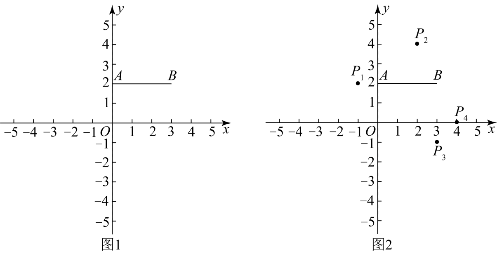

# Mathematics - 题目 2135

**ID**: 39e483bc13bf44edb1e06fab1c948caf
**年级**: Grade 9
**难度**: Medium-Hard
**题型**: Calculation

## 题目
对于平面直角坐标系 $xOy$ 中的点 $P$ 和图形 $W$ ，给出如下定义：若图形 $W$ 上存在点 $Q$ ，使得点 $P$ 绕着点 $Q$ 旋转 $90{}^\circ $ 得到的对应点 $P^{′}$ 在图形 $W$ 上，则称点 $P$ 为图形 $W$ 的“关联点”．(1)图形 $W$ 是线段 $AB$ ，其中点A的坐标为 $(0,2)$ ，点 $B$ 的坐标为 $(3,2)$ ，①如图1，在点 $P{{}_{1}}(-1,\,2)$ ， $P{{}_{2}}(2,\,4)$ ， $P{{}_{3}}(3,\,-1)$ ， $P{{}_{4}}(4,\,0)$ 中，线段 $AB$ 的“关联点”是；​​​​​​​‌②如图2，若直线 $y=\frac {1}{3}x+b$ 上存在点 $P$ ，使点 $P$ 为线段 $AB$ 的“关联点”，求 $b$ 的取值范围；(2)图形 $W$ 是以 $T(t,\,0)$ 为圆心， $1$ 为半径的 $\odot $  $T$ ．已知点 $M(6,\,0)$ ， $N(0,\,2\sqrt {3})$ ．若线段 $MN$ 上存在点 $P$ ，使点 $P$ 为 $\odot $  $T$ 的“关联点”，直接写出 $t$ 的取值范围．

## 解答

1. （1）解：①依题意，线段 $AB$ 的“关联点” $P$ 在如图所示的阴影部分（含外边缘线段，不含线段 $AB$ ），其中点 $C(0,5)$ ， $D(3,5)$ ， $E(3,-1)$ ， $F(0,-1)$ ，点 $G$ 是线段 $AD$ 与 $BC$ 的交点，点 $H$ 是线段 $AE$ 与 $BF$ 的交点，
2. 
3. ∴ $P{{}_{2}}(2,\,4)$ ， $P{{}_{3}}(3,\,-1)$ 是线段 $AB$ 的“关联点”，  $P{{}_{1}}(-1,\,2)$ ， $P{{}_{4}}(4,\,0)$ 不是线段 $AB$ 的“关联点”；
4. ②若直线 $y=\frac {1}{3}x+b$ 过点 $E(3,-1)$ ，可得 $b=-2$ ，
5. 若直线 $y=\frac {1}{3}x+b$ 过点 $C(0,5)$ ，可得 $b=5$ ，
6. 结合函数图象，可得 $b$ 的取值范围是 $-2\mathrm{\leqslant }b\mathrm{\leqslant }5$ ；
7. （2）解：如图所示，图形 $W$ 是以 $T(t,\,\,0)$ 为圆心， $1$ 为半径的 $\odot $  $T$ ，
8. 在 $\odot T$ 上任意取一点 $Q$ ，将点 $T$ 绕 $Q$ 点旋转 $90{}^\circ $ 得到 $T^{′}$ ，在 $\odot T^{′}$ 上的点是 $\odot T$ 的关联点，
9. 
10. ∵ $TQ=T^{′}Q=1,\angle TQT^{′}=90{}^\circ $ ，
11. ∴ $TT^{′}=\sqrt {2}$ ，
12. ∴ $PT$  $=1+\sqrt {2}$ ，
13. 即 $\odot T$ 的关联点是以 $T$ 为圆心，半径为 $1+\sqrt {2}$ 和 $\sqrt {2}-1$ 的两个圆组成的圆环部分，如图所示，阴影部分，
14. 
15. 当点 $P$ 与 $M$ 重合，则半径为 $1+\sqrt {2}$ 的 $\odot T$ 经过点 $P$ 时， $t$ 取得最大值，
16. ∵点 $M(6,\,0)$ ，
17. ∴ $OM=6$ ，
18. 则 $t=6+1+\sqrt {2}=7+\sqrt {2}$ ，如图所示，
19. 
20. 当半径为 $1+\sqrt {2}$ 的 $\odot T$ 与 $MN$ 相切时，如图所示，此时 $t$ 取得最小值，
21. 
22. ∵点 $M(6,\,0)$ ， $N(0,\,2\sqrt {3})$ ，
23. ∴ $OM=6,ON=2\sqrt {3}$ ，则 ${\tan}\angle MON=\frac {ON}{OM}=\frac {\sqrt {3}}{3}$ ，
24. ∴ $\angle PMT=\angle OMN=30{}^\circ $ ，
25. ∵半径为 $1+\sqrt {2}$ 的 $\odot T$ 与 $MN$ 相切，
26. ∴ $TP\bot MN$ ，
27. ∴ $TM=2PT=2+2\sqrt {2}$ ，
28. ∴ $T\left ({6-2-2\sqrt {2},0}\right )$ ，即 $4-2\sqrt {2}$ ，
29. 综上所述， $4-2\sqrt {2}\mathrm{\leqslant }t\mathrm{\leqslant }7+\sqrt {2}$ ．

## 知识点

**中文**:
  - 一次函数图象的平移
  - 切线的性质定理
  - 旋转的性质
  - 解直角三角形

**English**:
  - Translation of Linear Function Graphs
  - Tangent Properties Theorem
  - Properties of Rotation
  - Solving Right Triangles

---
