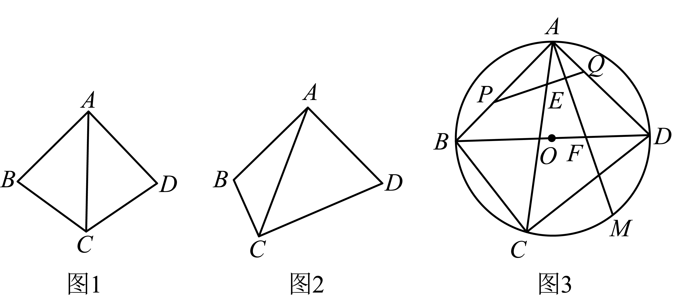

# Mathematics - 题目 3353

**ID**: 39f4258079b1420fadcbf9c57e87c6c8
**年级**: Grade 9
**难度**: Medium-Hard
**题型**: Calculation

## 题目
定义：只有一组邻边相等且互相垂直的四边形叫做等直四边形．理解：（1）如图1，在等直四边形 $ABCD$ 中， $AB=AD$ ， $AB\bot AD$ ，若 $BC=CD$ ，求证： $\angle ACB=\angle ACD$ ；​​​​​​​‌（2）如图2，在四边形 $ABCD$ 中， $AB\bot AD$ ， $\angle ABC+\angle ADC=180{}\degree $ ， $\angle ACB=\angle ACD$ ，求证：四边形 $ABCD$ 是等直四边形；探究：（3）如图3，在 $\odot O$ 中，圆内接四边形 $ABCD$ 是等直四边形， $AB=AD$ ， $AB\bot AD$ ，点P为 $AB$ 上一点，点Q为 $AD$ 上一点，且 $BP=AQ$ ，连接 $PQ$ ，点M为 $\overset{\frown}{{CD}}$ 的中点，连接 $AM$ 交 $PQ$ 于点E，交 $BD$ 于点F，若 $\angle MAC=\angle APQ$ ， $EF=3EQ$ ， $BD=4\sqrt {5}$ ，求 $BC$ 的长．

## 解答

1. （1）证明：根据题意得，在等直四边形 $ABCD$ 中， $AB\bot AD$ ， $AB=AD$ ，
2. 又∵ $BC=CD$ ， $AC=AC$ ，
3. ∴ $\vartriangle ABC≌\vartriangle ADC\left ({{\rm{S}}{\rm{S}}{\rm{S}}}\right )$ ，
4. ∴ $\angle ACB=\angle ACD$ ．
5. 
6. （2）证明：延长 $CB$ 至K，使 $CK=CD$ ，连接 $AK$ ，
7. ∵ $\angle ACB=\angle ACD$ ， $AC=AC$ ，
8. ∴ $\vartriangle ACK≌\vartriangle ACD\left ({SAS}\right )$ ，
9. ∴ $\angle AKB=\angle ADC$ ， $AK=AD$ ，
10. ∵ $\angle ABC+\angle ADC=180{}\degree $ ， $\angle ABC+\angle ABK=180{}\degree $ ，
11. ∴ $\angle AKB=\angle ABK=\angle D$ ，
12. ∴ $AB=AK$ ，
13. ∴ $AB=AD$ ，
14. ∵ $AB\bot AD$ ，
15. ∴四边形 $ABCD$ 是等直四边形．
16. 
17. （3）解：∵点M为 $\overset{\frown}{{CD}}$ 中点，
18. ∴ $\overset{\frown}{{MC}}=\overset{\frown}{{MD}}$ ，
19. ∴ $\angle DAM=\angle MAC$ ，
20. ∴ $\angle DAM=\angle MAC=\angle APQ$ ，
21. ∵ $AB\bot AD$ ，
22. ∴ $\angle BAD=90{}\degree $ ，
23. ∴ $BD$ 是圆O的直径，
24. ∴ $\angle DAM+\angle PAE=\angle APQ+\angle PAE=90{}\degree $ ，
25. ∴ $\angle AEP=180{}\degree -90{}\degree =90{}\degree $ ，
26. ∴ $AM\bot PQ$ ，
27. 延长 $PA$ 至点N使 $AN=BP$ ，连接 $NQ$ ，则 $\angle NAQ=\angle PAQ=90{}\degree $ ，
28. ∵ $AB=AD$ ，
29. ∴ $\angle ADB=45{}\degree $ ，
30. ∵ $BP=AQ$ ，
31. ∴ $AN=AQ$ ，
32. ∴ $\angle N=\angle ADB=45{}\degree $ ，
33. ∵ $AN=BP$ ，
34. ∴ $BP+AP=AP+AN$ ，
35. ∴ $AB=PN=AD$ ，
36. ∵ $\angle DAF=\angle APQ,PN=AD,\angle N=\angle ADB=45{}\degree $ ，
37. ∴ $\vartriangle PQN≌\vartriangle AFD\left ({ASA}\right )$ ，
38. ∴ $AF=PQ$ ，
39. ∵ $EF=3EQ$ ，设 $EQ=m$ ， $AE=n$ ，
40. ∴ $EF=3m$ ，
41. 则 $PE=3m+n-m=2m+n$ ，
42. ∵ $\angle MAQ=\angle APE$ ，
43. ∴ ${\rm{t}}{\rm{a}}{\rm{n}}\angle MAQ={\rm{t}}{\rm{a}}{\rm{n}}\angle APE$ ，
44. ∴ $\frac {m}{n}=\frac {n}{2m+n}$ ，
45. ∴ $m=\frac {1}{2}n$ 或 $m=-n$ （舍），
46. ∴ ${\rm{t}}{\rm{a}}{\rm{n}}∠DAM=\frac {1}{2}$ ，
47. 连接 $BM$ 交 $CD$ 于R，连接 $DM$ ，
48. ，
49. ∵ $\angle DAM=\angle MAC$ ，
50. ∴ $CM=DM$ ，
51. ∴ $\angle CDM=\angle MBD=\angle CBM=\angle DAM$ ，
52. ∴ ${\rm{t}}{\rm{a}}{\rm{n}}\angle MBD={\rm{t}}{\rm{a}}{\rm{n}}\angle DAM={\rm{t}}{\rm{a}}{\rm{n}}\angle CBM=\frac {1}{2}$ ，
53. ∵ $BD$ 为圆直径，
54. ∴ $\angle BMD=\angle BCD=90{}\degree $ ，
55. 设 $MR=a$ ，则 $DM=2a$ ， $BM=4a$ ，
56. 在 ${\rm{R}}{\rm{t}}\mathrm{△}BMD$ 中， ${\left({2a}\right)^{2}}+{\left({4a}\right)^{2}}={\left({4\sqrt {5}}\right)^{2}}$ ，
57. ∵ $a>0$ ，
58. ∴ $a=2$ ，
59. ∴ $BR=6$ ， $BM=8$ ，
60. ∴ ${\rm{c}}{\rm{o}}{\rm{s}}\angle MBD=\frac {2\sqrt {5}}{5}$ ，
61. ∴ ${\rm{c}}{\rm{o}}{\rm{s}}\angle CBM=\frac {2\sqrt {5}}{5}$ ，
62. ∴ $BC=BR\cdot {\rm{c}}{\rm{o}}{\rm{s}}\angle CBM=6\times \frac {2\sqrt {5}}{5}=\frac {12\sqrt {5}}{5}$ ．

## 知识点

**中文**:
  - 90°的圆周角所对的弦是直径
  - 勾股定理
  - 解直角三角形

**English**:
  - Chord of 90° Inscribed Angle is Diameter
  - Pythagorean Theorem
  - Solving Right Triangles

---
