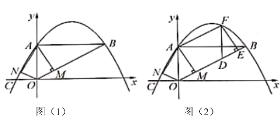

# Mathematics - 题目 2426

**ID**: 3aec679e54f14837970d7bfc317b02cd
**年级**: Grade 9
**难度**: Medium-Hard
**题型**: Calculation

## 题目
如图（1），在平面直角坐标系中抛物线 $y=ax{^{2}}+bx+4$  $\left ({a\ne 0}\right )$ 与 $y$ 轴交于点 $A$ ，与 $x$ 轴交于点 $C\left ({-2,0}\right )$ ，且经过点 $B\left ({8,4}\right )$ ，连接 $AB$ ， $BO$ ，作 $AM\bot OB$ 于点 $M$ ，将 $Rt\vartriangle OMA$ 沿 $y$ 轴翻折，点 $M$ 的对应点为点 $N$ ．解答下列问题：（1）抛物线的解析式为，顶点坐标为；​​​​​​​‌（2）判断点 $N$ 是否在直线 $AC$ 上，并说明理由；（3）如图（2），将图（1）中 $Rt\vartriangle OMA$ 沿着 $OB$ 平移后，得到 $Rt△DEF$ ．若 $DE$ 边在线段 $OB$ 上，点 $F$ 在抛物线上，连接 $AF$ ，求四边形 $AMEF$ 的面积．

## 解答

1. 解：把点 $C\left ({-2,0}\right )$ ，点 $B\left ({8,4}\right )$ 代入抛物线解析式 $y=ax{^{2}}+bx+4$  $\left ({a\ne 0}\right )$ 得：
2. $\begin{cases}4a-2b+4=0\\64a+8b+4=4\end{cases}$  ，解得 $\begin{cases}a=-\frac {1}{5}\\b=\frac {8}{5}\end{cases}$ ，
3. 即抛物线解析式为： $y=-\frac {1}{5}x{^{2}}+\frac {8}{5}x+4$ ，
4. ∴ $y=-\frac {1}{5}(x-4){^{2}}+\frac {36}{5}$ ，
5. ∴顶点坐标为（4， $\frac {36}{5}$ ）
6. 故答案为： $y=-\frac {1}{5}x{^{2}}+\frac {8}{5}x+4$ ，（4， $\frac {36}{5}$ ）；
7. （2）∵ $y=-\frac {1}{5}x{^{2}}+\frac {8}{5}x+4$ 与y轴交于A点，
8. ∴A点坐标为(0，4)，
9. 又∵B点坐标为(8，4)，故AB⊥y轴，
10. ∵AM⊥OB，
11. ∴∠MAB+∠B=∠MAB+∠MAO，
12. ∴∠MAO=∠B，
13. ∵OA=4，AB=8，
14. ∴tan∠MAO=tan∠B= $\frac {1}{2}$ ，
15. 将 $Rt\vartriangle OMA$ 沿 $y$ 轴翻折，点 $M$ 的对应点为点 $N$ ．
16. ∴tan∠MAO=tan∠NAO= $\frac {1}{2}$ ，
17. 又∵ OC=2，tan∠CAO$=\frac {OC}{OA}=\frac {1}{2}$ ，
18. ∴∠CAO=∠NAO，即AC与AN共线，
19. 故N点直线AC上；
20. （3）∵B点坐标为(8，4)，
21. ∴直线OB解析式为 $y=\frac {1}{2}x$ ，
22. 平移规律可知，AF//OB，又因为点A坐标为 $\left ({0,4}\right )$ ，
23. ∴直线AF解析式为 $y=\frac {1}{2}x+4$ ，
24. 联立解析式得方程组： $\begin{cases}y=\frac {1}{2}x+4\\y=-\frac {1}{5}x{^{2}}+\frac {8}{5}x+4\end{cases}$  ，解得 $\begin{cases}x{{}_{1}}=0\\y{{}_{1}}=4\end{cases}$ ， $\begin{cases}x{{}_{2}}=\frac {11}{2}\\y{{}_{2}}=\frac {27}{4}\end{cases}$ ，
25. 故F点坐标为： $\left ({\frac {11}{2},\frac {27}{4}}\right )$ ，
26. 由平移性质可知四边形AODF是平行四边形， $Rt\vartriangle OMA$ ≌ $Rt△DEF$ ．
27. ∴四边形 $AMEF$ 的面积=平行四边形AODF面积，
28. ∵平行四边形AODF面积= $OA\centerdot x{{}_{F}}=4\times \frac {11}{2}=22$ ，
29. ∴四边形 $AMEF$ 的面积为22．

## 知识点

**中文**:
  - 几何变换——平移综合题
  - 图形问题
  - 解直角三角形

**English**:
  - Translation Comprehensive Problems
  - Geometric Problems
  - Solving Right Triangles

---
