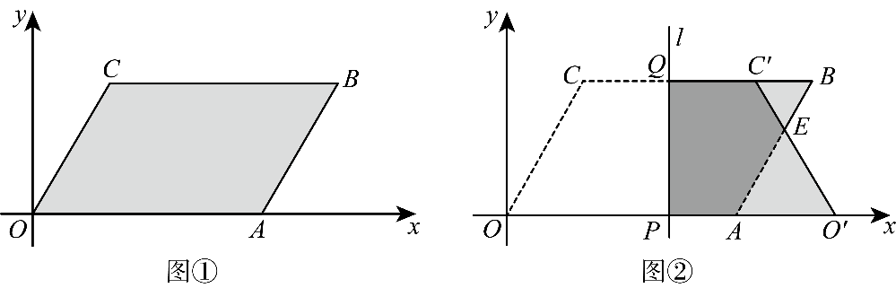

# Mathematics - 题目 2558

**ID**: 3b52e5171aba47b799fb5a156e07f37e
**年级**: Grade 9
**难度**: Medium-Hard
**题型**: 演算步骤或推理过程）

## 题目
将一个平行四边形纸片 $OABC$ 放置在平面直角坐标系中，点 $O\left ({0,0}\right )$ ，点 $A\left ({3,0}\right )$ ，点 $B,C$ 在第一象限，且 $OC=2,∠AOC=60{^{\circ }}$ ．(1)填空：如图①，点 $C$ 的坐标为，点 $B$ 的坐标为；​​​​​​​‌(2)若 $P$ 为 $x$ 轴的正半轴上一动点，过点 $P$ 作直线 $l\bot x$ 轴，沿直线 $l$ 折叠该纸片，折叠后点 $O$ 的对应点 $O^{′}$ 落在 $x$ 轴的正半轴上，点 $C$ 的对应点为 $C^{′}$ ．设 $OP=t$ ．①如图②，若直线 $l$ 与边 $CB$ 相交于点 $Q$ ，当折叠后四边形 $PO^{′}C^{′}Q$ 与 $▱OABC$ 重叠部分为五边形时， $O^{′}C^{′}$ 与 $AB$ 相交于点 $E$ ．试用含有 $t$ 的式子表示线段 $BE$ 的长，并直接写出 $t$ 的取值范围；②设折叠后重叠部分的面积为 $S$ ，当 $\frac {2}{3}\leqslant t\leqslant \frac {11}{4}$ 时，求 $S$ 的取值范围（直接写出结果即可）．

## 解答

1. （1）解：如图：过点 ${\rm \mathit{C}}$ 作 $CH\bot OA$ ，
2. 
3. ∵四边形 $OABC$ 是平行四边形， $OC=2,∠AOC=60{^{\circ }}$ ， $A\left ({3,0}\right )$ ，
4. ∴ $OC=AB=2，CB=OA=3，\angle B=\angle AOC=60{}^\circ ，$
5. ∵ $CH\bot OA$ ，∴ $\angle OCH=30{}^\circ $ ，∴ $OH=\frac {1}{2}OC=1$ ，∴ $CH=\sqrt {OC{^{2}}-CH{^{2}}}=\sqrt {3}$ ，∴ $C\left ({1，\sqrt {3}}\right )$ ；
6. ∵ $CB=OA=3$ ，∴ $1+3=4$ ，∴ $B\left ({4，\sqrt {3}}\right )$ ；
7. （2）解：①∵过点 $P$ 作直线 $l\bot x$ 轴，沿直线 $l$ 折叠该纸片，折叠后点 $O$ 的对应点 $O^{′}$ 落在 $x$ 轴的正半轴上，∴ $\angle OO^{′}C^{′}=\angle AOC=60{}^\circ $ ， $O^{′}P=OP$ ，∴ $OO^{′}=2OP=2t$ ，
8. ∵ $A\left ({3,0}\right )$ ，∴ $OA=3$ ，∴ $AO^{′}=OO^{′}-OA=2t-3$ .
9. ∵四边形 $OABC$ 为平行四边形，∴ $AB=OC=2$ ， $AB\mathrm{/\mskip-4mu/}OC$ ， $\angle O^{′}AB=\angle AOC=60{}^\circ $ ，
10. ∴ $\vartriangle EO^{′}A$ 是等边三角形，∴ $AE=AO^{′}=2t-3$ ，
11. ∵ $BE=AB-AE$ ，∴ $BE=AB-AE=2-\left ({2t-3}\right )=5-2t$ ，∴ $BE=-2t+5$ ；
12. 当 $O^{′}$ 与点 $A$ 重合时，
13. 
14. 此时 $AB$ 与 $C^{′}O^{′}$ 的交点为 ${\rm \mathit{E}}$ 与 ${\rm \mathit{A}}$ 重合， $OP=\frac {1}{2}OA=\frac {3}{2}$ ；
15. 如图：当 $C^{′}$ 与点 ${\rm \mathit{B}}$ 重合时，
16. 
17. 此时 $AB$ 与 $C^{′}O^{′}$ 的交点为 ${\rm \mathit{E}}$ 与 ${\rm \mathit{B}}$ 重合， $OP=\frac {CB+1}{2}=\frac {5}{2}$ ，∴ $t$ 的取值范围为 $\frac {3}{2}<t<\frac {5}{2}$ ；
18. ②如图：过点 ${\rm \mathit{C}}$ 作 $CH\bot OA$ ，
19. 
20. 由（1）得出 $C\left ({1，\sqrt {3}}\right )$ ， $\angle COA=60{}^\circ $ ，∴ ${\tan}60{}^\circ =\frac {MP}{OP}$ ， $\sqrt {3}=\frac {MP}{t}$ ，∴ $MP=\sqrt {3}t$ ，
21. 当 $\frac {2}{3}\leqslant t<1$ 时， $S=\frac {1}{2}O^{′}P=\frac {1}{2}OP\times MP=\frac {1}{2}t\times \sqrt {3}t=\frac {\sqrt {3}}{2}t{^{2}}$ ，
22. ∴ $\frac {\sqrt {3}}{2}>0$ ，开口向上，对称轴直线 $t=0$ ，∴在 $\frac {2}{3}\leqslant t<1$ 时， $S=\frac {\sqrt {3}}{2}t{^{2}}$ 随着 $t$ 的增大而增大，
23. ∴ $\frac {2\sqrt {3}}{9}\leqslant S<\frac {\sqrt {3}}{2}$ ；
24. 当 $1\leqslant t\leqslant \frac {3}{2}$ 时，如图：
25. $S=\frac {1}{2}\left ({O^{′}P+MC^{′}}\right )\times MP=\frac {1}{2}\left ({OP+CM}\right )\times MP=\frac {1}{2}\left ({t+t-1}\right )\times \sqrt {3}=\frac {\sqrt {3}}{2}\left ({2t-1}\right )=\sqrt {3}t-\frac {\sqrt {3}}{2}$ ，
26. ∴ $\sqrt {3}>0$ ， $S$ 随着 $t$ 的增大而增大，
27. ∴在 $t=\frac {3}{2}$ 时 $S=\sqrt {3}\times \frac {3}{2}-\frac {\sqrt {3}}{2}=\frac {3\sqrt {3}}{2}-\frac {\sqrt {3}}{2}=\sqrt {3}$ ；在 $t=1$ 时 $S=\sqrt {3}\times 1-\frac {\sqrt {3}}{2}=\frac {\sqrt {3}}{2}$ ；
28. ∴当 $1\leqslant t\leqslant \frac {3}{2}$ 时， $\frac {\sqrt {3}}{2}\leqslant S\leqslant \sqrt {3}$ ，
29. ∵当 $\frac {3}{2}<t<\frac {5}{2}$ 时，过点 ${\rm \mathit{E}}$ 作，如图：
30. 
31. ∵由①得出 $\vartriangle EO^{′}A$ 是等边三角形， $EN\bot AO$ ，∴ $AN=\frac {1}{2}AO^{′}=\frac {1}{2}\left ({2t-3}\right )=t-\frac {3}{2}$ ，
32. ∴ ${\tan}\angle EAO^{′}=\sqrt {3}$ ， $\sqrt {3}=\frac {EN}{AN}$ ，∴ $EN=\sqrt {3}\left ({t-\frac {3}{2}}\right )$ ，
33. $S=\sqrt {3}t-\frac {\sqrt {3}}{2}-\frac {1}{2}\times AO^{′}{\times }EN$  $=\sqrt {3}t-\frac {\sqrt {3}}{2}-\frac {1}{2}\left [\left ({2t-3}\right )\times \sqrt {3}\left ({t-\frac {3}{2}}\right )\right ]$  $=-\sqrt {3}t{^{2}}+4\sqrt {3}t-\frac {11\sqrt {3}}{4}$ ，
34. ∵ $-\sqrt {3}<0$ ，∴开口向下，在 $t=-\frac {4\sqrt {3}}{2\times \left ({-\sqrt {3}}\right )}=2$ 时， $S$ 有最大值，
35. ∴在 $\frac {3}{2}<t<\frac {5}{2}$ 时， $\left |{2-\frac {3}{2}}\right |=\left |{2-\frac {5}{2}}\right |$ ，∴ $S=-\sqrt {3}\times {\left({\frac {3}{2}}\right)^{2}}+4\sqrt {3}\times \frac {3}{2}-\frac {11\sqrt {3}}{4}=\sqrt {3}$ ，
36. 则在 $\frac {3}{2}<t<\frac {5}{2}$ 时， $\sqrt {3}<S\leqslant \frac {5\sqrt {3}}{4}$ ；当 $\frac {5}{2}\leqslant t\leqslant \frac {11}{4}$ 时，如图，
37. $S=\sqrt {3}t-\frac {\sqrt {3}}{2}-\frac {1}{2}\times \left ({AO^{′}+BC^{′}}\right )\times MP=\sqrt {3}t-\frac {\sqrt {3}}{2}-\frac {1}{2}\times \left ({2t-3+2t-5}\right )\times \sqrt {3}=-\sqrt {3}t+\frac {7\sqrt {3}}{2}$ ，
38. ∴ $-\sqrt {3}<0$ ， $S$ 随着 $t$ 的增大而减小，
39. ∴在 $\frac {5}{2}\leqslant t\leqslant \frac {11}{4}$ 时，则把 $t=\frac {5}{2}，t=\frac {11}{4}$ 分别代入 $S=-\sqrt {3}t+\frac {7\sqrt {3}}{2}$ ，
40. 得出 $S=-\sqrt {3}\times \frac {5}{2}+\frac {7\sqrt {3}}{2}=\sqrt {3}$ ， $S=-\sqrt {3}\times \frac {11}{4}+\frac {7\sqrt {3}}{2}=\frac {3\sqrt {3}}{4}$ ，
41. ∴在 $\frac {5}{2}\leqslant t\leqslant \frac {11}{4}$ 时， $\frac {3\sqrt {3}}{4}\leqslant S\leqslant \sqrt {3}$ ，
42. 综上 $\frac {2\sqrt {3}}{9}\leqslant S\leqslant \frac {5\sqrt {3}}{4}$ .

## 知识点

**中文**:
  - 图形问题
  - 平行四边形的性质
  - 解直角三角形
  - 折叠问题

**English**:
  - Geometric Problems
  - Properties of Parallelograms
  - Solving Right Triangles
  - Folding Problems

---
