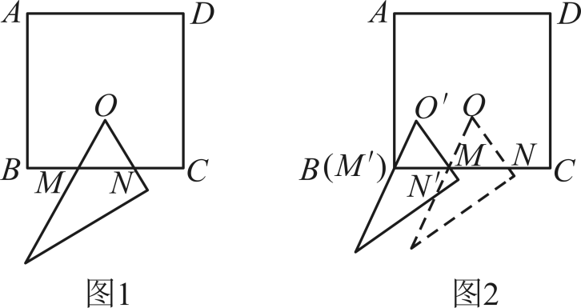
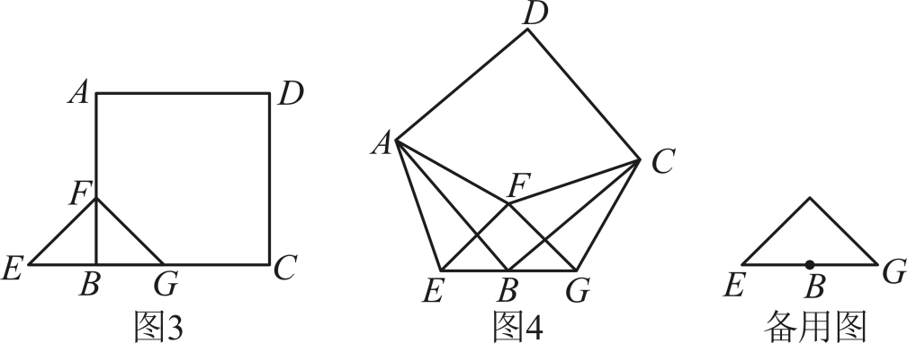

# Mathematics - 题目 3841

**ID**: 3c3434bb8bee4f94a7fd364ff4fe2c17
**年级**: Grade 9
**难度**: Medium-Hard
**题型**: Calculation

## 题目
综合与实践问题情境：在综合实践课上，老师要求同学们利用一副直角三角板和一张边长为10的正方形纸片 $ABCD$ ，以“探究图形的性质”为主题开展数学活动，下面是同学们对相关问题的研究．操作发现：如图1，点O为正方形 $ABCD$ 内 $BC$ 边的垂直平分线上一点，巧手小组将含有 $60{}\degree $ 的直角三角板中 $60{}\degree $ 角的顶点与O重合， $60{}\degree $ 角的两边与边 $BC$ 交于M，N两点，调整三角板使得 $BM=CN$ ．（1）①判断 $\vartriangle OMN$ 的形状，并说明理由；​​​​​​​‌②如图2，善思小组将图1的三角板沿 $CB$ 方向平移，点M，N，O的对应点分别为 $M^{′}$ ， $N^{′}$ ， $O^{′}$ ．当点 $M^{′}$ 与B重合时，若 $OM:AB=1:5$ ，直接写出 $\vartriangle O^{′}M^{′}N^{′}$ 平移的距离；类比探究：（2）缜密小组将等腰直角三角板 $EFG$ 如图3放置，其中斜边 $EG$ 的中点与正方形 $ABCD$ 的顶点B重合，点F，G分别在边 $AB$ ， $BC$ 上，点E在边 $CB$ 的延长线上．将正方形纸片 $ABCD$ 从图3的位置开始，绕点B逆时针方向旋转角度 $α\left ({0{}\degree <α<360{}\degree }\right )$ ．①在旋转过程中，当点F在正方形 $ABCD$ 内部时，如图4，请判断线段 $AE$ ， $CF$ 的数量关系和位置关系，并说明理由；②已知 $EG=8$ ，在旋转过程中，当 $AF=2\sqrt {13}$ 时，过点A作 $\vartriangle ABE$ 的高交 $BE$ 所在直线于点Q，请直接写出 $QG$ 的长．

## 解答

1. （1）①解： $\vartriangle OMN$ 是等边三角形，理由如下：
2. 连接 $OB,OC$ ，
3. 
4. ∵点O为正方形 $ABCD$ 内 $BC$ 边的垂直平分线上一点，
5. ∴ $OB=OC$ ，
6. ∴ $\angle OBC=\angle OCB$ ，
7. ∵ $\begin{cases}OB=OC\\\angle OBC=\angle OCB\\BM=CN\end{cases}$ ，
8. ∴ $\vartriangle OBM≌\vartriangle OCN\left ({{\rm{S}}{\rm{A}}{\rm{S}}}\right )$ ，
9. ∴ $OM=ON$ ，
10. ∵ $\angle MON=60{}\degree $ ，
11. ∴ $\mathrm{△}MON$ 是等边三角形．
12. ②解：∵ $OM:AB=1:5$ ， $AB=BC=10$ ，
13. ∴ $OM=\frac {1}{5}AB=2$ ，
14. ∵ $\mathrm{△}MON$ 是等边三角形，
15. ∴ $OM=MN=ON=2$ ，
16. ∴ $BM=CN=\frac {AB-MN}{2}=4$ ，
17. 故 $\vartriangle O^{′}M^{′}N^{′}$ 平移的距离为4．
18. 
19. （2）①解：线段 $AE$ ， $CF$ 的数量关系和位置关系分为 $AE=CF$ ， $AE\mathrm{⊥}CF$ ．理由如下：
20. 延长 $CF$ 交 $AB$ 于点Q，交 $AE$ 于点M，
21. ∵四边形 $ABCD$ 是正方形，
22. ∴ $AB=CB$ ， $\angle ABC=90{}\degree $ ，
23. ∵等腰直角三角板 $EFG{\rm \mathit{，}}$ 其中斜边 $EG$ 的中点与正方形 $ABCD$ 的顶点B重合，点F，G分别在边 $AB$ ， $BC$ 上，点E在边 $CB$ 的延长线上．
24. ∴ $FE=FG,FB=BE=BG$ ， $\angle FBE=\angle FBG$ ，
25. ∵ $\angle CBG=\angle FBA=α$ ，
26. ∴ $\angle FBC=90{}\degree -α=\angle EBA$ ，
27. ∵ $\begin{cases}EB=FB\\\angle EBA=\angle FBC\\BA=BC\end{cases}$ ，
28. ∴ $\vartriangle BAE≌\vartriangle BCF\left ({{\rm{S}}{\rm{A}}{\rm{S}}}\right )$ ，
29. ∴ $AE=FC$ ； $\angle FCB=\angle EAB$ ，
30. ∵ $\angle ABC=90{}\degree $ ，
31. ∴ $\angle FCB+\angle BQC=\angle ABC=90{}\degree $ ，
32. ∵ $\angle AQM=\angle BQC$ ，
33. 
34. ∴ $\angle FCB+\angle AQM=90{}\degree $ ，
35. ∴ $\angle QAM+\angle AQM=90{}\degree $ ，
36. ∴ $\angle AMQ=90{}\degree $ ，
37. ∴ $AE\mathrm{⊥}CF$ ．
38. ②解：过点F作 $FW\bot AQ$ 于点Q，根据题意，得四边形 $FWQB$ 是矩形，
39. ∴ $FW=BQ$ ， $QW=BF$ ；
40. ∵ $EG=8$ ，
41. ∴ $EB=FB=BG=\frac {1}{2}EG=4$ ，
42. ∴ $QW=BF=4$ ，
43. 设 $AW=x$ ，则 $AQ=x+4$ ，
44. ∵ $AF=2\sqrt {13}$ ， $AB=10$ ，
45. ∴ $FW{^{2}}=AF{^{2}}-AW{^{2}}=52-x{^{2}}$ ， $QB{^{2}}=AB{^{2}}-AQ{^{2}}=100-{\left({x+4}\right)^{2}}$ ，
46. ∴ $52-x{^{2}}=100-{\left({x+4}\right)^{2}}$ ，
47. 解得 $x=4$ ，
48. ∴ $QB=\sqrt {100-{\left({x+4}\right)^{2}}}=6$ ，
49. ∴ $QG=QB+BG=10$ ；
50. 
51. 过点F作 $FT\bot AQ$ 于点T，根据题意，得四边形 $FTQB$ 是矩形，
52. ∴ $FT=BQ$ ， $QT=BF$ ；
53. ∵ $EG=8$ ，
54. ∴ $EB=FB=BG=\frac {1}{2}EG=4$ ，
55. ∴ $QT=BF=4$ ，
56. 设 $AT=x$ ，则 $AQ=x+4$ ，
57. ∵ $AF=2\sqrt {13}$ ， $AB=10$ ，
58. ∴ $FT{^{2}}=AF{^{2}}-AT{^{2}}=52-x{^{2}}$ ， $QB{^{2}}=AB{^{2}}-AQ{^{2}}=100-{\left({x+4}\right)^{2}}$ ，
59. ∴ $52-x{^{2}}=100-{\left({x+4}\right)^{2}}$ ，
60. 解得 $x=4$ ，
61. 
62. ∴ $QB=\sqrt {100-{\left({x+4}\right)^{2}}}=6$ ，
63. ∴ $QG=QB-BG=2$ ；
64. 综上所述， $QG$ 的长为2或10．

## 知识点

**中文**:
  - 四边形综合
  - 等边三角形的判定与性质
  - 正方形的性质

**English**:
  - Comprehensive Quadrilateral Problems
  - Determination and Properties
  - Properties of Squares

---
