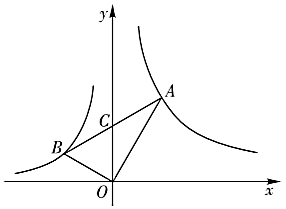

# Mathematics - 题目 897

**ID**: 3e87357e266a4c7280c103bfeb2027b5
**年级**: Grade 9
**难度**: Medium-Hard
**题型**: Calculation

## 题目
如图， ${\rm{R}}{\rm{t}}\Delta AOB$ 的直角顶点 $O$ 为坐标原点， $\angle OAB=30{}^\circ $ ，点 $A$ 在反比例函数 $y=\frac {\sqrt {3}}{x}$  $(x>0)$ 的图象上，点 $B$ 在反比例函数 $y=\frac {k}{x}$  $(x<0)$ 的图象上， $AB$ 交 $y$ 轴于点 $C$ ， $C$ 为 $AB$ 中点．（1）求点 $A$ 的坐标；​​​​​​​‌（2）求 $\Delta ACO$ 的面积；（3）求 $k$ 的值．

## 解答

1. （1）在 ${\rm{R}}{\rm{t}}\Delta ABO$ 中， $C$ 为 $AB$ 的中点
2. ∴ $AC=OC$
3. 又 $\angle OAB=30{}^\circ $
4. ∴ $\angle AOC=30{}^\circ $
5. 设点 $A$ 的坐标为 $(x,\sqrt {3}x)$ ，将其代入 $y=\frac {\sqrt {3}}{x}$
6. 解得 $x{{}_{1}}=1$ ， $x{{}_{2}}=-1$ （舍）
7. ∴点 $A$ 的坐标为 $(1,\sqrt {3})$
8. 故答案为： $(1,\sqrt {3})$
9. （2）∵点 $A$ 的坐标为 $(1,\sqrt {3})$
10. ∴ $AO=2$
11. ∴ $OB=OA\cdot {\tan}30{}^\circ =\frac {2\sqrt {3}}{3}$
12. ∴ $ΔAOB$ 的面积为 $\frac {1}{2}OB\cdot OA=\frac {1}{2}\times \frac {2\sqrt {3}}{3}\times 2=\frac {2\sqrt {3}}{3}$
13. 又 $C$ 为 $AB$ 中点
14. ∴ $S{{}_{\Delta ACO}}=\frac {1}{2}S{{}_{\Delta AOB}}=\frac {\sqrt {3}}{3}$
15. 故答案为： $\frac {\sqrt {3}}{3}$
16. （3）如图，过点 $B$ 作 $BM\bot x$ 轴于点 $M$ ，过点 $A$ 作 $AN\bot x$ 轴于点 $N$ ．
17. ∵ $\angle BOA=90{}^\circ $
18. ∴ $\angle BOM+\angle AON=90{}^\circ $
19. ∵ $\angle AON+\angle OAN=90{}^\circ $
20. ∴ $\angle BOM=\angle OAN$
21. 又 $\angle BMO=\angle ANO=90{}^\circ $
22. ∴ $\Delta BMO∽\Delta ONA$
23. ∴ $\angle AOC=\angle OAN=\angle BOM=30{}^\circ $
24. ∴ ${\tan}\angle BAO=\frac {BO}{AO}={\tan}30{}^\circ =\frac {\sqrt {3}}{3}$
25. ∴ $\frac {S{{}_{\Delta BMO}}}{S{{}_{\Delta OAN}}}={\left({\frac {OB}{OA}}\right)^{2}}=\frac {1}{3}$
26. ∵ $S{{}_{\Delta AON}}=\frac {1}{2}\times 1\times \sqrt {3}=\frac {\sqrt {3}}{2}$
27. ∴ $S{{}_{ΔBOM}}=\frac {\sqrt {3}}{6}$
28. ∴ $k=-2S{{}_{\Delta BOM}}=-\frac {\sqrt {3}}{3}$
29. 
30. 故答案为： $-\frac {\sqrt {3}}{3}$

## 知识点

**中文**:
  - 反比例函数的性质
  - 相似三角形的判定与性质综合
  - 解直角三角形

**English**:
  - Properties of Inverse Proportionality Functions
  - Determination and Properties
  - Solving Right Triangles

---
