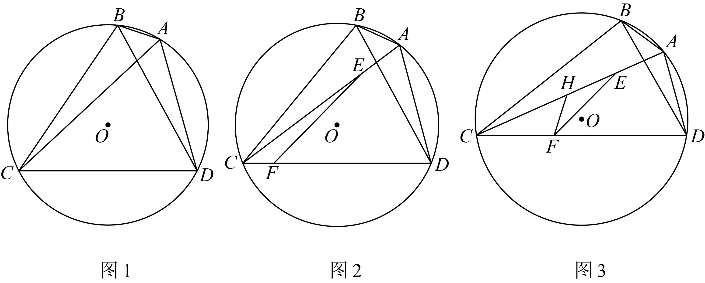

# Mathematics - 题目 3443

**ID**: 3e94c870912e4bd48ead0b053987d77f
**年级**: Grade 9
**难度**: Medium-Hard
**题型**: Calculation

## 题目
已知：四边形 $ABCD$ 内接于 $\odot O$ ，分别连接 $AC$ 、 $BD$ ，且 $\angle BAD-\angle CBD=60{}\degree $ ；​​​​​​​‌（1）如图1，求 $\angle BDC$ 的度数；（2）如图2，在 $AC$ 上取点 $E$ ，使 $AE=AB$ ，在 $CD$ 上取点 $F$ ，使 $DF=DB$ ，连接 $EF$ ，求证： $EF=AD$ ；（3）如图3，在（2）的条件下，在 $AC$ 上取点 $H$ ，连接 $FH$ ，使 $\angle FHC=\angle BDC$ ，若 $EH=EA$ ， $\mathrm{△}ABD$ 的面积为 $9\sqrt {3}$ ， $DF=14$ ，求 $\odot O$ 半径．

## 解答

1. （1）证明：∵ $\overset{\frown}{{CD}}=\overset{\frown}{{CD}}$  ，
2. ∴ $\angle CBD=\angle CAD$  ，
3. ∵ $\angle BAD-\angle CBD=60{}\degree $ ，
4. ∴ $\angle BAC=60{}\degree $ ，
5. ∵ $\overset{\frown}{{BC}}=\overset{\frown}{{BC}}$  ，
6. ∴ $\angle BDC=\angle BAC=60{}\degree $ ．
7. （2）证明：连接 $BE$ ， $BF$
8. 
9. ∵ $AB=AE$ ， $\angle BAC=60{}\degree $ ，
10. ∴ $\vartriangle ABE$ 是等边三角形
11. ∴ $BA=BE$ ， $\angle ABE=60{}\degree $
12. 同理： $\vartriangle BDF$ 是等边三角形
13. ∴ $BF=BD$ ， $\angle FBD=60{}\degree $
14. ∴ $\angle ABD=\angle FBD$ ，
15. ∴ $\angle FBD-\angle EBD=\angle EBA-\angle EBD$
16. ∴ $∠FBE=∠DBA$ ，
17. ∴ $\vartriangle BEF≌\vartriangle BAD$ ，
18. ∴ $EF=AD$ ．
19. （3）解：延长 $FH$ 到 $K$ ，使 $HK=HE$ ，连接 $KE$ ， $KB$
20. 
21. ∵ $\angle FHC=\angle BDC=60{}\degree $ ，
22. ∴ $\angle KHE=\angle FHC=60{}\degree $
23. ∴ $\mathrm{△}HEK$ 是等边三角形，
24. 又∵ $\vartriangle ABE$ 是等边三角形
25. ∴ $\angle KEH=\angle BEA=60{}\degree $ ，
26. ∴ $\angle KEB=60{}\degree $ ， $EK=EH$ ， $EB=EA$
27. 又∵ $EH=EA$ ，
28. ∴ $EK=EB$ ，
29. ∴ $\mathrm{△}BKE$ 是等边三角形
30. ∴ $\angle KEB=\angle EBA=60{}\degree $ ，
31. ∴ $EK{\rm{/\mskip-4mu/}}AB$
32. 又∵ $\mathrm{△}BFD$ 是等边三角形，
33. ∴ $BD=BF=DF=14,\angle DBF=\angle EBK=60{}\degree $
34. ∴ $\angle DBE=\angle FBK$
35. ∴ $\vartriangle BFK≌\vartriangle BDE$
36. ∴ $\angle BKF=\angle BED=120{}\degree $ ，
37. ∴ $\angle KEB+\angle BED=180{}\degree $
38. ∴ $K$ ， $E$ ， $D$ 三点共线，
39. ∴ $ED{\rm{/\mskip-4mu/}}BA$
40. 过 $D$ 作 $DQ\bot BA$ 延长线于 $Q$ ， $ER\bot AB$ 于 $R$ ，则四边形 $DERQ$ 是矩形，
41. ∴ $DQ=ER$ ，
42. 设 $AB=2x$ ，则 $ER=DQ=\sqrt {3}x$ ，
43. ∴ $S{{}_{\vartriangle DAB}}=\frac {1}{2}\times 2x\cdot \sqrt {3}x=\sqrt {3}x{^{2}}=9\sqrt {3}$ ，
44. ∴ $x{{}_{1}}=3$ ， $x{{}_{2}}=-3$ （舍），
45. ∴ $AB=6$
46. ∴ $DQ=ER=3\sqrt {3}$ ，
47. ∴ $BQ=\sqrt {14{^{2}}-{\left({3\sqrt {3}}\right)^{2}}}=13$ ，
48. ∴ $AQ=7$
49. ∴ $AD=\sqrt {DQ{^{2}}+AQ{^{2}}}=2\sqrt {19}$ ，
50. 作直径 $BM$ ，连 $DM$ ，
51. ∴ $\angle M=\angle DCB=\angle DAQ$
52. ∴ ${\rm{s}}{\rm{i}}{\rm{n}}\angle M={\rm{s}}{\rm{i}}{\rm{n}}\angle DAQ$ ，
53. ∴ $\frac {BD}{BM}=\frac {DQ}{AD}$
54. ∴ $\frac {14}{2r}=\frac {3\sqrt {3}}{2\sqrt {19}}$
55. ∴ $r=\frac {14}{9}\sqrt {57}$

## 知识点

**中文**:
  - 同弧或等弧所对的圆周角相等
  - 等边三角形的判定与性质
  - 解直角三角形

**English**:
  - Angles Subtended by Same Arc are Equal
  - Determination and Properties
  - Solving Right Triangles

---
