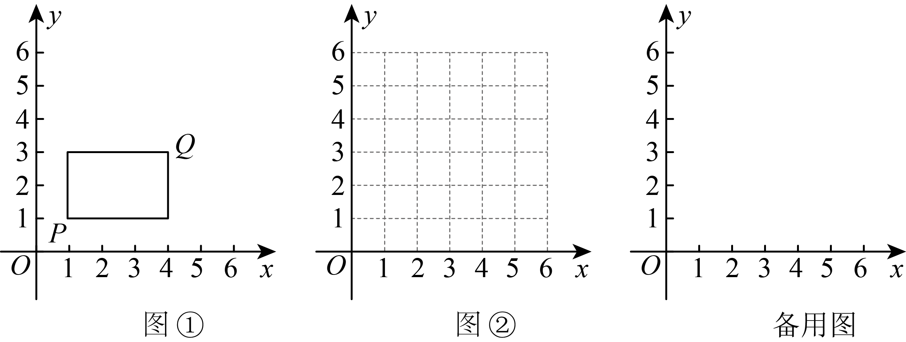

# Mathematics - 题目 2155

**ID**: 3e9c11f133ea489e93d6d09231067185
**年级**: Grade 9
**难度**: Medium-Hard
**题型**: Calculation

## 题目
在平面直角坐标系中，点 $P$ 的坐标为 $(x{{}_{1}}$ ， $y{{}_{1}})$ ，点 $Q$ 的坐标为 $(x{{}_{2}}$ ， $y{{}_{2}})$ ，且 $x{{}_{1}}\ne x{{}_{2}}$ ， $y{{}_{1}}\ne y{{}_{2}}$ ．若 $P$ 、 $Q$ 为某个矩形的两个顶点，且该矩形的边均与某条坐标轴垂直，则称该矩形为点 $P$ 、 $Q$ 的“相关矩形”，如图①为点 $P$ 、 $Q$ 的“相关矩形”示意图．若点 $P(1,0)$ ，点 $Q(m,5)$ ．(1)当 $m=3$ 时，在图②中画出点 $P$ 、 $Q$ 的“相关矩形”并求它的周长．(2)若点P、Q的“相关矩形”为正方形，求m的值．(3)已知一次函数 $y=-2x+4$ 的图象交x轴于点A，交y轴于点B，若在线段AB上存在一点C，使得点C、Q的“相关矩形”是正方形．①点A的坐标为，点B的坐标为．②直接写出m的取值范围．​​​​​​​‌

## 解答

1. （1）当 $m=3$ 时， $Q(3,5)$ ，点 $P$ 、 $Q$ 的“相关矩形”  $PDQE$ 如图所示：
2. 
3. $\because $ 四边形 $PDQE$ 是矩形，
4. $\therefore PE=DQ=5$ ， $PD=EQ=2$ ，
5. $\therefore $ 矩形 $PDQE$ 的周长 $=2\times (5+2)=14$ ．
6. （2） $\because P(1,0)$ ， $Q(m,5)$ ， $DQ\bot x$ 轴， $PE\bot x$ 轴， $EQ\bot y$ 轴， $PD\bot y$ 轴，
7. $\therefore D(m,0)$ ， $E(1,5)$ ，
8. $\therefore PD=\left |{m-1}\right |$ ， $PE=5$ ，
9. $\because $ 四边形 $PDQE$ 是正方形，
10. $\therefore PD=PE$ ，
11. $\therefore \left |{m-1}\right |=5$ ，
12. $\therefore m=6$  或 $-4$ ．
13. （3）①在一次函数 $y=-2x+4$ 中，令 $x=0$ ，得 $y=4$ ，令 $y=0$ ，得 $x=2$ ，
14. $\therefore A(2,0)$ ， $B(0,4)$
15. ②如图，
16. 
17. $\because $ 点 $C$ 线段 $AB$ 上，
18. $\therefore $ 设 $C(n,-2n+4)$ ，且 $0\leqslant n\leqslant 2$ ，
19. 则 $D(m,-2n+4)$ ， $E(n,5)$ ，
20. $\therefore CD=\left |{m-n}\right |$ ， $CE=5-(-2n+4)=2n+1$ ，
21. $\because $ 点 $C$ 、 $Q$ 的“相关矩形”是正方形，即四边形 $CDQE$ 是正方形，
22. $\therefore CD=CE$ ，即 $\left |{m-n}\right |=2n+1$ ，
23. $\therefore m=3n+1$ 或 $m=-n-1$ ，
24. 当 $m=3n+1$ 时，
25. $\because 0\leqslant n\leqslant 2$ ，
26. $\therefore 1\leqslant 3n+1\leqslant 7$ ，
27. 即 $1\leqslant m\leqslant 7$ ；
28. 当 $m=-n-1$ 时，
29. $\because 0\leqslant n\leqslant 2$ ，
30. $\therefore -3\leqslant -n-1\leqslant -1$ ，
31. 即 $-3\leqslant m\leqslant -1$ ；
32. 综上所述， $m$ 的取值范围为 $-3\leqslant m\leqslant -1$ 或 $1\leqslant m\leqslant 7$ ．

## 知识点

**中文**:
  - 正方形的判定与性质综合
  - 矩形的判定与性质综合

**English**:
  - Determination and Properties of Squares
  - Determination and Properties of Rectangles

---
