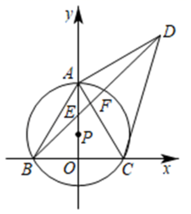

# Mathematics - 题目 1224

**ID**: 3f673cfa8d2b4889b1f6865a16dfd95c
**年级**: Grade 9
**难度**: Medium-Hard
**题型**: Calculation

## 题目
如图，点P在y轴的正半轴上，⊙P交x轴于B、C两点，交y轴于点A，以AC为直角边作等腰Rt△ACD，连接BD分别交y轴和AC于E、F两点，连接AB．（1）求证：AB＝AD；​​​​​​​‌（2）若BF＝4，DF＝6，求线段CD的长；（3）当⊙P的大小发生变化而其他条件不变时， $\frac {DE}{AO}$ 的值是否发生变化？若不发生变化，请求出其值；若发生变化，请说明理由．

## 解答

1. （1）证明：∵OA⊥BC，且OA过圆心点P，
2. ∴OB＝OC，
3. 在△AOB和△AOC中，
4. $\begin{cases}{\rm{O}}{\rm{A}}={\rm{O}}{\rm{B}}\\\angle {\rm{A}}{\rm{O}}{\rm{B}}=\angle {\rm{A}}{\rm{O}}{\rm{C}}\\{\rm{O}}{\rm{A}}={\rm{O}}{\rm{A}}\end{cases}$ ，
5. ∴△AOB≌△AOC（SAS），
6. ∴AB＝AC，
7. ∵以AC为直角边作等腰Rt△ACD，
8. ∴AD＝AC，
9. ∴AB＝AD；
10. （2）如图1，过点A作AM⊥BD于M，
11. 由（1）知，AB＝AD，
12. ∴DM＝ $\frac {1}{2}$ BD，
13. ∵BF＝4，DF＝6，
14. ∴BD＝10，
15. ∴DM＝5，
16. ∵∠AMD＝90°＝∠DAF，∠ADM＝∠FDA，
17. ∴△ADM∽△FDA，
18. ∴ $\frac {AD}{DF}=\frac {DM}{AD}$ ，
19. ∴ $\frac {AD}{6}=\frac {5}{AD}$ ，
20. ∴AD＝ $\sqrt {30}$ ，
21. 在等腰直角三角形ADC中，CD＝ $\sqrt {2}$ AD＝2 $\sqrt {15}$ ；
22. （3） $\frac {DE}{AO}$ 的值是不发生变化，
23. 理由：如图2，过点D作DH⊥y轴于H，作DQ⊥x轴于Q，
24. ∴∠AHD＝90°＝∠COA，
25. ∴∠ADH+∠DAH＝90°，
26. ∵∠CAD＝90°，
27. ∴∠CAO+∠DAH＝90°，
28. ∴∠ADH＝∠CAO，
29. ∵AD＝AC，
30. ∴△ADH≌△ACO（AAS），
31. ∴DH＝AO，AH＝OC，
32. ∵∠OHD＝∠QOH＝∠OQD＝90°，
33. ∴四边形OQDH是矩形，DH＝OQ，DQ＝OH，
34. 又∵HO＝AH+AO＝OC+DH＝OB+DH＝OB+OQ＝BQ，
35. ∴DQ＝BQ，
36. ∴△DBQ为等腰直角三角形，
37. ∴∠DBQ＝45°，
38. ∴∠DEH＝∠BEO＝45°，
39. ∴sin∠DEH＝ $\frac {DH}{DE}$ ，
40. ∴ $\frac {DH}{DE}$ ＝ $\frac {\sqrt {2}}{2}$ ，
41. ∴ $\frac {DE}{DH}=\sqrt {2}$ ，
42. ∴ $\frac {DE}{AO}=\sqrt {2}$ ．
43. 
44. 

## 知识点

**中文**:
  - 垂径定理的应用
  - 等腰三角形的判定与性质
  - 相似三角形的判定与性质综合
  - 解直角三角形

**English**:
  - Applications of Perpendicular Chord Theorem
  - Determination and Properties
  - Determination and Properties
  - Solving Right Triangles

---
