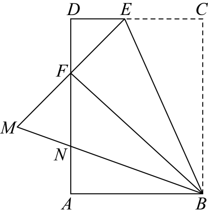

# Mathematics - 题目 3625

**ID**: 401b0abe90a64d1aa0a59223261b5e3e
**年级**: Grade 9
**难度**: Medium-Hard
**题型**: Calculation

## 题目
如图，在矩形 $ABCD$ 中， $E$ 为 $CD$ 边上一点，将 $\vartriangle BCE$ 沿 $BE$ 翻折，使点 $C$ 恰好落在 $AD$ 边上点 $F$ 处，作 $\angle ABF$ 的角平分线交 $EF$ 的延长线于点 $M$ ， $BM$ 交 $AD$ 于点 $N$ ．(1)求证： $MF=NF$ ；​​​​​​​‌(2)若 $AB=6$ ， $BC=10$ 时，求 $MF$ 的长；(3)若 $NF=\frac {1}{2}\left ({AN+FD}\right )$ 时，求 $\frac {AB}{BC}$ 的值．

## 解答

1. （1）解：∵ $BM$ 平分 $\angle ABF$ ，
2. ∴ $\angle ABN=\angle FBM$ ，
3. 在矩形 $ABCD$ 中， $\angle A=\angle C=90{}\degree $
4. 由翻折可知 $\angle C=\angle EFB=90{}\degree $
5. ∵点 $M$ 在 $EF$ 的延长线上
6. $\angle MFB=\angle EFB=90{}\degree $
7. ∴ $\angle A=\angle MFB=90{}\degree $ ，
8. ∴ $\angle BMF+\angle FBM=\angle ANB+\angle ABN$ ，
9. ∴ $\angle BMF=\angle ANB$ ，
10. 又 $\angle ANB=\angle FNM$ ，
11. ∴ $\angle BMF=\angle FNM$ ，
12. ∴ $FN=FM$ ；
13. （2）∵ $BC=10$ ，
14. 由翻折可知
15. $BF=BC=10$ ，
16. 在 ${\rm{R}}{\rm{t}}\vartriangle ABF$ 中， $AB=6$ ，
17. ∴ $AF=\sqrt {BF{^{2}}-AB{^{2}}}=8$ ，
18. 设 $MF=FN=x$ ，
19. 则 $AN=8-x$ ，
20. 由（1）可知 $\angle A=\angle MFB=90{}\degree $ ， $\angle ABN=\angle FBM$ ，
21. ∴ $\mathrm{△}ABN\sim \mathrm{△}FBM$ ，
22. 得 $\frac {AN}{AB}=\frac {MF}{FB}$ ，
23. ∴ $\frac {8-x}{6}=\frac {x}{10}$ ，
24. 解得： $x=5$ ，
25. 即 $MF=5$ ；
26. （3）如图，过点 $N$ 作 $NH\bot BF$ ，垂足为 $H$ ，
27. 
28. 设 $DF=m$ ， $AN=n$ ，则 $NF=\frac {1}{2}\left ({m+n}\right )$ ，
29. $\therefore BF=BC=FN+AN+DF=\frac {1}{2}\left ({m+n}\right )+\left ({m+n}\right )=\frac {3}{2}\left ({m+n}\right )$ ，
30. ∵ $BN$ 平分 $\angle ABF$ ，
31. ∴ $NA=NH=n$ ，
32. ∵ $\angle HFN=\angle AFB$ ， $\angle FHN=\angle FAB=90{}\degree $ ，
33. ∴ $\mathrm{△}FNH\sim \mathrm{△}FBA$ ，
34. ∴ $\frac {NH}{AB}=\frac {FH}{FA}=\frac {FN}{FB}$ ，
35. 即 $\frac {n}{AB}=\frac {FH}{\frac {1}{2}\left ({m+n}\right )+n}=\frac {\frac {1}{2}\left ({m+n}\right )}{\frac {3}{2}\left ({m+n}\right )}$ ，
36. 故 $AB=3n$ ， $FH=\frac {1}{6}m+\frac {1}{2}n$ ，
37. 又∵ $FB=FH+BH=FH+AB$ ，即 $\frac {3}{2}\left ({m+n}\right )=\frac {1}{6}m+\frac {1}{2}n+3n$ ，
38. ∴ $m=\frac {3}{2}n$ ，
39. ∴ $\frac {AB}{BC}=\frac {3n}{\frac {3}{2}\left ({m+n}\right )}=\frac {3n}{\frac {3}{2}\left ({\frac {3}{2}n+n}\right )}=\frac {4}{5}$ ．

## 知识点

**中文**:
  - 折叠问题
  - 角平分线的性质
  - 等腰三角形的判定与性质
  - 相似三角形的判定与性质综合

**English**:
  - Folding Problems
  - Properties of Angle Bisectors
  - Determination and Properties
  - Determination and Properties

---
