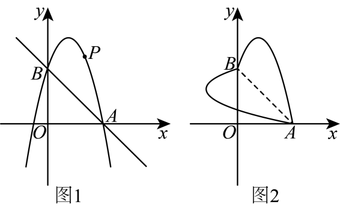

# Mathematics - 题目 2383

**ID**: 42234d5ab0db445e81e7e797c9a80ff5
**年级**: Grade 9
**难度**: Medium-Hard
**题型**: Calculation

## 题目
如图1，在平面直角坐标系中，一次函数 $y=-x+2$ 的图象与x轴，y轴分别交于A，B两点，抛物线 $y=-2x{^{2}}+bx+c$ 经过点A，B．(1)求抛物线的解析式；​​​​​​​‌(2)点P是第一象限内抛物线上的一个动点，求点P到直线 $AB$ 的最大距离；(3)如图2，将抛物线在直线 $AB$ 上方的部分沿 $AB$ 翻折得到“心形图”（包含A，B两点），若直线 $l:y=-x+m$ 与该图形有交点，求m的取值范围．

## 解答

1. （1）解：一次函数 $y=-x+2$ 与 $x$ 轴分别交于点 $A$ ， $B$ 两点，
2. 当 $x=0$ 时， $y=2$ ，则 $B(0,2)$ ，
3. 当 $y=0$ 时，可得 $0=-x+2$ ，解得 $x=2$ ，则 $A(2,0)$ ，
4. 将 $B(0,2)$ ， $A(2,0)$ 代入抛物线，
5. 可得 $\begin{cases}-2\times 4+2b+c=0\\c=2\end{cases}$ ，
6. 解得 $\begin{cases}b=3\\c=2\end{cases}$ ，
7. $\therefore $ 抛物线的解析式为 $y=-2x{^{2}}+3x+2$ ；
8. （2）解：设 $P(n$ ， $-2n{^{2}}+3n+2)(0<n<2)$ ，
9. 过点 $P$ 作 $PM\bot AB$ 于点 $M$ ，过点 $P$ 作 $PN/\mskip-4mu/y$ 轴交 $AB$ 于点 $N$ ，
10. 
11. $\therefore N(n,-n+2)$ ，
12. $\therefore PN=-2n{^{2}}+3n+2-(-n+2)=2n{^{2}}+4n$ ，
13. $\because A(2,0)$ ， $B(0,2)$ ，
14. $\therefore AO=BO=2$ ，
15. $\therefore \angle OAB=\angle OBA=45{}\degree $ ，
16. $\therefore \angle PNB=\angle OBA=45{}\degree $ ，
17. $\because PM\bot AB$ ，
18. $\therefore \angle PNB=\angle NPM=45{}\degree $ ，
19. $\therefore PM=MN$ ，
20. $\because PM{^{2}}+MN{^{2}}=PN{^{2}}$ ，
21. $\therefore PM{^{2}}+PM{^{2}}=PN{^{2}}$ ，
22. $\therefore $  $PM{^{2}}=\frac {1}{2}PN{^{2}}$ ，
23. $\therefore $  $PM=\frac {\sqrt {2}}{2}PN=\frac {\sqrt {2}}{2}(-2n{^{2}}+4n)(0<n<2)$ ，
24. $\therefore $ 当 $n=1$ 时， $PM$ 最大为 $\sqrt {2}$ ，
25. $\therefore $ 点 $P$ 到直线 $AB$ 的最大值为 $\sqrt {2}$ ；
26. （3）解：当直线 $l$ 与抛物线只有一个交点时，
27. 令 $-2x{^{2}}+3x+2=-x+m$ ，
28. 则 $\Delta =0$ ，
29. $\therefore 4{^{2}}-4\times (-2)(2-m)=0$ ，
30. $\therefore m=4$ ，
31. $\therefore $ 当 $m=4$ 时，直线 $l$ 与“心形图”右上方只有一个交点，此时 $C\left ({0,4}\right )$ ，
32. $\because $ 直线 $l$ 解析式的 $k$ 值与直线 $AB$ 解析式的 $k$ 值相同，为 $-1$ ，
33. $\therefore $ 直线 $l$ 与直线 $AB$ 平行，
34. 根据“心形图”关于直线 $AB$ 对称可知，
35. 上方直线与下方直线关于直线 $AB$ 对称且平行于直线 $AB$ ，
36. $\therefore $ 上方直线到直线 $AB$ 的距离与下方直线到直线 $AB$ 的距离相等，
37. 根据平行线分线段成比例可得 $\frac {CB}{BO}=1$ ，
38. $\therefore CB=BO=2$ ，
39. 故当 $m=0$ 时，直线 $l$ 与“心形图”左下方只有一个交点，
40. 由图可知，当 $0\leqslant m\leqslant 4$ 时，直线 $l$ 与“心形图”有交点．
41. 

## 知识点

**中文**:
  - 二次函数与一元二次方程
  - 二次函数的综合

**English**:
  - Quadratic Functions and Quadratic Equations
  - Comprehensive Quadratic Function Problems

---
