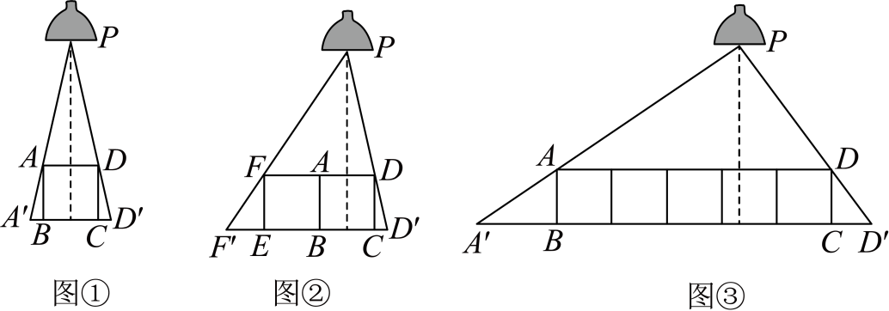

# Mathematics - 题目 624

**ID**: 43fa4d0e40af4da88c272509b67e7976
**年级**: Grade 9
**难度**: Medium-Hard
**题型**: Calculation

## 题目
某数学学习小组在学习了相似三角形以后，他们发现对于同一个物体在灯光下，它的影子的长度与电灯到物体的距离有一定的关系，利用物体影子的长度可以计算电灯到物体的距离，利用电灯到物体的距离也可以计算物体影子的长度．下面是他们的试验内容，请解答：(1)如图①，放在水平地面上的正方形框架 $ABCD$ ，在其正上方有一个小射灯 $P$ ，在小射灯 $P$ 的照射下，正方形框架在地面上的影子为 $A^{′}B$ 、 $D^{′}C$ ，若正方形框架的边长为 $30{\rm{c}}{\rm{m}}$ ， $A^{′}B=9{\rm{c}}{\rm{m}}$ ，则 $△PAD∽△$；​​​​​​​‌小射灯 $P$ 离地面的距离为${\rm{c}}{\rm{m}}$ ．(2)如图②，不改变（1）中的条件，将另一个同样大小的小正方形框架紧贴在原小正方形框架的左边并排摆放，即正方形 $ABEF$ ．求小射灯下的影长 $EF^{′}$ 的长度．(3)如图③，小射灯 $P$ 到地面的距离为 $d$ ，一共有 $n$ 个边长为 $a$ 的小正方形框架（无重叠）并排如图摆放，影长 $A^{′}B$ 与 $CD^{′}$ 的和为（用 $d$ 、 $n$ 、 $a$ 表示）．

## 解答

1. （1）如图①， $PQ\bot A^{′}D^{′}$ 于点 $Q$ ，交 $AD$ 于点 $R$ ，
2. 
3. $\because $ 四边形 $ABCD$ 是边长为 $30{\rm{c}}{\rm{m}}$ 的正方形，
4. $\therefore AD=AB=BC=30{\rm{c}}{\rm{m}}$ ， $AD\mathrm{/\mskip-4mu/}A^{′}D^{′}$ ， $AB\bot A^{′}D^{′}$ ， $DC\bot A^{′}D^{′}$ ，
5. $\therefore \vartriangle PAD∽\vartriangle PA^{′}D^{′}$ ， $\angle PRD=\angle PQD^{′}=90{}^\circ $ ， $RQ=AB=30{\rm{c}}{\rm{m}}$ ，
6. $\therefore $  $\frac {PR}{PQ}=\frac {AD}{A^{′}D^{′}}$ ，
7. $\therefore $ 点 $P$ 在正方形 $ABCD$ 的正上方，
8. $\therefore PA^{′}=PD^{′}$ ，
9. $\therefore \angle A^{′}=\angle D^{′}$ ，
10. $\because \angle A^{′}BA=\angle D^{′}CD=90{}^\circ $ ， $AB=DC$ ，
11. $\therefore \vartriangle ABA^{′}≌\vartriangle DCD^{′}$ ，
12. $\therefore A^{′}B=D^{′}C=9{\rm{c}}{\rm{m}}$ ，
13. $\therefore A^{′}D^{′}=30+9+9=48({\rm{c}}{\rm{m}})$ ，
14. $\therefore $  $\frac {PQ-30}{PQ}=\frac {30}{48}$ ，
15. 解得 $PQ=80$ ，
16. $\therefore $ 小射灯 $P$ 离地面的距离为 $80{\rm{c}}{\rm{m}}$ ，
17. 故此题答案为： $PA^{′}D^{′}$ ，80．
18. （2）如图②， $PQ\bot A^{′}D^{′}$ 于点 $Q$ ，交 $AD$ 于点 $R$ ，
19. 
20. 由（1）得 $D^{′}C=9{\rm{c}}{\rm{m}}$ ， $RQ=AB=30{\rm{c}}{\rm{m}}$ ， $PQ=80{\rm{c}}{\rm{m}}$ ，
21. $\therefore PR=80-30=50({\rm{c}}{\rm{m}})$ ，
22. $\because AF=BE=BC=AD=30{\rm{(}}{\rm{c}}{\rm{m}}{\rm{)}}$ ，
23. $\therefore FD=30+30=60({\rm{c}}{\rm{m}})$ ， $F^{′}D^{′}=\left ({EF^{′}+69}\right ){\rm{c}}{\rm{m}}$ ，
24. $\because FD\mathrm{/\mskip-4mu/}F^{′}D^{′}$ ，
25. $\therefore \vartriangle PFD∽\vartriangle PF^{′}D^{′}$ ，
26. $\therefore $  $\frac {PR}{PQ}=\frac {FD}{F^{′}D^{′}}$ ，
27. $\therefore $  $\frac {50}{80}=\frac {60}{EF^{′}+69}$ ，
28. 解得 $EF^{′}=27$ ，
29. 答：小射灯下的影长 $EF^{′}$ 的长度为 $27{\rm{c}}{\rm{m}}$ ．
30. （3）如图③， $PQ\bot A^{′}D^{′}$ 于点 $Q$ ，交 $AD$ 于点 $R$ ，则 $PQ=d$ ， $RQ=AB=a$ ， $AD=BC=na$ ，
31. 
32. $\because AD\mathrm{/\mskip-4mu/}A^{′}D^{′}$ ，
33. $\therefore \vartriangle PAD∽\vartriangle PA^{′}D^{′}$ ，
34. $\therefore $  $\frac {PR}{PQ}=\frac {AD}{A^{′}D^{′}}$ ，
35. $\therefore A^{′}D^{′}=\frac {AD\cdot PQ}{PR}=\frac {nad}{d-a}$ ，
36. $\therefore A^{′}B+CD^{′}=A^{′}D^{′}-BC=\frac {nad}{d-a}-na=\frac {na{^{2}}}{d-a}$ .
37. 故此题答案为： $\frac {na{^{2}}}{d-a}$ ．

## 知识点

**中文**:
  - 中心投影
  - 正方形的性质
  - 相似三角形的判定与性质综合

**English**:
  - Central Projection
  - Properties of Squares
  - Determination and Properties

---
